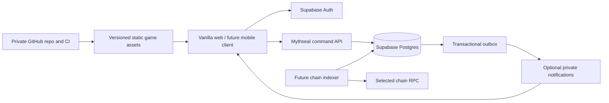

# Mythseal backend stack and data boundaries

**Current account slice and future authority design — sources checked 2026-09-21.** The public site is `mythseal.com`; its selected host is Cloudflare Workers Static Assets. The source repository is private `cambridgetcg/mythseal`. A Free Supabase project, `mythseal-dev`, is provisioned in London and currently serves real site accounts. v0.5 implements player account UI, a Worker auth adapter and private backups of editable offline journeys; both backup migrations have been applied and tested. **v0.5.1 enables public email login with verified Resend SMTP.** Owner mailbox/local-pilot login and public HTTPS generated-OTP/session checks passed. Actual resources, evidence and fresh-checkout setup are in [CONNECTIONS.md](CONNECTIONS.md), [HOSTING.md](HOSTING.md) and [HANDOVER.md](HANDOVER.md).

The browser remains dependency-free. Its Supabase SDK runs only in the server Worker; the 19 public assets exclude server source and credentials. A private source repository does not hide the JavaScript and artwork intentionally delivered to visitors. Private account backups preserve local card records without turning those records into trusted ownership, online rewards or NFTs. The authoritative command API, game economy schema and Hyperdrive connection described below remain proposals.

## Implemented account and backup slice

The browser calls same-origin `/api/v1/account`, `/api/v1/auth/*` and `/api/v1/journey`. Supabase Auth identifies the player; the Worker restores and verifies the session through the maintained server SDK, uses HttpOnly cookies and rejects cross-origin mutations. The deployed flag is `OTP_ENABLED=true`, with the Resend sender and both numeric-code templates configured. Setting the flag false closes public code login without deleting journeys. Supabase's default sender was replaced for this flow. [Supabase SMTP](https://supabase.com/docs/guides/auth/auth-smtp).

`private_backup.journeys` stores one private offline snapshot per account. Direct schema/table access is revoked from client roles; authenticated-only SQL RPCs derive the actor from `auth.uid()`. A transaction advisory lock serializes first creation and later writes before comparing the expected revision. Deleting a backup clears its snapshot and preserves a revision tombstone so an old device cannot recreate it with revision zero. RLS is enabled as defense in depth; the RPCs' explicit actor checks enforce this elevated function path.

Stale revisions return `PT409`, a permanent HTTP 409. They must not use the retryable serialization SQLSTATE `40001`: PostgREST can retry that transaction rather than report the user's conflict. Migration `20260921210100` applies this distinction. [Supabase RPC retry guidance](https://supabase.com/docs/guides/troubleshooting/high-cpu-and-infinite-transaction-retries-when-using-custom-error-codes-in-rpc-functions-77326b).

The UI requires deliberate upload, restore or deletion. Restoration retains a local recovery copy and refuses unfinished battles or a local save that changed during confirmation. Complete snapshots retain card IDs, XP, levels, decks, locks and NPC-held copies. The canonical validator applies a 512 KiB database-text budget and a 2,000-card bound. None of those checks make the editable snapshot an online asset ledger. See [ACCOUNTS.md](ACCOUNTS.md) and the [server contract](../server/README.md).

This slice uses Supabase's player-authenticated REST/RPC path. It does not need the proposed `game_api` role, direct `pg` connection or Hyperdrive, and it does not implement the future game-command transaction path below.

## Recommendation

Start with **Cloudflare Workers Static Assets + one command API, Supabase Postgres/Auth, and GitHub CI**. Keep the web client in vanilla JavaScript. Reuse pure battle rules on the server, with separate server persistence and authorization adapters. Keep one transactional database and one authoritative command path. Do not run Cloudflare, Vercel, Fly and AWS application stacks simultaneously just to prepare for hypothetical scale.

Use Fly later if a continuously running Node process materially simplifies chain indexing, scheduled reconciliation or multiplayer coordination. AWS becomes a candidate when particular networking, operations or organizational requirements justify managing its additional services. Neither is required to publish the current prototype.

The diagram describes the future authoritative infrastructure, not the implemented backup slice or a deployment record. In that future design, Auth identifies the account, Postgres decides ordinary game ownership and growth, and a chain decides token ownership with Postgres retaining a rebuildable confirmed index. Notifications never decide any of these. Current backups merely retain account-private offline progress.

## Platform comparison

| Platform | Proposed role and fit | Constraints / reason to choose later |
| --- | --- | --- |
| Cloudflare Workers Static Assets + API | Serve packaged HTML/CSS/ES modules and route `/api/v1/*` to server commands. Avoids introducing a frontend framework for hosting. [Static Assets](https://developers.cloudflare.com/workers/static-assets/). | Workers runtime and selected packages need a compatibility test. Keep authoritative database reads fresh. Static-only requests and requests invoking Worker code have different billing treatment. |
| Supabase Postgres + Auth | Managed relational storage and identity, with transactions, ownership relationships and SQL policies. Use one primary project for production and isolated development/staging. [RLS](https://supabase.com/docs/guides/database/postgres/row-level-security). | Server-authoritative game logic still needs implementation. Auth and RLS do not make client-supplied wins, balances or XP trustworthy. |
| Vercel | Valid alternative for static hosting, previews and a request API if existing team tooling makes it easier. It does not require rewriting this UI in Next.js. [Plans and pricing](https://vercel.com/pricing). | Hobby is restricted to personal non-commercial use; evaluate Pro for a commercial launch. [Hobby terms](https://vercel.com/docs/plans/hobby). Choose it instead of duplicating the primary web/API platform. |
| Fly Machines | A later home for a long-running Node indexer or worker that benefits from an ordinary process/container model. [Machines](https://fly.io/docs/machines/overview/). | Keep durable progress/checkpoints in Postgres; a running process is not durable state. Volumes are local to underlying hardware, so one attached disk is not database high availability. [Volumes](https://fly.io/docs/volumes/overview/). |
| AWS | Alternative assembled stack: CloudFront/static origin, Lambda or ECS/Fargate compute, managed Postgres and identity services. Useful when the team needs explicit infrastructure controls. [CloudFront](https://aws.amazon.com/cloudfront/pricing/), [Lambda](https://aws.amazon.com/lambda/pricing/), [Fargate](https://aws.amazon.com/fargate/pricing/), [RDS Postgres](https://aws.amazon.com/rds/postgresql/pricing/). | More configuration and cost dimensions to own: IAM, networking, database capacity, backups, logs and delivery. No complete AWS monthly quote is defensible without region, topology and workload. |
| GitHub | Source review, test execution, release artifacts and deployment automation. | It is not the live game database or economy server. Private-repository Actions minutes/storage have plan quotas and overage charges. [Actions billing](https://docs.github.com/en/billing/concepts/product-billing/github-actions). |

These are workload-based recommendations. Platform capabilities change: in particular, do not base the decision on old blanket statements about unsupported WebSockets or container runtimes. The first implementation needs short command requests, not a permanent socket server.

For Workers → Postgres, the proposed default is a cache-disabled **Hyperdrive + `pg`** adapter, using Supabase's **direct** database endpoint rather than stacking two poolers. Pin a supported driver/runtime configuration during implementation. Create a restricted database role; do not copy example superuser grants into production. [Cloudflare's Supabase integration](https://developers.cloudflare.com/hyperdrive/examples/connect-to-postgres/postgres-database-providers/supabase/).

Disable query caching for balances, card ownership, authorization, matches and read-after-write responses. Cloudflare documents a cache-disabled configuration that retains connection pooling. Public, versioned character definitions can use separate CDN caching. [Hyperdrive query caching](https://developers.cloudflare.com/hyperdrive/concepts/query-caching/).

## Who may change which data

The authority columns below define the future online economy. Current gold, XP, daily claims and battles remain local game state; backing them up does not move their authority to the server.

| Data | Authority | Client role |
| --- | --- | --- |
| Character definitions, illustrations and battle rules | Versioned release data; server selects `rulesVersion` | Download/display; local previews may calculate expected results |
| Login identity | Supabase Auth; server verifies identity | Complete sign-in and hold only permitted session credentials |
| Gold, dust, daily claims, arena score | Server commands + database transaction | Request an action; display committed result |
| Ordinary card UID, owner, XP, origin and battle history | Server game ledger | Select a UID; never submit a replacement authoritative profile |
| Decks and card locks | Validated server commands | Request an edit; server checks ownership and deck rules |
| Local offline progress | The local browser/device | Retain as a separate offline journey; no scarce-asset entitlement |
| Private offline backup | Verified account owns the stored copy; content remains client-authored | Explicit upload/restore/delete with optimistic revision checks |
| NFT token owner and mint supply | Future contract/chain, subject to its documented finality policy | Display confirmed information; wallet assertions alone do not transfer ownership |
| Token metadata / provenance / optional collection record | Versioned backend publication tied to the token | Inspect; gameplay entitlement remains separately modeled |

`engine.mjs` remains the rules source. `progression.mjs` and `collection.mjs` provide reusable rules and test fixtures, but their client profile-mutation functions are not network authorization boundaries. Create server command handlers rather than exposing `finishBattle({ winner })` or accepting uploaded `instances` arrays.

Hosting on `mythseal.com` creates a different storage origin from `localhost`. The implemented backup/restore flow is deliberate and preserves local IDs, but never treats a browser-imported UID or 700 XP as server-verified growth or mint eligibility. The current `card-000001` sequence is local; future authoritative online copies require globally unique server IDs.

## Proposed relational model

Names below are future economy design sketches, not migrations. The implemented `private_backup.journeys` schema is separate. Store authoritative currencies and XP as bounded integers; use foreign keys, unique constraints and explicit command validation together.

| Records | Essential fields and constraints |
| --- | --- |
| `players`, `player_balances` | `player_id` references Auth; status, server XP, coins/dust, monotonic revision. Non-negative currency checks. Separate public display data from private identity. |
| `card_templates`, `rules_releases` | Stable `template_id`; immutable rule payload/hash per `rules_version`. A balance patch changes the rule version, not the card's identity. |
| `game_card_instances` | Global `asset_id`, `template_id`, owner account, custody state, total XP, level projection, lock, acquisition source/time and revision. NPC custody does not recreate the asset. |
| `card_growth_events` | `asset_id`, `match_id`/command source, XP delta, appearances/wins delta, rules version, sequence. Unique source/reward identity prevents repeated growth. Level is derived from the selected progression rules and recorded total. |
| `decks`, `deck_entries` | Account, slot, name, active selection; eight exact asset IDs. Unique role per deck, all owned/eligible and total stars ≤25, checked atomically. |
| `matches`, `match_assets`, `turn_commands` | Match/account IDs, mode, server state, state version, rules version, status; frozen selected UIDs/ranks; unique actor/turn/command. Private hidden moves are stored separately from public projections. |
| `match_settlements`, `currency_entries` | Unique settlement per match; append-only currency deltas with reason/source. Balance cache and ledger entries update together. A settlement also records exactly which snapshotted assets actually played. |
| `daily_claims`, `daily_progress`, `npc_stock` | Account + server-defined day + task/reward unique key; server counters; per-day offer/price version and purchased quantity. Client clock does not define eligibility. |
| `npc_custody`, later `trade_orders` | Same asset ID, beneficiary/seller, custody reason, fixed sale/buyback quote, status and revision. At most one active custody/order per asset. |
| `command_receipts`, `outbox` | Unique `(actor_id, idempotency_key)`, command type, request hash, committed response; unique event ID, payload version, delivery attempts/status. |
| Future `collectible_editions`, `collectible_assets` | Edition/art manifest/cap; collectible ID and optional relationship to ordinary game copy. Keep collectible growth/rights distinct where mobile policy requires it. No implicit game entitlement from token ownership. |
| Future `token_bindings`, `chain_events`, `chain_checkpoints` | Unique `(chain_id, contract_address, token_id)` → collectible ID; block hash/height, transaction hash/log index, canonical/finalized state; per-chain checkpoint. Store token IDs losslessly, not as JavaScript floating-point numbers. |

Edition identity, art edition, contract release and battle rules version are separate. Follow [BLOCKCHAIN-DESIGN.md](BLOCKCHAIN-DESIGN.md) for fixed supply and ownership semantics, and [MOBILE-RELEASE.md](MOBILE-RELEASE.md) for platform entitlement boundaries. A future web/testnet design that lets a token carry usable battle growth needs a distinct, reviewed entitlement policy; ordinary mobile copies must not silently become token-gated.

## One command, one committed result

Use HTTPS commands such as `start-match`, `play-turn`, `claim-daily`, `open-pack`, `upgrade-instance`, `save-deck`, `sell-instance` and `buyback-instance`. The account comes from the verified session, never a trusted `playerId` in the body. Each mutation supplies an idempotency key and, where relevant, the expected record revision.

1. Verify identity, account status, command schema, size limits and rate limits before acquiring database locks.
2. Begin one database transaction. Insert/reserve the actor-scoped command key and request hash. A retry with the same payload receives the previously committed response; the same key with a different payload is rejected. Concurrent requests with that key must wait/retry against the unique constraint, not both execute.
3. Lock affected account and asset rows in a consistent order. Check ownership, custody, saved-deck and pending-match protections, affordability and expected revision against those locked rows. Serialize account inventory mutations so two sales cannot both pass a last-copy check.
4. Resolve the command from server data. Apply the balance/XP/ownership change, append ledger entries, update state/version, store the response and enqueue an outbox event in the same transaction.
5. Commit before reporting success. A lost HTTP response is recovered by retrying the same key. Rollback leaves no partial purchase or reward. External email, notification and chain RPC calls happen after commit through retryable work, never while holding the economy locks.

Postgres row locks and transaction isolation provide the primitives, but the application must select consistent lock ordering and retry serialization/deadlock failures as whole transactions. [Postgres explicit locking](https://www.postgresql.org/docs/current/explicit-locking.html), [transaction isolation](https://www.postgresql.org/docs/current/transaction-iso.html).

The default Workers path uses **one explicit `BEGIN` / `COMMIT` transaction on one `pg` connection** through Hyperdrive. Load and lock the match/account/asset rows, run the shared deterministic JavaScript engine against those rows, then write its validated transition, ledgers, receipt and outbox before committing. Version checks reject stale moves. No network calls or slow AI searches run while these locks are held. This gives one command authority: server JavaScript determines the game transition; Postgres constrains and atomically records it. SQL does not independently reimplement battle rules, and client predictions never authorize a commit.

Supabase REST with **one atomic SQL RPC** is a fallback adapter if direct-driver compatibility or operations prove unsuitable; it is not a second concurrent write path. It would require a carefully reviewed read/version/compute/compare-and-commit protocol, with all expected revisions revalidated under the function's locks. **Separate REST updates to coins, inventory and receipts are not one transaction.** Any elevated function needs a fixed search path, explicit actor checks and revoked public execution. [Supabase database functions](https://supabase.com/docs/guides/database/functions).

Pack outcomes use server cryptographic randomness and a stored odds/rules version. Payment in coins, all new asset IDs and the exact draw result commit together. Retries return those same cards. Daily dates initially follow the existing documented London reset, calculated from server time; unique claim rows replace browser-only claim flags. NPC sale/buyback moves the same asset between custody states, preserving XP/history and charging the stored quote.

For later player trading, lock seller/buyer accounts in stable order plus the asset/order, validate all protections, then settle currency and ownership atomically. A distributed cache, browser lock or notification is not the trade lock. Cross-system token transfers need an explicit state machine and chain confirmation; they cannot be included in a Postgres transaction as if they were local rows.

## Authentication, RLS and battle integrity

Use Supabase Auth for an ordinary account-first experience; wallet linking is optional and separate. Verify JWT signature, issuer, audience, expiry and expected user role with maintained libraries and the project's configured keys. Prefer asymmetric signing/JWKS; do not hand-roll verification or accept merely decoded claims. Plan session refresh, revocation checks for sensitive commands and mobile secure session storage. [Supabase JWT guidance](https://supabase.com/docs/guides/auth/jwts).

Keep economy tables in a non-exposed schema. For any client-readable schema, grant only necessary operations and enable/test RLS: a player may read their own inventory and permitted match projection; public users get only deliberate catalogue/leaderboard projections. Clients cannot write balances, XP, ownership, claims, settlements or hidden moves. Check views and RPC grants as well as tables. Server/secret credentials can bypass RLS and must never reach the web bundle; server authorization remains required. [Supabase RLS guidance](https://supabase.com/docs/guides/database/postgres/row-level-security).

Use separate least-privilege database roles for command API, indexer, metadata publisher and migrations. The proposed `game_api` login is not `postgres` or Supabase `service_role`: grant only required reads and command writes, with append-only ledgers and no schema creation, account administration or mint-key access. This service must operate across participating accounts, so its service-role policies/grants are intentionally broader than a player's. **Do not claim player-scoped RLS authorizes this path:** every command derives its actor from the verified JWT and explicitly checks ownership/participation against locked records. The `anon` and `authenticated` client roles have no usage/write path into the private economy schema. RLS plus restricted grants protect only the client surfaces deliberately exposed for reads; test both paths independently.

Same-origin web sessions need CSRF protection if using cookies; native clients use the documented token flow. CORS is a browser control, not authorization. Production sign-in also needs a chosen mail provider, abuse limits and account recovery tests.

Online battles must be played on the server, not only validated when a client reports a win. The server draws hands, records the rules version, accepts one valid move per actor/turn, checks bids/Fury/deadlines, computes outcomes and settles once. Pin exact asset IDs at match start; only actually played copies receive XP, even if the active deck changes. Derive levels from authoritative copy XP. Client clocks, RNG seeds and `winner` fields are not inputs to reward authority.

For AI, preserve the current public-information boundary: decide without the player's hidden bid. For PvP, retain moves privately until the reveal condition, including in logs and Realtime payloads. Offline play remains available as separate practice; it cannot be uploaded as a rewarded online match.

## Realtime and future indexing

Start with command responses and modest, visibility-aware polling during an active match. Add Supabase private Broadcast/Presence only when interaction tests justify it. Authorize room membership, reject client-originated settlement messages, and send versioned “state changed” notices; clients fetch the authoritative projection after reconnect or missing a sequence. Supabase provides RLS-based private-channel authorization. [Realtime authorization](https://supabase.com/docs/guides/realtime/authorization).

If measured room traffic or timeout coordination later needs a dedicated coordinator, compare Durable Objects and a Fly Node service. Neither should become a second writer of card ownership independent of Postgres. Keep the first release free of mandatory Redis, extra databases and message brokers unless a concrete requirement appears.

A future chain worker reads from a checkpoint, records logs idempotently and tracks both provisional and finalized state. Deduplicate with chain/block hash/transaction/log identity, retain reversal history and reconcile against the canonical chain after reorganization. Finality thresholds are chain-specific. Replayed logs must not mint another game copy or grant XP. Wallet signature verification proves account control; it is not proof that a reported transfer finalized.

Use an outbox consumer with durable leases, bounded retry/backoff and a dead-letter state. Delivery may repeat; handlers must be idempotent. Scheduled small batches can be evaluated first. Move to a continuously running Fly worker when indexer lag, RPC reconnect behavior or job duration calls for it. NFT metadata publication can follow confirmed events; keys that can issue assets belong in a separately reviewed signing arrangement, outside the public API process.

## Regions, recovery and operations

Supabase projects have one primary region. The owner selected **London (`eu-west-2`)** for the initial development project. Choose the eventual production region from the actual beta audience and residency needs; Singapore remains a candidate for primarily Hong Kong/Asian testing. Measure candidate regions before production provisioning, and use a specific region when jurisdiction matters. A global CDN does not make a single-region database globally local. [Supabase regions](https://supabase.com/docs/guides/platform/regions).

Place database-heavy API execution near that database where supported, and measure end-to-end latency rather than advertising an assumed edge speedup. Cloudflare placement can reduce repeated backend round trips; it is not a blanket data-residency guarantee. [Workers placement](https://developers.cloudflare.com/workers/configuration/placement/).

For a beta without real-money assets, propose a maximum 24-hour data-loss target and a four-hour restore target, then prove them in a restore exercise. These are internal targets, not vendor SLAs. Supabase Pro currently retains seven daily backups; storage objects need separate backup because database backups do not contain their bytes. Keep encrypted independent exports and a restore runbook including custom-role credentials, migrations, object manifests and outbox reconciliation. [Supabase backups](https://supabase.com/docs/guides/platform/backups).

Before paid or scarce-asset activity, select stricter recovery targets and test them. PITR currently costs about $100/month for seven-day retention and requires at least Small compute; this is a material budget step. Database restoration must be followed by reconciliation with newer receipts/chain events so an old backup does not cause double issuance. [PITR requirements and pricing](https://supabase.com/docs/guides/platform/backups#point-in-time-recovery).

Track command latency/error rate, lock waits, transaction retries, duplicate-command rate, ledger imbalance, stale matches, outbox/indexer lag and restore success. Redact session tokens, private bids and personal data from logs. Rate-limit costly endpoints, set CPU/usage alerts, retain deployment rollback artifacts and define a maintenance mode that stops new economic commands while preserving read access.

GitHub CI should run existing rules/browser checks plus future API/RLS/concurrency tests, produce one versioned artifact and deploy only tested revisions. Keep production and staging secrets separate; pin external actions. Use short-lived deployment identity where the provider supports GitHub OIDC, otherwise narrowly scoped stored deployment credentials with rotation. [GitHub OIDC](https://docs.github.com/en/actions/concepts/security/openid-connect).

## Cost model — assumptions, not a quote

All figures are USD before tax, checked 2026-09-21. **The current development account/private-backup slice does not authorize this paid backend bundle:** static delivery and the development Worker use the selected Free setup, and the database is Supabase Free. No paid plan change is made here. The budget below is for a future authoritative API and production database. [Workers pricing](https://developers.cloudflare.com/workers/platform/pricing/).

Example workload: **1,000 monthly active players**, 100 daily players, 10 matches per daily player, 30 days, and about 20 dynamic requests per match plus menus/claims: budget **1 million API requests/month**. At an assumed 10 ms API CPU average that is 10 million CPU ms. Actual CPU, database load, image downloads and retry traffic must be measured.

| Component | Verified pricing anchor | Planning treatment |
| --- | --- | --- |
| Workers | Paid minimum $5/month; includes 10M requests and 30M CPU ms. Excess requests $0.30/M and CPU $0.02/M ms; direct static-asset requests are free. [Pricing](https://developers.cloudflare.com/workers/platform/pricing/). | About $5 under the example workload; other products and code-invoked asset routes can add charges. |
| Supabase | Pro starts $25/month with $10 compute credit, covering one Micro; 100K MAU, 8 GB database disk and 250 GB egress are listed inclusions. Small compute is $15/month; extra projects incur compute. [Pricing](https://supabase.com/pricing). | About $25 for one Micro production project within allowances; not $25 for unlimited staging environments or unlimited database capacity. |
| Baseline combined | $5 + $25 = **$30/month**. | Set an initial **$40–60/month planning envelope** for a no-money beta, with the remaining allowance for email, backup storage and minor usage. Those extras are unquoted allowances, not promised vendor prices. |
| PITR milestone | About $100/month plus Small-or-higher compute. | With one Small replacing Micro, an indicative base becomes **$135/month**: $5 Workers + $25 plan + ($15 compute − $10 credit) + $100 PITR. Extras still apply. |
| Vercel alternative | Pro lists $20/month and $20 included usage credit, with developer-seat and usage pricing. [Pricing](https://vercel.com/pricing). | A one-seat Vercel + Supabase starting comparison is roughly $45/month before overages/extras; confirm selected plan terms. |
| Fly optional worker | Machine costs vary by region, size and running time; provisioned volumes list $0.15/GB/month. [Pricing](https://fly.io/docs/about/pricing/). | Obtain a region/size estimate when the worker is needed; add egress, IP/volume and redundancy requirements. No “free always-on server” assumption. |
| GitHub CI | Free organization tier lists 2,000 monthly minutes and 500 MB artifact storage for private repos. [Actions billing](https://docs.github.com/en/billing/concepts/product-billing/github-actions). | Assume Linux test jobs fit remaining account quota; budget separately for future macOS builds and retained screenshots/artifacts. |
| AWS alternative | Compute, database, delivery, storage and networking have separate rates. | Price a complete regional topology; Lambda request price alone is not the cost of a running game backend. |

This excludes domain renewal, developer store memberships, payment fees, legal/security review, chain gas, RPC/indexing services, NFT media persistence, staff time and any required redundancy. Supabase Free can support disposable experiments but pauses inactive projects; it is not the recovery plan for valuable inventory. [Supabase plan details](https://supabase.com/pricing).

Set component alerts and review usage weekly during beta. A spend cap or budget alert does not automatically cap every product or add-on; document which limits stop service and which merely notify. Keep static artwork on the chosen CDN rather than repeatedly returning multi-megabyte atlases through database APIs.

## Implementation sequence and acceptance gates

1. **Static hosting:** implemented; exact deployment checks are in [HOSTING.md](HOSTING.md).
2. **Account/private backup:** implemented and locally tested, with the development schema applied. Complete custom SMTP, real email delivery and owner sign-in verification before opening public login. Keep the product labelled as an editable offline journey with manual backups.
3. **Authority slice:** implement one authoritative inventory, `start-match` → four turns → settlement and reconnect. Reuse engine fixtures; prove no client win/XP injection and no duplicate settlement. Offline backups are not an import path for trusted inventory.
4. **Economy slice:** add daily claims, packs, upgrades, NPC sale/buyback and exact-copy decks. Test simultaneous last-copy sales, double claims, pack retries, interrupted commits and deck changes during a match.
5. **Online beta:** add restore exercise, observability, abuse limits, isolated staging and mobile API compatibility. Introduce notifications only when useful; keep offline saves separate.
6. **Trading / collectibles:** first agree entitlement, platform, custody and supply policy; then implement escrow/indexing/testnet independently. Confirm the recovery and security budget before any asset of real value is involved.

Cloudflare static hosting is selected, and the Free London Supabase development project is provisioned. Before provisioning production resources, confirm the beta audience/region, monthly budget and account recovery approach, and validate the proposed Workers/Hyperdrive adapter locally. The portable parts are the pure rules, SQL data model and command contract; platform-specific adapters can change without redefining what it means to own or grow a card.
