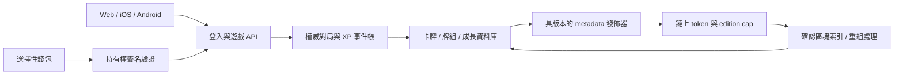

# 限量卡牌與鏈上身份：架構草案

狀態：**DRAFT，未選鏈、未定發行量、未部署合約。** 查閱日期：2026-09-21；下列官方來源均於此日查閱。這份文件提出後續設計與驗收條件，不代表已推出 NFT、公開售賣、承諾稀缺價值或提供投資回報。

建議先把現有「每張卡有自己的編號與歷練」升級成可信的伺服器資料，再於 testnet 驗證 **ERC-721 每張一枚、固定批次上限、XP 隨卡保留**。對局、反作弊及 XP 計算初期由後端負責；鏈上負責可核對的發行與持有權。鏈、錢包供應商、正式數量與交易方式，留待原型、成本與平台審查後決定。

## 產品與平台邊界

手機版先保持遊戲權益不依賴 NFT 持有：正常遊玩、角色、XP、造型與功能的取得，不因錢包是否有某枚 NFT 而解鎖。可研究選擇性的收藏展示與來源證明，但不能把展示悄悄變成付費或持有權門檻。Apple／Google 的具體條件與查閱證據見 [手機發佈研究](MOBILE-RELEASE.md)。

以下「按鏈上持有權使用卡牌」流程，是 **web／testnet 的候選設計**，尚不是 iOS／Android 已獲允許的功能。NFT 的歷練可作為隨 token 保存的收藏紀錄；是否能影響某平台的實際戰鬥能力，需要單獨決定。若採用分開的遊戲卡與收藏 NFT，兩者須有不同 entitlement／成長欄位，不能讓 NFT 交易暗中解鎖手機遊戲能力，也不能把普通遊戲副本宣稱為同一限量 NFT。

現有本地金幣秘匣仍是非鏈上原型。**隨機 NFT 卡包、付費抽 NFT、可兌換 NFT 的遊戲貨幣與隨機獎勵，全部等待商店政策及發行方式審查。** 公開機率或加入可驗證隨機數，不能替代平台允許。首個可評估的鏈上發行候選是內容事先可見的指定卡／指定批次；它同樣不代表自動獲准上架。

## 三層身份：人物、批次、每一張卡

| 層次 | 建議識別 | 固定內容與用途 |
| --- | --- | --- |
| 人物模板 Template | `templateId`，例如 `wukong` | 人物與基本規則的索引；平衡調整另用 `rulesVersion`，不改人物身份 |
| 發行批次 Edition | `editionId` + 發行 manifest hash | 綁定人物、畫作版本、版別名稱、發行政策、上限、分配；封存後不可改成另一批 |
| 單張 Copy | 後端 `assetId`；鑄造後另有 `chainId + contractAddress + tokenId` | 固定連到一個 edition；自己的 XP、出戰紀錄與 metadata 版本；轉手不換身份 |

例如兩張同一批次的悟空，人物與初始能力可相同，token ID、歷練與來歷各自不同。「限量」首先是發行批次的數量約束；若要宣稱整個人物永遠只有某個數量，必須再封存跨批次的人物總額。不能把單一批次有限，描述成所有未來批次合計有限。

ERC-721 定義逐枚持有及轉移；token ID 在該合約內識別 NFT，metadata 是可選擴充。本設計在多鏈資料庫再加 `chainId`，避免不同鏈的同地址／同 token ID 相撞。[ERC-721 官方標準](https://eips.ethereum.org/EIPS/eip-721)

目前的 `card-000001` 只在一份本地存檔內唯一，且存檔可自行修改。見 [現有背包規格](BACKPACK.md)。匯入時可保存 `{importId, localUid}` 作離線來源記錄，不能把它當成全球 ID、鑄造資格、已驗證 XP 或持有權。正式後端使用新產生的全域識別及唯一索引；舊存檔保留為離線旅程，不會一鍵兌換限量 NFT。任何未來贈禮或遷移配額，都必須另有可信資格來源，並包含於事先公布的 cap。

## Token 標準的選擇

| 候選 | 適合程度 | 設計代價 |
| --- | --- | --- |
| **ERC-721，建議先驗證** | 每張卡獨立成長、逐張出售、保留同一張的來歷 | 批次 cap、mint 權限、歷練與 metadata 更新仍要自行設計 |
| ERC-1155，每張獨立 token ID、終身只鑄一份 | 技術上可承載相同身份模型，並有批次轉移介面 | 必須保證該 ID 永遠不增發；需驗證目標錢包及市集對此模型的體驗 |
| ERC-1155，一個 edition ID 有多份餘額 | 適合彼此可互換、沒有獨立成長的物品 | 同一 ID 的多份餘額不能直接表示「這一張 80 XP、另一張 400 XP」，不符合目前卡牌需求 |

ERC-1155 將每個 ID 視為可有自己 metadata、供應與屬性的 token type，並支援批次操作。上述取捨是根據獨立成長需求作出的設計判斷。[ERC-1155 官方標準](https://eips.ethereum.org/EIPS/eip-1155)

OpenZeppelin 的 `ERC1155Supply` 會追蹤供應，但官方明確指出 supply 為 1 並不保證日後不能再鑄同一 ID。因此無論用哪個標準，都不能把通用 token 套件誤當成限量保證。[OpenZeppelin ERC1155Supply](https://docs.openzeppelin.com/contracts/5.x/api/token/erc1155#ERC1155Supply)

## 發行參數：只列 DRAFT 選項

正式 `C_e`、批次數、售價、分配比例、開始／截止時間目前全部未定；以下符號是待批准參數，不是已承諾的數字。

| DRAFT 選項 | 發行範圍 | 使用者能核對的承諾 |
| --- | --- | --- |
| A：固定批次，較適合首輪驗證 | 每個 edition 一個 `C_e`；同人物未來可有另名、另畫作／版別的新 edition | 這一批最多 `C_e` 張；不宣稱人物全部未來版別只有這些 |
| B：人物終身總額 | 先封存人物總額 `T_t`、有限 edition 清單及各自 `C_e`，滿足 `sum(C_e) <= T_t` | 官方命名空間內不再為該人物新增未列批次；需要更早固定內容計劃 |
| C：全數預鑄的固定批次 | 發行前把 `C_e` 全數鑄入公開 treasury，日後只分配既有 token | 已鑄總數立即可查；持有於 treasury 的數量仍算已發行，不可藏起來 |

A／B 可選按需鑄造或預鑄；C 描述的是分配方式。任何團隊、活動、合作或補償配額，均是 `C_e` 內的公開子配額，不能額外加印。版別不同不應自動有較高戰鬥能力；擂台繼續由規則版本統一基礎能力。

首批 mint 前封存 edition 的 cap、人物、不可變畫作 manifest 及配額政策；之後沒有提高 cap、重設計數或替換 edition 身份的管理介面。建議 token／發行核心採非代理、不可升級設計，遊戲規則與服務另行版本化。若日後選可升級 token，便不能聲稱 cap 不受管理升級影響，必須重新審查此承諾。代理合約可以更換程式而保留地址與狀態，這正是需要避免的 cap 旁路。[OpenZeppelin 合約升級說明](https://docs.openzeppelin.com/contracts/5.x/learn/upgrading-smart-contracts)

不可變合約只能約束其自身命名空間，不能阻止他人在其他合約複製圖片，也不能神奇地限制發行者另開一條鏈。正式版要公布 canonical 合約／edition 清單及其可變範圍；首輪不做橋接、包裝 token 或換鏈重發。若日後研究遷移，須另列原卡處理與總供應核對，不能把重發藏於維護操作。

### 數量與 mint 帳務

每個 edition 至少分開記錄：

```text
C = 封存的發行上限
M = 歷來成功鑄造數（包括 treasury；只增不減）
B = 歷來銷毀數
O = 尚存在的 token 數 = M - B
R = 尚未兌付／到期的有效保留配額
F = 可新增分配數 = C - M - R

0 <= B <= M <= C
0 <= R <= C - M
M + R + F = C
```

`O` 並非剩餘可鑄額。燒毀卡牌不降低 `M`、不恢復額度，已用 token ID 永不重用。初版可不提供燒毀功能；仍須測試內部 mint 路徑不能繞過 lifetime counter。商店出售、回購、玩家轉移只是同一 token 換持有人，完全不呼叫 mint。

所有公開／管理員／贈禮／補償／批次 mint 路徑，最後都經過同一個 cap 及 consumed-ID 檢查；先更新計數再執行 receiver callback，失敗整筆回滾。每份 mint 授權需綁定 `chainId`、合約、edition、收件人、數量、唯一 claim ID 與期限；合約只接受一次，不能跨鏈重播。後端保留配額需以資料庫交易更新，配額帳與鏈上成功事件持續對帳；合約上的 `M <= C` 是最終硬限制。

發行請求狀態機：`reserved → submitted → confirmed`，另有 `expired / failed / reorg-pending`。逾時或 RPC 失去回覆，先查原 claim 與交易狀態，不能直接重新送另一份 mint。重試必須保留同一 claim identity。預鑄分配也要有同等單次兌付保障。

## 後端權威與持有權同步



手機端權益仍受前述平台分界約束；圖中的錢包不是開玩前置條件。第一階段把 `engine.mjs` 的規則抽成可由後端重用的確定性模組，保留單機模式作離線練習。正式對局由伺服器抽手牌、接收動作、驗證丹量及輪次、判勝與結算；不接受客戶端自行上傳「我贏了」或「XP 已變成 700」。AI 仍只能接觸公開資訊。

後端每張卡保存固定 `assetId / templateId / editionId / tokenRef?`，成長事件另存 `matchId / assetId / delta / reason / rulesVersion / sequence`。`matchId + assetId + rewardType` 設唯一鍵，使重送、斷線、雙裝置與工作佇列重試只結算一次。XP／勝局與帳號金幣分開；卡牌 XP 屬於 asset，金幣屬於有資格的對局帳號，不因轉手而複製給買家。

鏈上持有權是 token 資產的依據；資料庫只做可重建的索引。採用哪種確認／finality 門檻須在選鏈後決定，不能以送出交易或看到 mempool 訊息就發卡。索引器保存區塊 hash、log identity 與 checkpoint，處理重播、重組、暫停及重新掃描。

對允許使用 NFT 戰卡的平台，開始對局時綁定精確 asset、持有人及已確認區塊；後端對每張卡設短期對局占用，避免兩個帳號同時拿它刷 XP。每次提交與結算再次核對持有權；若已確認轉出，停止原持有人的後續操作，按事先公布規則作廢尚未結算的該局獎勵。已完成結算的歷練留在卡上，新持有人讀同一條事件帳。紀錄每次判定使用的區塊，不能聲稱在索引延遲期間能即時知道鏈上變動。

本地的「鎖定」、「牌組中」、「最後一張」只是遊戲 UI 保護，不等同鏈上 transfer lock；錢包仍可能在遊戲外轉出。轉移確認後，舊持有人的牌組應標記缺卡，新持有人取得相同卡牌的歷練與公開來源。租借、跨鏈與託管交易先不納入初版。

現有 NPC 寄售／保管／回購保持非 tokenized 模式。要讓 NFT 進入商人保管，必須另設明示簽名、真正鏈上轉移與經審查的保管／結算流程；不能只改 `merchantVault` 陣列就宣稱已轉移 NFT。初期不把本地金幣價格解釋成鏈上收購承諾。

## Metadata、成長與透明度

固定部分是人物、edition、序號與原始畫作／manifest hash；動態部分是已驗證 XP、衍生 level、出戰次數及成長紀錄版本。遊戲平衡 patch 另列 `rulesVersion` 與公告，不能暗改 edition 或把歷練清零。修正作弊／計算錯誤須留下具理由的補正事件，不覆寫歷史；此管理權限必須在發行前說明。

建議 `tokenURI` 指向每次封存的 metadata checkpoint；checkpoint 包含 `metadataVersion`、`xpRulesVersion`、XP／level、資料截至時間、來源 manifest 與前一版 hash。底層 JSON／圖片以內容 hash 核對並有可維護的備份；hash 可驗內容，不能自行保證永遠有人提供檔案。

即時遊戲 XP 留在後端。NFT metadata 只在明示的 checkpoint 發佈節奏更新，介面分別顯示即時 XP 與鏈上已公布的截至時間。修改已公布 JSON 時要發出 ERC-4906 的 `MetadataUpdate`；連續 token 區間可用 `BatchMetadataUpdate`。這些事件供索引者得知 metadata 變更，不證明 XP 正確，也不保證所有市集立即刷新。[ERC-4906 官方標準](https://eips.ethereum.org/EIPS/eip-4906)

OpenZeppelin 的 `ERC721URIStorage` 提供 URI 管理，`_setTokenURI` 發出對應更新事件；若改用固定 URL、在伺服器直接換 JSON，仍要另外完成更新通知，不能以 URL 沒變為由省略。[OpenZeppelin ERC721URIStorage](https://docs.openzeppelin.com/contracts/5.x/api/token/erc721#ERC721URIStorage)

metadata 發佈金鑰與 mint 權限分開；發佈器不能增發、改 edition 或移走玩家 token。必要管理權由多人控制並保留可查事件與延遲規則，避免單一營運熱錢包掌握所有權限。權限工具可參考 OpenZeppelin，但具體角色與治理仍屬本專案需要驗證的設計。[OpenZeppelin Access Control](https://docs.openzeppelin.com/contracts/5.x/access-control)

此方案的 XP 仍信任遊戲營運後端。未來可研究發佈成長事件摘要或 Merkle root 作篡改稽核；把摘要上鏈不會使伺服器作出的錯誤戰果變成真實。發行前要說明服務停止時仍可取得哪些圖像、metadata 與歷練匯出，不能把鏈上持有權描述成遊戲永遠營運的保證。

## 錢包與登入候選

先以普通遊戲帳號／passkey 登入，錢包連結是選擇性的。內部帳號 ID、wallet address 及 card asset ID 分開；增加錢包需要新錢包控制權證明及帳號再次驗證，不能只接受使用者填入一個地址。

外接錢包可用 ERC-4361 的登入訊息，檢查 domain、URI、chain ID、一次性 nonce 與期限，伺服器只接受符合這次登入請求的簽名。登入簽名不是 token 轉移授權。支援合約錢包時也要按 ERC-1271 驗證，而非一律使用 EOA 公鑰恢復。[ERC-4361](https://eips.ethereum.org/EIPS/eip-4361)、[ERC-1271](https://eips.ethereum.org/EIPS/eip-1271)

另一候選是以 passkey 控制的 smart account，利用 ERC-4337 的 UserOperation、bundler 與 paymaster 研究代付 gas。恢復、passkey 支援與 session key 權限仍取決於所選 wallet 實作，並非套上 ERC-4337 就自動完成。[ERC-4337 官方標準](https://ercs.ethereum.org/ERCS/erc-4337)

先在 testnet 比較外接錢包與 smart account 的裝置遺失恢復、跨裝置、收取安全轉移、資產匯出／轉出、供應商故障與費用。代付只限批准的方法及預算；遊戲 session key 不授予 NFT 轉移或無限 operator approval。保管權、恢復權與依賴的服務需清楚列明，未選定或建立任何正式錢包帳戶。

## 分階段實作與放行條件

| 階段 | 可交付成果 | 下一步前的必要證據 |
| --- | --- | --- |
| 0．規格與平台選擇 | 確定 edition／template 邊界、手機權益模式、固定內容發行候選 | 產品與平台判斷有紀錄；原型資料不被當成 mint 資格；供應參數仍標示草案 |
| 1．權威遊戲後端 | 登入、資料庫、伺服器對局、每卡成長帳、交易式結算 | 重送／雙裝置／竄改 save 不可重領；備份還原與規則版本回放通過 |
| 2．本地鏈與 testnet | 最小 ERC-721、封存 edition、mint 狀態機、持有權索引與 metadata checkpoint | cap、權限、重組、錢包恢復、供應對帳及 metadata 測試通過；testnet 卡明示無正式兌換承諾 |
| 3．獨立審核與封版 | 凍結合約版本、發行 manifest、依賴與編譯設定；第三方安全審核與整改 | 無未解決的重大／嚴重漏洞；修正有複核；部署演練、管理權移交、事故處理與費用預算可重現 |
| 4．正式發行決策 | 選定鏈、實際 cap／配額、平台與地區範圍、metadata／服務責任 | 使用者明確批准正式部署及發行；政策與適用發行要求重新核對；正式簽署與資金準備完成 |
| 5．小範圍 mainnet | 經核准的指定卡批次；公開 canonical 地址、來源與版本 | 對帳、索引、錢包及運維觀察符合門檻後才擴大；隨機 NFT 卡包仍需另行放行 |

使用固定版本的 OpenZeppelin 已審核穩定發行作基礎，並核對該版的審核範圍與依賴；不使用浮動版本。官方文件區分已審核與未審核 release tag，但使用已審核 library 不等於本專案的自訂 mint、權限、metadata 或後端已獲審核。[OpenZeppelin Contracts 發行說明](https://docs.openzeppelin.com/contracts/5.x)

正式合約應提供可核對的編譯輸入、版本與部署 bytecode；私有遊戲 GitHub 倉庫與公開可核對的鏈上合約是不同決策。本次只新增文件，沒有建立錢包、部署 testnet／mainnet、寫合約或更改現有遊戲權益。

## 後續里程碑必測不變量

1. **數量**：每條 mint 路徑、批次邊界、管理員操作、重入及回滾後，`M <= C`；燒毀不回補，舊 token ID 不重用，保留配額不能超賣。
2. **身份**：token 與 edition／asset 的映射唯一且固定；轉移與回購不 mint，不新增 XP；兩張同名卡的經驗互不影響。
3. **授權**：claim 重播、跨鏈／跨合約重播、改收件人、到期簽名、錯誤 nonce、惡意 receiver 與失效角色都被拒絕；撤銷金鑰後不能繼續 mint／發佈。
4. **戰鬥**：舊持有人不能繼續使用已確認轉出的卡；同一卡並行對局與重送結算不重獲經驗；客戶端改 HP、丹量、結果或本地存檔不能改後端歷練。
5. **鏈同步**：事件重複、亂序、重組、RPC 故障、交易逾時與索引重建，不造成雙份卡、遺失配額或永久錯誤所有權。
6. **Metadata**：更新有連續版本與可重取舊 hash；公開 JSON 變更有相應 ERC-4906 通知；XP 到 level 的規則可回放，管理補正留紀錄。
7. **跨平台**：同一帳號在 web／iOS／Android 權益一致於各自已批准模式；錢包連結、持有或轉出不意外解鎖／收回手機版受限功能；NFT 路徑不接受本地 save 作憑證。
8. **營運**：測試金鑰恢復、權限輪替、metadata 備份還原與服務退出匯出；核對供應 dashboard 與鏈上事件，不以市場價格或市集展示作持有權依據。

上述皆為未來驗收項目，本次文件研究沒有執行合約測試、安全審核或商店審批。
