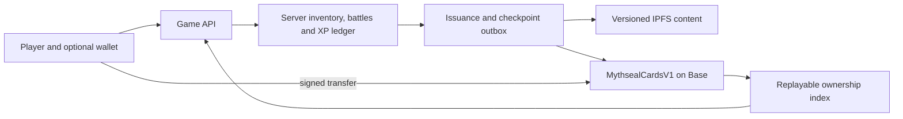

# Mythseal · Blockchain implementation plan

Planning review: **2026-09-23**, source baseline `ed60996` on
`codex/game-lobby`. **Recommendation, not an approved production chain or
issuance decision.** This document makes the existing [NFT design](NFT-STACK.md)
actionable; contract code and services are unchanged.

## Progress verified for this review

| Track | Evidence and remaining work |
| --- | --- |
| Public release | Read `https://mythseal.com/release.json`: v0.5.1, `ea485586d14032bc145a993749a49d5c343ff5f8`, 19 assets, empty `contractRefs`. Anonymous account endpoint returned `emailEnabled: true`; this is not a fresh mailbox-login test. |
| Local game | 39 rules characters, WX-01 16 identities / 29 printings, 66 encounters, 火焰山三連戰, inheritance, codex, paged scenes and jade map navigation. Branch was clean before this planning edit, 20 commits ahead of the locally recorded `origin/main`. |
| Current checks | This review reran `npm test`: **433 passed**; `npm run test:contracts`: **one toolkit fixture passed**. The latter verifies local mint/transfer tooling, not a production contract. |
| Browser evidence | Existing [validation records](VALIDATION.md) document Chromium/WebKit campaign and map checks. This review did not rerun browsers. Human balance, physical phones and hosted rollout remain open. |
| Online authority | Email accounts/private journey backups exist. Server-owned inventory, authoritative battles, economy settlement and transferable player ownership do not. |
| Chain and archive | No Mythseal game contract, mint, wallet integration or proven IPFS restore. Existing Solidity/Foundry tooling and Base Sepolia read probe are preparation. |

Source snapshots, local tests and hosted behavior are separate evidence. This
planning review does not deploy the local content or apply journey migrations.

## Decision proposal: Ethereum ecosystem through Base

Use **Base Sepolia** for the first integrated rehearsal and **Base** as the
leading production candidate. Keep one canonical issuance chain. **The owner
confirmed this product direction during the review: limited collectible cards
with per-copy history; ordinary cards remain free to play.** Wallet ownership
is optional for ordinary gameplay. This confirms the asset model, not the final
production chain, supply quantities or a sale/deployment.

| Candidate | Fit for Mythseal | Decision driver |
| --- | --- | --- |
| Ethereum L1 | ERC-721 fits the asset model; settlement directly on L1. | Repeated low-value mint/checkpoint writes should be costed against an L2 before choosing L1 for this game. |
| Base, Ethereum L2 | Same EVM contracts/tooling; existing Solidity/OpenZeppelin/viem preparation; exact-copy ERC-721 identity. | Best first implementation fit. Measure total operating cost, wallet recovery and confirmation UX; retain sequencer/L2 dependencies in the threat model. |
| Solana + Metaplex Core | Per-asset ownership, metadata and authority also express trained cards. Native separate fee-payer support can sponsor actions. | Strong alternative if the player ecosystem or measured high-volume issuance requirement favors Solana; requires a different custom program and adapter/indexing implementation. |

This recommendation is an engineering judgment, not a claim that Base is always
cheapest or that Solana cannot preserve XP. Base's official docs establish EVM
compatibility and distinguish inclusion from finality; Ethereum explains why
rollups can reduce per-transaction costs. [Base network](https://docs.base.org/get-started/connect-to-base),
[Base finality](https://docs.base.org/specifications/transactions/transaction-finality),
[Ethereum L2 overview](https://ethereum.org/layer-2/).

For a Solana experiment, use Core as the baseline. Compressed assets are a
separate scale experiment with proof/indexer requirements and wallet/marketplace
compatibility to test; do not assume the cheapest issuance route has the same
integration support. [Core](https://www.metaplex.com/docs/smart-contracts/core),
[Bubblegum v2](https://www.metaplex.com/docs/smart-contracts/bubblegum-v2),
[Solana fee abstraction](https://solana.com/docs/payments/send-payments/payment-processing/fee-abstraction).

## Ownership and gameplay boundary

On-chain: canonical collectible owner, unique identity, edition/art commitment,
lifetime issuance caps, consumed claims and latest published growth checkpoint.
Off-chain: hidden hands/bids, battle execution, matchmaking, detailed XP events,
ordinary earned coins and ordinary packs. An NFT transfer preserves identity
and completed history. A checkpoint authenticates an operator statement; it
does not prove that the operator calculated a battle honestly.

Use separate `templateId`, `printingId`, `editionId`, server `assetId`, and
`(chainId, contractAddress, tokenId)`. A printing in the current local catalogue
is not automatically a scarce edition. Local UIDs, saves, coins and XP are never
mint entitlements. The online starter grant must come from the server. Avoid
publishing account IDs, email, opponent identities or private match details.

ERC-721 is the first choice because each trained copy is distinct. ERC-1155 can
represent unique supply-one IDs too, but its interchangeable balances are more
useful for future identical tickets/materials than this primary card model.
[ERC-721](https://eips.ethereum.org/EIPS/eip-721),
[ERC-1155](https://eips.ethereum.org/EIPS/eip-1155).

## Minimal contract surface

Start with **one custom non-proxy contract, `MythsealCardsV1`**, containing three
logical modules below. Admin infrastructure uses established components. Split
contracts only when a concrete lifecycle or permission boundary warrants it.

| Module | Required behavior | Key constraints |
| --- | --- | --- |
| Card and edition registry | ERC-721/ERC-165; immutable token-to-edition and asset binding; constructor-sealed edition/template/art-manifest/cap list; standard transfers. | `mintedEver <= cap` for every edition and fixed release total; every reserve/team/promotion allocation counts. No cap increase, token-ID reuse or arbitrary admin transfer. |
| Signed issuance | `mintWithAuthorization(claim, signature)` consumes one globally unique claim and creates one known-content card. | Bind asset ID, edition, recipient, initial metadata commitment, signer epoch and deadline. EIP-712 domain binds chain/contract/version. One-use asset binding as well as one-use claim ID prevents remint under a new claim. All mint paths share cap checks. |
| Growth checkpoints | `publishCheckpoint(tokenId, checkpoint, uri, signature)` advances sequenced metadata and emits ERC-4906 notifications. | Separate publisher signer; bind exact URI hash, edition commitment, rules hash, XP, prior digest and next sequence. Transfers neither reset nor copy history. No mint or edition-edit authority for publisher. |
| Standard administration | Multisig administration, explicit role events, delayed sensitive changes and separate immediate emergency pause/revoke paths. | Mint issuer, publisher and guardian powers separated. Pause new issuance/checkpoints without silently freezing owner transfers. Recovery/unpause policy must be tested. |

Use the pinned OpenZeppelin/Foundry dependencies already in the repository;
reassess their relevant interfaces and release evidence when implementation
starts. EIP-712 does not provide application replay protection by itself.
Multisig issuers require an ERC-1271-aware verification path; do not assume every
authorized signer is an EOA. [EIP-712](https://eips.ethereum.org/EIPS/eip-712),
[ERC-1271](https://eips.ethereum.org/EIPS/eip-1271),
[ERC-4906](https://eips.ethereum.org/EIPS/eip-4906),
[OpenZeppelin access control](https://docs.openzeppelin.com/contracts/5.x/access-control).

The technical testnet pilot uses one card per claim, with no payment or random
allocation; production distribution remains undecided.
Consume claims and counters before receiver callbacks; a rejected receiver
reverts the whole mint. Specify reentrancy behavior across mint/checkpoint entry
points. A compromised issuer can still spend remaining authorized supply, so
caps, issuance budgets, monitoring and revocation are distinct controls.
Check the current signer role and epoch at execution; restoring a revoked key
must not revive its old authorizations. Define a genesis metadata/digest and
sequence before the mint receiver callback can interact with the new card.

Seal original art separately from dynamic metadata. Keep historical JSON bytes,
signatures and CIDs, with two independent pins and a restorable archive. The
contract verifies signed commitments, not JSON art semantics; the publisher
must validate immutable fields before signing. XP corrections append a reasoned
new event/checkpoint rather than erase history. Sequence must increase; XP may
decrease only through the disclosed correction process.

## Required integration alongside contracts

- **Authoritative ledger:** unique server asset IDs; one settlement per
  `matchId + assetId + rewardType`; transactional reward/XP writes and an outbox.
  No transaction spans Postgres and the chain atomically.
- **Wallet linking:** account reauthentication plus one-use, domain/chain-bound
  signature challenge; external-wallet and contract-wallet cases. Linking is
  not transfer approval. Start with a small provider adapter and server-side
  viem, preserving the dependency-free browser runtime rule.
- **Wallet usability:** evaluate passkeys and existing sponsored-transaction
  infrastructure separately. Test device loss, recovery, cross-device use and
  transfer-out. Sponsor only approved methods with explicit budgets; gameplay
  session keys receive no general NFT transfer/operator permission.
- **Issuance reconciliation:** reserve supply transactionally before signing;
  track reserved/submitted/confirmed/expired/reorg-pending. An RPC timeout does
  not authorize a second mint. Check the original claim/transaction and preserve
  its identity through retry; reconcile reservations with on-chain issuance.
  Do not release a reservation while its authorization remains redeemable;
  expiry/cancellation and finalized reconciliation determine release.
- **Ownership indexing:** checkpoint block hashes and log identities; dedupe,
  replay, recover after restart and handle reorgs. Show pending transfers
  promptly, but initially base valuable rights on `finalized` state. Benchmark
  the resulting wait; any earlier provisional rights need an explicit rollback
  policy. A receipt is not finality.
- **Battle/transfer race:** freeze the exact asset and ownership observation at
  match start; recheck during play and settlement. Once the selected confirmed
  transfer is observed, prevent the former owner from starting new matches and
  void unsettled rewards under a published rule. Completed XP follows the same
  asset. Indexing delay is a real limitation, not instant ownership knowledge.
  Serialize ownership projection changes with settlement, record the exact
  observed block, and define how a late-observed earlier transfer is corrected.
  A transfer does not move or duplicate the seller's account coins.
- **Existing inheritance/NPC market:** tokenized copies are excluded in v1.
  Local inheritance consumes a copy and NPC custody changes local records;
  neither is an NFT burn/transfer. Future NFT inheritance needs explicit owner
  authorization, atomic/reconciled consumption and XP, and permanent tombstones.
  Burning must never restore issuance capacity or allow asset-ID reuse.

## Contracts only if later product scope needs them

| Candidate | Trigger and minimum design |
| --- | --- |
| `MythsealPrimarySale` | A defined fixed-content sale. Bind price/currency/recipient and quotas; payment and mint complete atomically. Core cap still governs every sale. Treasury and refund semantics are explicit. |
| `SeasonRewardDistributor` | Large server-verified campaigns justify batch/Merkle claims. Bind season/root/recipient/reward; claim bitmap or nonce; defined root replacement rules. An operator-published root does not prove a player earned it. |
| ERC-1155 packs/items + reveal controller | Transferable sealed packs or interchangeable items become a requirement. Reserve exact edition supply before sale; freeze loot configuration, bind randomness to one request, prevent selective rerolls and make fulfillment retryable. Ordinary current packs need none of this. |
| Marketplace adapter | Player-owned NFT trading is selected. Integrate an assessed existing settlement protocol first; test approvals, stale orders, partial failures and royalties. ERC-2981 signals royalty information but cannot guarantee payment. |

Verifiable randomness is relevant to future public collectible allocation,
not secret battle hands: public randomness reveals a public deck seed. Before
random packs, reassess oracle network support, availability, funding and failure
semantics. No fungible game token, staking/yield, bridge, rental or custom exchange
is needed for the first collectible pilot.
[ERC-2981](https://eips.ethereum.org/EIPS/eip-2981).

## Ordered implementation packets

| Packet | Deliverable | Exit evidence |
| --- | --- | --- |
| P0 · Current game readiness | Apply the planned persistent battle-table layout; human content/balance review; coherent client/Worker/schema release preparation. | Both hands and move context visible; existing save/reward behavior preserved; old/new backup and release checks. Physical-device evidence remains explicit. |
| P1 · Trusted battle, M1–M2 | Online API/schema contract, fresh starter inventory, one four-round server-settled battle and exact-copy XP. | Tampered local saves grant nothing; reconnect/two-device resume, concurrent actions and duplicate settlement cannot duplicate rewards. |
| P2 · Local collectible core, M6 | Fixed-content synthetic editions, CardsV1 modules, local index/metadata fixtures and invariant tests. Can proceed alongside P1 using synthetic assets. | Cap exhaustion, duplicate assets/claims, wrong domains/recipient, signer revocation, malicious receivers, checkpoint rollback and role isolation pass. No network deployment required. |
| P3 · Online economy, M3 | Migrate daily grants, ordinary packs, inventory/decks, NPC commands and ordinary inheritance one command family at a time. | Currency/card/XP conservation, atomic costs, replay resistance and restoration. Only the command families needed by an NFT entitlement gate that entitlement; unrelated player trading need not delay a fixed-content pilot. |
| P4 · Integrated testnet pilot | One known-content card, linked wallets, ownership index, archive and checkpoint publisher. | A claims → earns verified XP → publishes checkpoint → transfers to B; B sees same identity/history and A loses use after selected confirmation. Reorg/RPC outage/index rebuild, wallet recovery and IPFS restore pass; measure total costs. |
| P5 · Production decision and review | Freeze chain, rights/platform scope, supply/reserves, art, signer policy, budget and contract bytecode; independent security review and rehearsal. | No unresolved critical/high findings, corrections rechecked, verified source/bytecode, admin handoff and incident/recovery drills before an expressly authorized limited release. |

Dates should follow these exit conditions, not an arbitrary launch countdown.
Native packaging/physical-device work and content polish can proceed alongside
online/contract work. Gameplay rights on native platforms remain a separate
product/store validation item in [MOBILE-RELEASE.md](MOBILE-RELEASE.md).

Before freezing interfaces, settle three remaining product parameters: which
specific limited printings become collectibles, the exact edition lifetime
caps/reserves, and whether the pilot is
a free fixed-content claim or a fixed-price known-content sale. Current ordinary
pack odds do not answer those questions. The next useful engineering slice is
P1's online command contract, with P2's local invariant suite in parallel.
