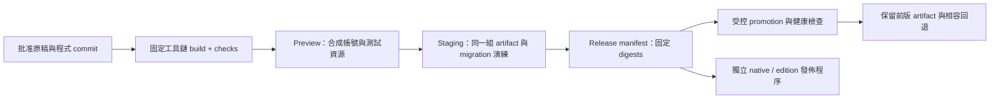

# Mythseal：素材、動畫與內容發佈流程

設計基線：2026-09-21，瀏覽器原型正以 v0.4.1 完成品牌及 hosting 更新。這份文件提出實作順序、產物與驗收條件；本文件工作沒有產生新圖片、安裝動畫套件、部署服務、上傳 IPFS 或簽署發行交易。品牌已確認為「萬象契 · Mythseal」，私有 repository 已改為 `cambridgetcg/mythseal`；本機資料夾仍保留 `shanhai-duel`，既有儲存鍵繼續相容。`mythseal.com` 已取得並啟用 Cloudflare，實際部署狀態以 `docs/HOSTING.md` 的獨立發佈紀錄為準。

**建議先保留 DOM 卡牌介面，以 CSS／Web Animations API 加上少量動畫；把插畫原稿、遊戲圖片及限量版封存包分開管理。** App、後端、合約與美術各有版本，再以 release manifest 指定可一起運作的一組版本。這延續 [路線圖](../ROADMAP.md)、[鏈上卡牌設計](BLOCKCHAIN-DESIGN.md) 與 [手機發佈計劃](MOBILE-RELEASE.md)，不把本地卡牌編號視為 NFT。

## 1. 現有基線與第一個改動

目前 `engine.mjs` 保存角色規則與 `artSet / art` 索引；`app.mjs` 的 `cardMarkup()` 以 CSS 背景座標顯示卡面。遊戲不依賴 Canvas 動畫引擎。`progression.mjs`、`collection.mjs` 擁有本地經濟／卡牌成長；動畫不能取得結算權。

| 現有素材 | 實際尺寸／檔案大小 | 保留方式 |
| --- | --- | --- |
| `assets/portraits.png` | 1254 × 1254；3,939,603 bytes；4 × 3 圖集 | 原始生成輸出，不覆寫 |
| `assets/classics.png` | 1254 × 1254；3,752,819 bytes；4 × 3 圖集 | 原始生成輸出，不覆寫 |
| `assets/world-map.png` | 1536 × 1024；3,146,354 bytes | 原始生成輸出，不覆寫 |
| `assets/mark.svg`、卡框及文字 | 程式繪製／排版 | 保持可縮放及可翻譯，不燒入插畫 |

首先加入 `templateId → artVersion → derivatives` 的資料映射，讓新畫作不必改變人物 ID、舊存檔或戰鬥規則。初版可在 client adapter 保留現有 `artSet / art` 相容層。公開靜態包只包含玩家需要的模組、版本資料和圖片；不把整個 repository、測試資料、原稿工作檔或內部筆記直接當網站根目錄。

## 2. 插畫製作與可重建加工

既有原稿的生成提示及排列見 [ART.md](ART.md) 和 [ART-CLASSICS.md](ART-CLASSICS.md)。後續沿用內建 imagegen 製作／編輯插畫；**不在每次 CI build 重新生成圖片**，也不承諾相同提示會得到相同輸出。若工具回傳 model、尺寸或 reference 資料便記錄，沒有回傳的 seed／model version 不自行補寫。

**2026-10-20 補充（參考圖）：** 專案擁有者決定新圖可以用參考圖，但只限 Mythseal 自己已提交、並有出處紀錄的畫作，紀錄寫明檔案路徑及 SHA-256；不用第三方圖片、真人照片或其他 IP。原因（同一角色跨系列、跨版本保持一致）見 [ART.md](ART.md#reference-images--2026-10-20)。入門卷（T2）計劃用 ArtCraft 製圖；計劃中的入門、教學及主視覺新圖，連同 ArtCraft 條款未確認之處，記錄於 [ART-ONBOARDING.md](ART-ONBOARDING.md)。本節保存選中輸出原始 bytes、不在 CI 重新生成的做法不變。

| 階段 | 人／AI 的工作 | 確定性工具的工作與產物 |
| --- | --- | --- |
| 角色 brief | 確認古典來源、人物輪廓、色板、道具、服裝與安全構圖；畫風參考不使用現代改編角色的專屬造型 | `art-brief`、來源及使用範圍記錄 |
| 原稿生成與修訂 | imagegen 產生構圖；針對臉、手、武器、衣物及背景修訂；美術逐張確認 | 保存每次選中輸出的原始 bytes、SHA-256、提示、日期、父版本與審核紀錄 |
| 可動圖層 | 若要局部動作，另製背景、身體、頭髮／衣袖、武器、前景效果及必要補畫；檢查被遮擋區域 | 統一畫布、透明度、命名、anchor、pivot 和裁切座標；PSD／KRA 等工作檔由實際編輯流程產生，不假稱平面 PNG 自帶圖層 |
| 遊戲加工 | 美術確認縮圖仍可辨認角色、膚色及細線 | crop、resize、atlas pack、邊緣延伸、WebP／AVIF／PNG 輸出、尺寸／bytes／hash 報告 |
| 發佈審核 | 在 390px、桌面及目標手機查看卡面與動畫；確認新限量版是否真的定稿 | 固定 asset manifest、測試截圖及可重建的 build recipe |

Scripts 負責已批准圖像的裁切、縮放、壓縮與封裝，不用程式畫幾何形狀替代所需插畫。建議新增開發階段工具 `tools/assets/build.mjs`，採固定版本的 Sharp／libvips；Sharp 提供明確的像素裁切和 WebP／AVIF 輸出。這是待實作的 build dependency，遊戲 runtime 維持無此依賴。[Sharp 裁切／縮放](https://sharp.pixelplumbing.com/api-resize/)、[輸出格式](https://sharp.pixelplumbing.com/api-output/)

**現有圖集的特別處理：** 1254 不能被 4 整除。舊圖集逐格匯出時以 `x0=floor(column*width/4)`、`x1=floor((column+1)*width/4)` 決定範圍；y 同理用 3 行。欄寬會是 313 或 314 pixels，不能把四格都取 313 而遺失最後兩列。此規則僅是初始裁切假設，仍須核對生成圖片的實際分界並固定批准的 rect 清單。裁切後才產生一致尺寸的遊戲版本；原圖不重新採樣。

未來每位新角色優先交付獨立 3:4 原稿，再由工具組 atlas。atlas 若供 GPU sprites 使用，預留 padding／edge extrusion 防止鄰格滲色，並輸出明確 rect 和 anchor；不要把 UI 姓名、稀有度、價格或序號畫進人物原稿。

建議產物組織（尚未建立）：

```text
private-art-store/<templateId>/<artVersion>/
  source.png, layers/, provenance.json, source.sha256
assets/generated/<contentHash>/
  thumb.webp, thumb.avif, portrait.webp, portrait.avif, fallback.png
  atlas.webp, atlas.json, motion.json, poster.webp
content/assets.manifest.json
releases/<releaseId>/release.json, checksums.txt, build-provenance.json
```

Git 保存 brief、映射、程式及小型批准 runtime 產物。大型原稿／圖層放受控且有版本及備份的 object storage；若選 Git LFS，需把 CI 取回權限、容量與 clone 流程一起驗證。現在約 10.8 MB 的三張 PNG 可留在 Git，不為導入流程立即搬走。原稿 archive 保留原始 metadata；對外 derivatives 檢查並移除私人路徑／非必要 metadata，公開來源資訊放入批准的 manifest。

## 3. 圖片與動畫預算

以下是首輪目標，**不是目前已達到的效能測量或格式保證**。以實機結果調整，不能只靠桌面 FPS 或壓縮檔案大小決定品質。

| 用途 | 初始目標 | 載入與降級 |
| --- | --- | --- |
| 收藏列表縮圖 | 240 × 320；每張最佳可用格式 ≤45 KiB | 僅載入可見區與下一屏；高 DPI 另測 360 × 480，不盲目使用 3× 原稿 |
| 卡牌詳情／出戰圖 | 600 × 800；每張 ≤160 KiB | 開啟詳情或抽定手牌才取；列表仍用縮圖 |
| 地圖 | 1280 × 853 左右；≤350 KiB | 只在遊歷頁載入；模糊預覽後替換，不阻塞主選單 |
| 稀有卡分層演出 | 單張最多 4 個 512 × 768 RGBA 圖層；下載合計 ≤500 KiB | 最多 1 張詳情卡有持續動態；所有卡都有靜態 poster |
| 共用 FX atlas | 單張最大 2048 × 2048；下載 ≤300 KiB | 全場重用一份，離開戰鬥釋放；較弱裝置降低粒子量 |
| 首次可操作畫面 | app shell、必要文字與首屏圖片合計 ≤1.5 MiB transfer | 地圖、全圖鑑、動畫 runtime 不列入首屏必需資源 |

WebP 作主要 runtime 候選，AVIF 作經品質／解碼時間檢查後的額外版本，PNG 作透明圖／相容 fallback；用 `<picture>` 或經測試的 `image-set()` 選擇，不同格式都能讀到同一人物。壓縮不能改變公開限量原稿；它們只是各有 hash 的 derivatives。格式選擇與品質數字記入 recipe，build 對同一 input hash 產出同一 manifest，差異需明示。

預算同時追蹤解碼記憶體：`width × height × 4` 是 RGBA8 單層約數，還未計 mipmaps、瀏覽器副本和 render targets。512 × 768 × 4 layers 約 6 MiB／卡，24 張同時可動便明顯超出「只動一張」的設計。低動態／低畫質模式停用裝飾粒子與循環，不降低文字對比或關鍵狀態可見性。

## 4. 動畫路線與接入方式

| 選項 | 適用 | 本專案決定 |
| --- | --- | --- |
| **CSS + Web Animations API** | hover、翻牌、卡片移動、數值淡入、短暫受擊與簡單分層視差 | 首選；沿用 HTML 按鈕、鍵盤與讀屏；不為目前 24 張卡改寫全個 renderer |
| **PixiJS** | 已量測需要大量 sprites／粒子、共享貼圖或連續戰場特效 | 第二階段只試做獨立 FX canvas；保留 DOM 卡牌、文字和操作。先測 GPU context loss、觸控及記憶體，再決定是否擴大 |
| **Spine** | 需要骨骼、關節及可重用角色動作的稀有卡演出 | 先有合格分層圖與 rig 才採用；一張平面卡圖不能直接變成可靠骨骼角色。確認 editor／runtime 授權後才排入工具鏈 |
| **Rive** | 向量徽章、互動按鈕、狀態機引導或精緻 UI ornament | 可獨立試一個 UI 元件；不是目前水彩／厚塗人物 atlas 的預設替代品。新增 JS／WASM 資源要計入包體、載入與 cleanup |

這是針對現有架構的設計判斷。WAAPI 提供 DOM 動畫與播放控制；Pixi 官方建議按需優化，並說明 spritesheet、texture／filter 成本；Rive 有 JS／WASM runtime 和明確的物件 cleanup；Spine 有獨立的 runtime 授權條件。[WAAPI](https://developer.mozilla.org/en-US/docs/Web/API/Web_Animations_API)、[Pixi 效能指南](https://pixijs.com/8.x/guides/concepts/performance-tips)、[Rive Web runtime](https://rive.app/docs/runtimes/web/web-js)、[Spine runtime 條件](https://esotericsoftware.com/spine-runtimes-license)

建議增加 presentation adapter：`playPresentation(publicEvent, {motion, signal})`。只接收已允許展示的出牌／揭曉／結果事件；既不讀未公開的對手暗注，也不在動畫 callback 裡支付獎勵。順序是**驗證並保存已接受的狀態 → 呈現演出 → 操作下一步**。重新整理、取消、切頁、切到背景或無法載入圖片時，直接畫出保存狀態；不能因 `animationend` 沒到而卡住對局或重複結算。

初始節奏可用選卡 120–180 ms、翻牌 250–400 ms、揭曉全段 ≤900 ms；減少動態模式改為即時狀態／短淡入，提供跳過重複演出。CSS 與 JS 都讀 `prefers-reduced-motion`，並提供遊戲內減少動態選項；切換時取消現有動畫並完成狀態對齊。裝飾動態在頁面不可見時暫停，關鍵結果保留文字與數字。[MDN reduced motion](https://developer.mozilla.org/en-US/docs/Web/CSS/Reference/At-rules/@media/prefers-reduced-motion)

2026-09-22 本機資源演出將一般揭曉調整為 1100 ms，留出獨立的回復／回丹節拍；
此設定取代上述初始 ≤900 ms 提案，跳過與下一回合仍可即時使用。實機與重複遊玩
節奏尚待測量，詳見 [生命、仙丹與對戰演出](IMMERSION.md#life-pills-and-battle-transitions--2026-09-22)。

## 5. 四條發佈線與相容 manifest

| 發佈線 | 獨立版本／固定產物 | 驗收及回退 |
| --- | --- | --- |
| App／web／native shell | `clientVersion`、commit、web artifact digest；native build number、bundle ID 與嵌入的 web digest | 預覽、瀏覽器／真機驗證；web 可重指前一個 artifact，native 需停止 rollout 並發修正版 |
| Backend／rules | API compatibility range、`rulesVersion`、服務 image digest、DB migration IDs | 舊／新 client 與在途對局可共存；先加欄位及向後相容讀寫，之後才清舊欄位；回退服務不逆轉已結算 XP |
| Contracts | chain ID、合約地址、bytecode hash、ABI version、edition cap manifest | 獨立 testnet／審查；已確認交易不能用網站 rollback 撤銷。發行核心按既有方案不以代理升級繞過固定上限 |
| Art／content | `artVersion`、assets manifest hash、固定原畫及 derivatives digest；限量 edition root CID | 先驗資源可取再啟用；普通遊戲可回到舊 art manifest，已封存 NFT 原稿保持原 CID |

一份 release manifest 至少記錄 `releaseId / gitCommit / clientVersion / apiCompatibility / rulesVersion / databaseCompatibility / assetsManifestSHA256 / contractRefs / enabledFeatures`。schema 版本另列；沒有合約時 `contractRefs=[]`，不能放假合約地址。每場 server 對局綁定開局使用的 rulesVersion；client 的網路回覆和記錄顯示服務／規則版本，避免把舊 replay 用新平衡數據重算。



Promotion 使用已檢查的同一 artifact，不在 production job 重新拉「最新」依賴或重畫圖片。Runtime 公開設定如 API URL 可獨立配置，但也記錄其版本；preview 與 production 的帳號／資料庫／權限分開。新內容先上傳、驗 hash、驗可用性，再切 manifest；保留舊資源給舊 client，不能上線新 HTML 同時刪除舊 hash 圖片。

## 6. GitHub 到 preview、staging 與 production

**今次 hosting 實作範圍：** Cloudflare Workers 的 assets-only `mythseal` 靜態網站服務 apex；build 明列可公開檔案，只把 allowlist 複製到 `dist/`。`_headers` 設定 CSP，資源採用 `public, max-age=0, must-revalidate`，讓瀏覽器每次使用前重新驗證新鮮度；未帶內容 hash 的程式／HTML 不設長期 immutable cache。`www` 使用獨立小型 `mythseal-www` Worker 回傳 308 到 apex，保留 path／query；兩個 hostname 各有對應 custom domain，不能用靜態 `_redirects` 檔案假設已完成 host 層跳轉。這裡描述本次實作選擇，實際網址、部署版本及線上檢查以獨立 hosting 發佈紀錄為準，不把設定檔存在當成已上線。[Cloudflare 靜態資源 headers](https://developers.cloudflare.com/workers/static-assets/headers/)

目前 repository 已有 unit／syntax CI；本次加入 build 與公開檔案邊界檢查。首輪部署由維護者在本機使用既有 Wrangler OAuth 執行，沒有把本機 OAuth 憑證或 GitHub token 複製到 Actions。**自動 CD、每個 PR 的 preview URL、staging、後端及合約部署均屬後續能力**，不從現有 CI 推定它們已啟用。先保留固定 commit 的 build 產物與發布紀錄，再逐步加入以下流程：

1. **PR check：** 保留既有純規則測試，加入 asset manifest schema／hash／尺寸／預算檢查。瀏覽器 smoke 加入 reduced motion、失敗圖片、取消動畫和舊存檔升級案例。輸出臨時 preview artifact 與截圖；未信任 PR 不能取得 production 權限或正式玩家資料。
2. **Preview：** 每個 commit 有獨立 URL，標示 build ID；需要保密的預覽加存取控制。使用合成玩家、測試 backend、testnet 設定；preview 不能向正式 XP 帳或限量配額寫入。
3. **Staging：** 合併後建立固定 release artifact，跑 API 整合、遷移／還原演練、圖片完整性和瀏覽器流程。後端無破壞性 schema 更新先上，client 後上；在途對局仍使用原規則。
4. **Production promotion：** 指定已核對的 commit 和 artifact digest，記錄操作者、版本、檢查結果與可回退版本；部署後驗入口、assets、API health、登入與一場合成對局。異常時停止新功能／新對局入口，再按相容矩陣回退。
5. **留存：** release artifact、checksums、工具版本及 provenance 留在受控 artifact store；不要依賴有保留期限的普通 CI logs 作唯一備份。支援時為 release bundle／manifest 產生並驗證 artifact attestation；它證明 build 來源，不代表遊戲已安全或平衡。[GitHub attestations](https://docs.github.com/en/actions/concepts/security/artifact-attestations)

日後自動部署認證先選支援受限 GitHub App 安裝的供應商原生 Git integration；GitHub OIDC 換取短期、最小權限角色則須確認目標服務支援，不能假設現有 Workers 部署已可直接用它。不要在 Git、workflow YAML、build bundle、logs 或一般 CI secrets 填入原始簽名私鑰／長期 cloud credentials。若服務只支援長期 token，交由受控部署 broker／供應商環境的 secret manager 保管；CI 只提交經允許的 artifact identity。沒有可用的無長期密鑰通路時，維持獨立的受控人工 promotion，不把 key 複製進 Actions 作方便做法。[GitHub OIDC](https://docs.github.com/en/actions/concepts/security/openid-connect)

設定 OIDC trust 時限制 repository identity、workflow、ref／environment、audience 與允許操作；根據實際 provider 支援的 claims 驗證。GitHub 官方註明 2026-07-15 後新建 repository 的預設 subject 格式加入不可變 owner／repository IDs；不要直接照抄舊的 repo-name subject 範例。

**Private repository 的 gate 要實測：** GitHub 現行文件把 Free／Pro／Team 的 required environment reviewers 限於 public repositories；不能只寫一個 `environment: production` 就假定本私有庫有雙人核准。先確認方案能力；不支援時用供應商側／部署 broker 的實際核准及權限隔離，或適用方案。`workflow_dispatch` 本身不是獨立核准機制。[GitHub deployment protections](https://docs.github.com/en/actions/reference/workflows-and-actions/deployments-and-environments)

## 7. IPFS 限量版封存與成長紀錄

IPFS 用於**已批准公開的固定內容**；內部生成嘗試、未發表 reveal、玩家個資、access tokens 及工作圖層不直接放入公開 IPFS。普通網站圖片仍可經 CDN 提供；「用了 CDN」不改變正式封存原畫的身份。

建議每次版別封存依序產生：

1. **Art bundle**：批准原畫、公開的縮圖／poster、已批准的授權說明和公開 provenance。每檔記錄 bytes、MIME、尺寸、SHA-256；以固定 importer／chunking／CIDv1 設定打包，得到 art root CID。
2. **Token metadata bundle**：每張序號對應固定 `templateId / editionId / serial`；`image` 使用 `ipfs://<art-root>/<path>`，可選的固定動畫另用 `animation_url`。再取得 metadata root CID。不要把 gateway 的可變網址當正式身份。[IPFS NFT 資料建議](https://docs.ipfs.tech/how-to/best-practices-for-nft-data/)
3. **Edition manifest**：包括 schema version、人物清單、每 edition 終身 cap、總 cap、保留配額、metadata／art CIDs、hash 算法、公開條款 digest、工具版本、簽署政策及尚未部署時明示的 contract 狀態。它只引用前兩個 CID，避免把自身 CID 塞進自身 bytes 造成循環依賴；封存後取得 edition manifest CID。
4. **Deployment receipt**：部署後另記 chain ID、地址、bytecode hash、edition manifest CID、交易／區塊與發行批次。Receipt 引用既有 manifest，不為填地址而偷偷改舊 manifest；mint 前合約參數與 manifest caps 必須一致。

CID 不是普通 SHA-256 檔案 checksum：相同檔案採不同分塊／編碼設定也可能有不同 CID。兩者分欄保存。保存可重匯的 CAR／原始固定 bytes 及 importer recipe；CI 用相同工具版本再計算並核對 CID。[IPFS CID 機制](https://docs.ipfs.tech/concepts/content-addressing/)

**已發行的原畫不得在同一身份後面被替換。** 改任何原畫 bytes 都產生新內容身份；新修訂必須是清楚命名的新 artVersion／edition 或公開的修訂紀錄，保留原件。也不能在 gateway 後面對某 CID 回傳另一張「最新圖」、用 IPNS／DNSLink 冒充 immutable art URI，或用可變 `tokenURI` 默默改回別的圖。

XP、勝場及可信成長事件由後端事件帳處理，不把它們塞進必須永久不變的原畫 metadata。推薦固定 token metadata／原畫，加上獨立且明示可變的 history API／版本化 snapshot；若需要 marketplace 顯示更新 level，先明示採動態 metadata 模式，每次 snapshot 有新 CID、sequence、規則版本與可驗證來源，固定 `image` 和 edition 指向仍不變。歷練隨同一 token／asset 轉移，禁止以更新圖片或重鑄新 token 代替卡牌成長。

至少兩個獨立保管位置 pin 全部 root 與被引用內容，加一份可還原 CAR 的離線／object-storage 備份；從不同 gateway 實際取回並驗 bytes，而不只看「pin request accepted」。持續監測下載與 hash，付費／保管責任及復原演練列入發行維運。IPFS 內容可驗證，不代表自動永久在線。[IPFS persistence](https://docs.ipfs.tech/concepts/persistence/)

合約部署／mint 與 metadata 正式封存分開執行。CI 可產生交易意圖、calldata、模擬結果和 artifact hashes；正式簽名由獨立受控 signer／硬體錢包／多簽程序確認，適用時用可稽核的非匯出式密鑰服務。Signer 自己核對 chain、合約、manifest CID、cap、收件人和額度，不盲簽 CI 送來的任意交易；私鑰不經 Actions runner。測試用可拋棄 local-chain keys 與正式 signer 權限也分開。

## 8. Native 發佈是另一條軌道

Web artifact 達標後才做 Capacitor 包裝試驗；iOS／Android bundle 固定相同的 client／assets manifest digest、API compatibility 和 build number。簽名後在真機驗觸控、音訊恢復、背景切換、斷線、儲存遷移、低動態、safe areas 和資源解碼；桌面 Chrome smoke 不代替這些驗收。

| 平台 | 建議試發流程 | 密鑰與回退 |
| --- | --- | --- |
| iOS | 選中 commit → Xcode／Xcode Cloud archive 與測試 → TestFlight → 明示選擇的商店發佈流程 | 優先 Apple 管理的 signing 流程；不把 `.p12`、私鑰或 App Store Connect 私鑰包進 GitHub artifact。停止擴大測試／rollout，再提交相容修正版 |
| Android | 同一 client digest → AAB → 獨立受控 upload signing → Play internal → closed testing → 正式 release | Play App Signing 管理 distribution key；upload key 仍需妥善管理，不能以「Google 簽名」誤認 AAB 無需 upload signature。用受控 signer／受限發佈環境，不將原始 keystore 交給普通 CI |

Apple 官方支援 cloud-managed certificates，Xcode Cloud 可接 TestFlight；Android 官方清楚區分 upload key 與 Play app-signing key；Play 有 internal／closed／open 測試軌道。具體帳號、權限與簽名自動化接法要在 native 試驗時驗證，不能假定所有供應商都支援同一 OIDC／remote-signing 介面。[Apple cloud signing](https://developer.apple.com/help/account/certificates/cloud-managed-certificates/)、[Xcode Cloud](https://developer.apple.com/xcode-cloud/)、[Android signing](https://developer.android.com/studio/publish/app-signing)、[Play 測試軌道](https://support.google.com/googleplay/android-developer/answer/9845334?hl=en)

Native 內容更新不能當成繞過商店 review 的任意遠端程式替換。商店可接受功能／支付／NFT 關係仍遵循 [MOBILE-RELEASE.md](MOBILE-RELEASE.md) 的另行決定；包裝成功不代表已獲商店接受。後端需保留舊版 API 相容窗口，因為使用者不會同時更新 App。

## 9. 下一個可交付切片

2026-09-22 補充：[沉浸體驗設計](IMMERSION.md) 的首次遊歷「霧隱渡口」已有
本地可玩切片：沿用現有圖集、程式繪製提燈及合成聲景，以已保存的公開結果串起
落子、揭曉、歷練及返回旅途。以下單卡 manifest／動畫試作仍是素材流程的獨立任務；
尚未新增分層卡圖或錄音檔。後續音效也需記錄原創／授權來源及下載、解碼成本。
這是本地實作，並非部署或真機驗收紀錄。

1. 先為現有 24 張卡建立 art manifest、原稿 checksums 和正確 crop rectangles；產生兩級 per-card WebP／AVIF derivatives，保留現在的 PNG fallback。驗卡序、裁切邊界、字／圖分離和真機可辨識度。
2. 做一張悟空卡的 CSS／WAAPI 翻牌及短暫武器光效，加 reduced-motion／跳過／取消；沿用已保存的 battle result。先測一張，未達效能目標不推全卡動畫。
3. 在本次 web artifact allowlist／build 邊界檢查上增加固定 release manifest 和 preview smoke；保留目前本機 Wrangler OAuth 的可追蹤發布流程。待供應商 GitHub App integration 或經確認支援的短期認證路徑可用，再驗證自動 staging promotion 與舊版本回退，不把自動部署同合約發行綁在一起。
4. 後端上線前加入 rulesVersion 相容矩陣、在途對局和成長帳 migration／rollback 演練；native trial 再用同一批准 artifact digest。
5. 有正式 edition 設計後才做非售賣 testnet 的 IPFS bundle、CAR 還原、跨 gateway bytes 核對和簽名演練；實際上限、正式圖作封存與 production mint 使用獨立發行紀錄。

完成條件是可展示的產物、可核對的版本及具體檢查證據。這份設計不替代後續的圖片實作、效能量測、後端測試或正式發佈紀錄。
