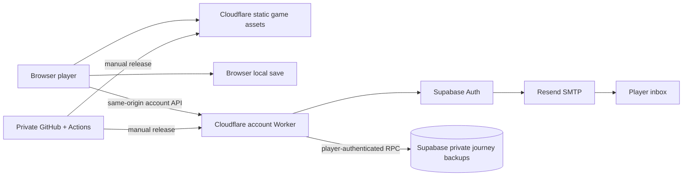

# Mythseal agent handover

Start here when joining development. Snapshot: **2026-09-21, v0.5.1 live**. Read
[AGENTS.md](../AGENTS.md), then this file and [ROADMAP.md](../ROADMAP.md). Provider
state and permissions can change; dated evidence below is not a permanent health check.

Use the [documentation library](README.md) to browse by title, purpose and tags.
It distinguishes implemented behavior, operations, future designs and historical
research while this handover remains the operational starting point.

## The project in one minute

**萬象契 / Mythseal** is an original Eastern mythology card game inspired by
神魔令's four-round bluffing/resource mechanics. It has 24 characters, travel,
daily progression, earned-coin packs, an NPC market and a backpack with exact-copy
XP/history and three decks. It is not a recovered copy of the old game.

The browser game runs locally, against AI opponents. **旅程閣** adds email-code
login and deliberate private cloud backup/restore. A cloud backup contains
editable offline progress; it is **not an authoritative inventory, transferable
online asset or NFT entitlement**. Player trading, server-settled battles,
native applications and limited-batch NFTs are roadmap work.

| Item | Handover baseline |
| --- | --- |
| Source | [cambridgetcg/mythseal](https://github.com/cambridgetcg/mythseal), default branch `main`; GitHub API confirmed `isPrivate: true`, `visibility: PRIVATE` during this handover |
| Public game | [mythseal.com](https://mythseal.com); HTTP and `www` redirect to HTTPS apex |
| Live source | Tag `v0.5.1`, commit `ea485586d14032bc145a993749a49d5c343ff5f8`; later documentation commits are not deployments |
| Public login | `/api/v1/account` returned HTTP 200 with `emailEnabled: true` at **21:33:57 UTC** |
| Release boundary | 19 allowlisted game assets, plus generated release metadata; server source, docs, tests and credentials are excluded |
| Existing owner workspace | `/Users/macair/Games/shanhai-duel`; a fresh clone normally uses `mythseal` |

A private repository still serves its approved JavaScript and artwork publicly.
Keep the repository private; this handover grants no new collaborator access and
contains no credentials. Resource identities and deployment receipts live in
[CONNECTIONS.md](CONNECTIONS.md) and [HOSTING.md](HOSTING.md).

## What actually runs



| Service | Current role and boundary |
| --- | --- |
| GitHub | Private source and CI. Actions tests/builds; it does **not** deploy the site. No public GitHub release is required for a web deployment. |
| Cloudflare | `mythseal` serves allowlisted assets and `/api/*`; `mythseal-www` handles canonical redirects. Existing OAuth can deploy Workers but its DNS API probe returned 403. |
| Supabase | Free **Mythseal** organization; `mythseal-dev`, ref `puiuevggytoxyyearkcq`, London `eu-west-2`. Despite its name, it currently backs the public website's real accounts/backups. There is no separate staging project. |
| Resend | `auth.mythseal.com` verified in `eu-west-1`; Supabase sends as `Mythseal <login@auth.mythseal.com>` using a domain-restricted sending key. Tracking is off. Owner-enabled receiving is preserved, but no incoming-mail game feature exists. |
| Pinata | Owner JWT file-read access verified. No artwork upload, pin/restore proof or upload permission test yet. |
| Hyperdrive / R2 | Hyperdrive list was accessible with no configurations. R2 returned service-not-enabled. Neither is needed for current private backups. |
| Blockchain | Base Sepolia chain ID 84532 read verified. `contracts/` has a local ERC-721 toolkit test fixture only; no signer, deployed game contract, funded wallet or mint. |
| Mobile | Capacitor config/development packages exist; no native iOS/Android projects, signing or store releases. |
| Other clouds | Vercel/Fly identities were available, but no Mythseal resources were created there. AWS identity was unverified. They are not required by the current application. |

Current backups use Supabase's authenticated REST/RPC path, **not Hyperdrive or
a service-role Worker credential**. The future economy design in
[BACKEND-STACK.md](BACKEND-STACK.md) is a different trust boundary. Stack, NFT,
mobile and content design documents contain dated proposals; use this handover,
source configuration and current connection/release records for operational state.

## Code ownership map

| Area | Entry points | Preserve |
| --- | --- | --- |
| Battle rules and card catalogue | [engine.mjs](../engine.mjs), [DESIGN.md](DESIGN.md) | Pure rules, injectable randomness, no AI access to hidden player moves |
| Local economy and travel | [progression.mjs](../progression.mjs), [PROGRESSION.md](PROGRESSION.md) | Daily rollover, single settlement, migration compatibility |
| Exact card copies and decks | [collection.mjs](../collection.mjs), [BACKPACK.md](BACKPACK.md) | UID, XP/history, locks, saved-deck references and sale/buyback continuity |
| Screens and interaction | [app.mjs](../app.mjs), `adventure-ui.mjs`, `backpack-ui.mjs`, `account-ui.mjs` | Dependency-free browser runtime and current guest saves |
| Cloud journeys | [account-client.mjs](../account-client.mjs), [cloud-save.mjs](../cloud-save.mjs), [ACCOUNTS.md](ACCOUNTS.md) | Explicit choices, stale-account/profile protection and local recovery copy |
| Account API and database | [server/account-api.mjs](../server/account-api.mjs), [server contract](../server/README.md), [migrations](../supabase/migrations/) | Verified identity, origin checks, rate limits, private RPCs and monotonic revisions |
| Assets and deployment | [public-assets.json](../hosting/public-assets.json), [build.mjs](../tools/build.mjs), [HOSTING.md](HOSTING.md) | Only approved files enter `dist`; public manifest matches deployed source |
| Art and future editions | [ART.md](ART.md), [ART-CLASSICS.md](ART-CLASSICS.md), [content pipeline](CONTENT-RELEASE-PIPELINE.md) | Original assets/provenance, stable character IDs, no art regeneration during CI |

The public API is documented in [server/README.md](../server/README.md). Browser
calls use same-origin JSON; tokens stay in HttpOnly cookies. Do not introduce
browser-side Supabase SDK/session storage to duplicate this adapter.

## Start a fresh checkout

Use **Node 22**, npm, Python **3.9+**, Git and an authorized GitHub account.
`npm ci` installs pinned development tooling, including optional platform
binaries; do not omit development or optional dependencies. It does not install
Foundry, Docker, Playwright browsers, Xcode or Android toolchains.

```sh
gh repo clone cambridgetcg/mythseal
cd mythseal
git status --short
git switch -c agent/your-task
npm ci
npm test
python3 tools/serve.py --open
```

The last command serves guest play on loopback, normally port **4177**. It does
not implement `/api/*`. Offline work and mocked account UI work need no cloud
credentials. On the existing Mac, first resolve the workspace path and inspect
the branch/diff; do not overwrite another agent's uncommitted work.

For service work, consult [CONNECTIONS.md](CONNECTIONS.md) and select the exact
Mythseal project before touching migrations or settings. Other Supabase projects
and the separate existing Pro organization belong to unrelated work.

| Credential or setting | Owner-controlled location / fresh-machine action |
| --- | --- |
| GitHub / Cloudflare developer access | Existing owner CLI sessions; another machine needs its own authorized login. Never copy browser cookies or put tokens in a handoff. |
| Supabase management access | Owner CLI native credential storage, macOS Keychain on this Mac; `npm run connect`, choice `1`, runs the official interactive flow. |
| Resend developer access | CLI profile `mythseal`, macOS Keychain on this Mac; connection helper choice `4` logs in, `5` performs a read-only check. This helper's Resend login requires macOS. |
| Project selection, DB password, Pinata JWT | Ignored root `.env.local`, mode `0600`; names/placeholders in [.env.example](../.env.example). Use choice `2` for Pinata's hidden entry. A clone does not carry these values or `supabase/.temp` linking. |
| Worker runtime binding | Only `SUPABASE_PUBLISHABLE_KEY`; normal project URL/origin/OTP flag are in [wrangler.jsonc](../wrangler.jsonc). No management token, DB password, SMTP key or service-role key belongs in the Worker. |
| SMTP sending key | Configured in Supabase; ignored mode-0600 local recovery record on the owner Mac. Routine client/Worker work does not need this key or a new key. |

`npm run connections:check` inspects installed tooling locally;
`npm run connections:check -- --live` makes read-only service checks. Read each
service's status: command success only means the report ran. It sends no email
and does not prove SMTP delivery, Pinata writes, database migrations or billing.
Do not rerun project/domain/key provisioning simply because a fresh clone lacks
local receipts.

## Local account Worker preview

For real account integration, build the public assets and use an **isolated local
config**, rather than changing production origins or weakening production cookies.
Create ignored `.runtime/dev/wrangler.jsonc` with this configuration; paths are
relative to that file:

```json
{
  "name": "mythseal-local-preview",
  "main": "../../server/account-api.mjs",
  "compatibility_date": "2026-06-16",
  "compatibility_flags": ["nodejs_compat"],
  "workers_dev": false,
  "preview_urls": false,
  "assets": {
    "directory": "../../dist",
    "binding": "ASSETS",
    "run_worker_first": ["/api/*"],
    "html_handling": "auto-trailing-slash",
    "not_found_handling": "none"
  },
  "vars": {
    "APP_ORIGIN": "http://127.0.0.1:8791",
    "ALLOW_INSECURE_LOCAL_AUTH": "true",
    "OTP_ENABLED": "false",
    "SUPABASE_URL": "https://puiuevggytoxyyearkcq.supabase.co"
  },
  "ratelimits": [
    { "name": "AUTH_RATE_LIMIT", "namespace_id": "26092101", "simple": { "limit": 5, "period": 60 } },
    { "name": "BACKUP_RATE_LIMIT", "namespace_id": "26092102", "simple": { "limit": 10, "period": 60 } }
  ]
}
```

Place only the selected project's `SUPABASE_PUBLISHABLE_KEY` in the adjacent
`.runtime/dev/.dev.vars`, mode `0600`, through a local editor/secure setup. Do not
copy the whole `.env.local`; it also contains unrelated administration secrets.
Then, from the repository root:

```sh
npm run build
npx --no-install wrangler dev --config .runtime/dev/wrangler.jsonc --local \
  --ip 127.0.0.1 --port 8791 --local-protocol http \
  --persist-to .runtime/dev/state --show-interactive-dev-session false
```

This runs the Worker locally but still connects to **hosted** Supabase. Keep OTP
off for ordinary UI work. For an authorized real-mail test, enable it only in
this local config and have the owner request a code using their own address.
Use exactly `http://127.0.0.1:8791`; other origins fail the origin guard. Local
storage is separate from the live website. The local cookie exception applies
only to loopback. Mocked browser smoke is the credential-free alternative.

The exact JSON example passed the pinned Wrangler's dry run during this handover
with no credentials. That checks its paths/bundling, not hosted account access.

## Checks matched to the change

| Work | Smallest relevant existing checks |
| --- | --- |
| Rules / local saves / card copies | `node --test tests/engine.test.mjs tests/progression.test.mjs tests/collection.test.mjs` |
| Account controller / snapshot / API | `node --test tests/account-client.test.mjs tests/cloud-save.test.mjs tests/account-api.test.mjs` |
| Connection helper | `npm run test:connections` |
| Public boundary / build | `node --test tests/hosting.test.mjs`; `npm run build`; pinned Wrangler `deploy --dry-run` |
| Database migration | `bash tools/test-backup-sql.sh` against a **fresh disposable loopback** PostgreSQL database named `mythseal_test`; needs `psql`, role-creation privileges and privately supplied `TEST_DATABASE_URL` |
| Contract toolkit | `npm run test:contracts`, with separately installed Foundry 1.7.1; local EVM only |
| Browser flows | Existing smoke scripts listed in [README checks](../README.md#checks), with separately available Playwright/browser and a running local server; set `GAME_URL` explicitly |

The SQL harness refuses remote databases and an existing Auth schema. Recreate
only its disposable local database between full harness runs; never aim its
bootstrap/reset at `mythseal-dev`. Both real migrations are already applied:
`20260921210000` and `20260921210100`.

The last release CI passed; the preceding connection-update CI recorded **177
Node tests and eight Python tests**. CI also covers PostgreSQL races, Forge,
syntax, build and Worker dry runs. Browser and mailbox results are separate:
owner-confirmed local mailbox login, generated-code public HTTPS sign-in/session/
logout and fixture cleanup passed. A mailbox-delivered public-browser flow and
physical cross-device restoration remain useful next verification tasks. See
[VALIDATION.md](VALIDATION.md) for exact scopes and timestamps.

`tools/live-account-check.mjs` creates/deletes synthetic users and writes test
backups; it is **not** a read-only connection probe. It needs elevated local
administration access and explicit scope for that integration test. Ignored
`.runtime` scripts and `test-results` receipts from the original setup do not
exist in a fresh clone and must not be dependencies of a new agent's workflow.

## Release and recovery

Follow [HOSTING.md](HOSTING.md), including preservation of the existing
publishable-key binding. The current generic `npm run deploy` helper predates
authenticated hosting and does not explicitly preserve/inject that binding;
use the documented explicit authenticated-release commands until that helper is
updated. Never deploy the repository root or introduce administration credentials
to solve a missing runtime binding.

Commit reviewed source, check exact-source CI, build from that clean commit,
deploy the required Worker(s), then verify the live release manifest, account
readiness and relevant behavior. Record source SHA/tag, Worker version IDs and
evidence in HOSTING/VALIDATION. A successful push, build or dry run is not a
deployment; a successful deployment command is not a successful player login.

`npm run verify:hosting` compares the **entire local `dist/release.json`, including
Git SHA**, with the live site. For a read-only check after documentation-only
commits, build/verify in a separate checkout of the actual deployed tag rather
than expecting current `main` metadata to match. Do not redeploy merely to make a
comparison green.

Cloudflare rollback affects the selected Worker, not Supabase data, SMTP, another
Worker or chain transactions. The v0.5.0 apex version closes public OTP while
retaining journeys; record actual rollback/readiness if that is needed. Database
recovery and authoritative-game recovery are separate future operations, not a
reason to replay or reverse the existing migrations casually.

## Invariants and joining with another agent

- Preserve `shanhai.*` storage keys, legacy data and per-copy identity/history.
  A stale tab, rejected cloud restore or failed command must not overwrite a
  newer journey. Restore keeps a local recovery copy.
- Keep private-backup writes revision-checked. **`PT409` is intentional**;
  replacing it with SQLSTATE `40001` caused PostgREST transaction retries.
  Ownership comes from `auth.uid()`; the account header only guards stale tabs.
- Keep six-digit OTP templates for both confirmation and magic-link email,
  ten-minute expiry and the server cookie/origin/rate-limit boundaries. Never
  auto-upload a journey as part of login.
- Use one writer per artifact. Assign a bounded roadmap packet, its files,
  acceptance criteria and reviewer before parallel editing. In separate
  branches/worktrees, coordinate migrations and shared integration files.
- Preserve existing authorization within its scope. Paid upgrades, native/store
  release, production minting and collaborator invitations are not authorized by
  the handover request; resolve those when a concrete future task needs them.

Close a task with a short durable handoff, not a raw conversation dump:

```text
Task / roadmap packet:
Branch and source commit:
Changed files and resulting behavior:
Checks actually run, result and scope (local / CI / hosted / browser):
Deployed? Exact tag/source/Worker version if yes:
Migration or service changes, plus recovery implications:
Open issue / next small task:
Credential or permission prerequisite (names only; never values):
```

Use [ROADMAP.md](../ROADMAP.md) for the next bounded tasks. Keep operational
discoveries here or in the specific service/release document, update dated
evidence when rechecked, and keep player data and credentials out of Git.
