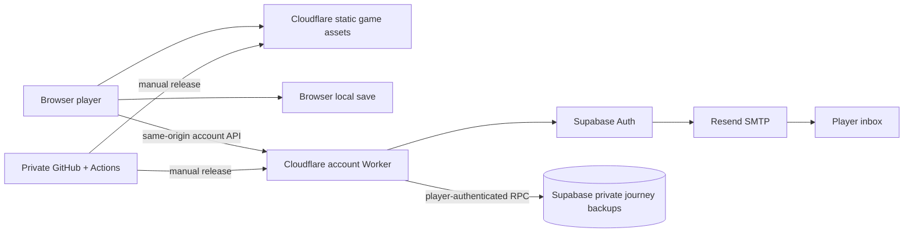

# Mythseal agent handover

Start here when joining development. Updated **2026-09-29**, with local Q0
and Q4 checkpoints and the LZ-01 special-art addenda (under
[LZ-01 local design preview](#lz-01-local-design-preview--2026-09-23)) added on
**2026-10-11**. The last recorded
public release is **v0.5.1**; this handover does not claim a fresh hosted check. Read
[AGENTS.md](../AGENTS.md), then this file and [ROADMAP.md](../ROADMAP.md). Provider
state and permissions can change; dated evidence below is not a permanent health check.

## The project in one minute

**萬象契 / Mythseal** is an original Eastern mythology card game inspired by
神魔令's four-round bluffing/resource mechanics. The recorded public v0.5.1 snapshot has 24 characters, travel,
daily progression, earned-coin packs, an NPC market and a backpack with exact-copy
XP/history and three decks. Current local source adds 15 西遊 characters,
29 WX-01 printings, a third pack, weekly quests, **66 story encounters** and
the standard **火焰山三連戰** activity. It is not
a recovered copy of the old game.

The browser game runs locally, against AI opponents. **旅程閣** adds email-code
login and deliberate private cloud backup/restore. A cloud backup contains
editable offline progress; it is **not an authoritative inventory, transferable
online asset or NFT entitlement**. Player trading, server-settled battles,
and native applications remain optional roadmap ideas. Collectible commercialization
and paid acquisition are retired objectives; dated NFT designs are historical research.

| Item | Handover baseline |
| --- | --- |
| Source | [cambridgetcg/mythseal](https://github.com/cambridgetcg/mythseal), private repository; fetched `main` is **`22092fc`**, including merged game-lobby PR #1, at the 2026-09-29 documentation checkpoint |
| Public game | [mythseal.com](https://mythseal.com); apex returned HTTP 200 and `/release.json` still reported v0.5.1 `ea48558` on **2026-09-24**. HTTP/`www` → HTTPS apex is recorded release evidence from 2026-09-21 |
| Last recorded public source | Tag `v0.5.1`, commit `ea485586d14032bc145a993749a49d5c343ff5f8`, deployed **2026-09-21**; later source commits do not imply deployment |
| Recorded public login | `/api/v1/account` returned HTTP 200 with `emailEnabled: true` at **2026-09-21 21:33:57 UTC** and again on **2026-09-24**; see [HOSTING.md](HOSTING.md) for the release receipt |
| Public release boundary | That v0.5.1 snapshot has 19 allowlisted game assets plus generated metadata; the current source build has 80. Server source, docs, tests and credentials stay excluded |
| Owner workspace | Machine-specific: the 2026-09-24 checkpoint used `mythseal`; another existing checkout is named `shanhai-duel`. Resolve the actual checkout/branch before editing; neither directory name establishes current source or running-service state |

A private repository still serves its approved JavaScript and artwork publicly.
Keep the repository private; this handover grants no new collaborator access and
contains no credentials. Resource identities and deployment receipts live in
[CONNECTIONS.md](CONNECTIONS.md) and [HOSTING.md](HOSTING.md).

## Q0 battle-table checkpoint · 2026-10-11 (local only)

Roadmap packet Q0 is implemented on the local branch **`q0/battle-table`**,
started from `origin/main` `ced2aa4`. The last source commit is **`0482837`**,
the end of a 2026-10-11 polish pass on top of the first checkpoint `80fb7a3`;
the documentation commits after it record that pass. The branch is **not
pushed, merged or deployed**. The last recorded public release is still
**v0.5.1**, and no hosted check was made for this checkpoint.

- **Changed:** the battle's 手牌/落子/對手/局勢 tabs are replaced by one 對局
  table. Both public four-card hands, the announced confrontation, life and
  pills, and the move controls stay visible together, and the reveal uses the
  same table. `permittedAnnouncement` in `battle-presentation.mjs` is the only
  reader of the stored AI move and never exposes its bid or Fury. No engine,
  reward, AI, save-schema or art change.
- **Polished:** twelve of thirteen review findings on `6a93cb4` are fixed, and
  so are the two regressions the next review found: the round result no longer
  shows before its staged reveal, the Fury switch, attack estimate, 危 mark and
  reveal pair stay whole, the reveal's resource and effect pages fit as on
  `ced2aa4`, short phones no longer overlap rows or card labels, Mist Gate keeps
  the table's selection highlight, and dead CSS is gone. The thirteenth did not
  reproduce; none was skipped.
- **Checked:** on `b9a3732`, whose game, test and tool files equal
  `0482837`'s, 456/456 Node tests and `npm run test:battle-table` 40/40 in
  Chromium and WebKit. On `0482837`, viewport 23/23 and battle-presentation 6/6
  in both engines and all 14 Chromium `npm run test:browser` suites. The
  expansion smoke last ran on `80fb7a3`. All ran headless against a loopback
  server.
- **Measured (on `80fb7a3`, not repeated after the polish):** one round in which
  the player checks the opponent three times takes 5 taps instead of 11. Input
  → next paint is unchanged, and the first table paint after resume is 3–17 ms
  slower in four of five headless profiles.
  [VALIDATION](VALIDATION.md#q0-battle-table--2026-10-10) has the table and
  method.
- **Open:** physical iOS/Android devices, human playtest, owner review of the
  new phone, tablet and landscape layouts; the live-region announcement that
  names the winner at Commit; a real-Safari check that the reveal's backdrop blur
  hides the resolved table (prefixed and fallback rules added 2026-10-11); portrait windows under about
  540 px tall; the plan's remaining clipping notes; and merge/build/release.
  The [battle-table plan](BATTLE-LAYOUT-PLAN.md#implementation-record-2026-10-10)
  lists them.

## Q4 content registry checkpoint · 2026-10-11 (local only)

Roadmap packet Q4's registry and audit are on the local branch
**`q4/content-registry`**, started from `origin/main` `8afbabc`. Source
commits: **`4265039`** (the registry), review fixes **`7291880`** and
**`cf63bec`**, merge commit **`d1f0f91`** (adapts the registry and its tests to
PR #8's LZ-01 specials), third-review fixes **`6bc784a`**, fourth-review
fixes **`092f1fd`**, fifth-review fixes **`2d44071`** and sixth-review fixes **`2a04859`**. Merge commit `d606447` brings in `origin/main` `daf18ed`
(PRs #6–#8, documentation only); the other commits change documentation only. The branch is not merged into
`main`, pushed or deployed, and no hosted check was made.

- **What it is:** `tools/content-registry.mjs` (Node tooling, never served),
  `tests/content-registry.test.mjs` and `npm run audit:content`. From the content
  modules, both asset allowlists and the LZ-01 docs, it derives what each
  encounter, the activity, each legacy/WX-01 printing, each LZ-01/HL-01 preview
  and each planned LZ-01 special can do. The registry's own commits change no
  runtime, save, content, art or allowlist file; the PR #8 merge brought in that
  branch's LZ-01 content, art and preview-allowlist changes.
  [Q4 registry states](EXPERIENCE-MODULES.md#q4-registry-states)
  defines statuses and capability states.
- **Checked:** 473/473 Node tests before the PR #8 merge and 474/474 after it
  and at `d606447`, the audit (exit 0, no findings), an 80-file build and the
  LZ-01/HL-01 preview smokes in Chromium and WebKit;
  [VALIDATION](VALIDATION.md#q4-content-registry--2026-10-11) has the receipts
  and every review round.
- **When content changes:** run `npm run audit:content`. If you bind an LZ-01
  special, update its row in the [EXPANSION-LZ01](EXPANSION-LZ01.md) checklist
  in the same change, or the audit fails.
- **Merged with `art/lz01-specials-images` (PR #8, at `35ab891`):** that
  branch replaces `LZ01_AA` with `LZ01_SPECIALS` (keyed by printId or
  `cardId:treatment`) and `LZ01_PLANNED_SPECIALS`, and renames ART-LZ01's
  "Pending specials briefs" section to "Specials briefs · 2026-10-10". The
  registry now reads both lists and the new heading, and the audit checks that
  `LZ01_PLANNED_SPECIALS` names exactly the checklist's planned rows. With all
  seven specials bound (小倩 AA since 2026-09-23, plus the six PR #8 planned and
  bound), it derives 120 local-playable and 30 preview entries and none planned. The tests derive the LZ-01 split from `liaozhai-cards.mjs`
  instead of pinning it, and rebuild a planned special from a bound one to keep
  the planned-path faults exercised.
- **Third review (`6bc784a`):** a cited test must now be a top-level
  `test(...)` (one nested in `describe.skip` had counted while the runner
  reported 0 skipped), `this.skip()` in a `function` callback disqualifies it,
  and a code reference must be defined in code, not a comment or string. Only
  `west-spirit-mountain` lists the story-gift claim, since the four westward
  nodes unlock in a chain. The audit compares a bound special's brief file with
  its binding.
- **Fourth review (`092f1fd`):** evidence
  reading fails closed. A cited test whose options are not an object literal (a
  variable, a conditional, a spread or a computed key), use a quoted
  `'skip'`/`'todo'` key, or whose callback is missing or passed by name no longer
  counts, nor does any access to its context's `skip`/`todo` (`t.skip?.()`,
  `t['skip']()`, `t.skip.call(t)`). Each checklist row's character, treatment
  and working title are compared with `LZ01_SPECIALS` (bound) or
  `LZ01_PLANNED_SPECIALS` (planned), and a planned entry takes its treatment
  from the module. A special, world or activity without an art or map path is a
  `capability-inconsistent` finding instead of a `TypeError`. The CLI resolves
  symlinks before deciding it is the main script, so a run through a symlinked
  path audits instead of printing nothing with exit 0. Still 27 finding codes.
  Checked: 475/475 Node tests, the audit (exit 0, no findings), an 80-file
  build and the LZ-01/HL-01 preview smokes in Chromium and WebKit.
- **Fifth review (`2d44071`):** a cited test marked
  `{ expectFailure }` no longer counts: Node 26 reports its throwing body as a
  pass and counts nothing as skipped. Option keys are now an allowlist
  (`timeout`, `concurrency`, `only`, `plan` and `signal`, plus `skip`, `todo`
  and `expectFailure` only when literally `false`), so an unknown key fails
  closed. A subtest `t.test(...)` is read by the same rules, recursively, and
  `(t).skip()` and a destructured context (`const { skip } = t`) no longer
  count. The audit reports an LZ-01 checklist or brief row listed twice (a
  stale row above the live one had passed unseen) and a bound special whose
  number belongs to another character (`planned-card-mismatch` is renamed
  `card-number-mismatch` and covers both). A preview special's
  `contentDigest` now hashes its own record, not its base card. Still 27
  finding codes. Checked: 476/476 Node tests, the audit (exit 0, no findings),
  an 80-file build and the LZ-01/HL-01 preview smokes in Chromium and WebKit.
- **Sixth review (`2a04859`):** a subtest declared through
  the runner's own `test`, `it`, `describe` or `suite` inside a cited test (Node
  attaches it to the running test) is now read like `t.test(...)`, so a
  skipped one no longer counts, with or without a context parameter; and
  `if (slow) (t).skip()` (a grouped context after an `if`, `while` or `for`
  head) no longer counts. The runner's functions imported under other names
  join the listed blind spots. Checked: 476/476 Node tests, the audit (exit 0,
  no findings, registry unchanged) and an 80-file build; the preview smokes
  were not re-run (no served file changed).
- **Merging into `main`:** `docs/README.md` now qualifies the Experience modules,
  Roadmap, Handover and Validation rows for Q4. When the branch merges, update
  the "not merged" status lines here, in ROADMAP, EXPERIENCE-MODULES and
  VALIDATION, then those rows.
- **Open:** feature views do not show unavailable reasons yet; there is no
  browser-level start → completion → receipt → return test; the
  deeper-encounter sample and human difficulty review are not started.

## Experience planning checkpoint · 2026-09-29

The fetched default branch now contains PR #1 at merge commit `22092fc`; start
new work from current `main`, not an assumed still-unmerged game-lobby branch.
The separate documentation-navigation PR #2 remains independent. Preserve its
work when updating shared guide entry points.

The owner requested transferring the RXSG restoration's smoothness and richer
gameplay lessons into Mythseal. Read [EXPERIENCE-LESSONS](EXPERIENCE-LESSONS.md),
then choose a [Q0–Q6 roadmap packet](../ROADMAP.md#experience-quality-track).
[EXPERIENCE-MODULES](EXPERIENCE-MODULES.md) specifies the proposed module contracts,
local/online boundaries and infrastructure. Start with the existing battle-table
visibility fix and a small command/receipt extension; reuse WX boxes, inheritance,
exact-copy identities and current content rather than rebuilding them.

This is documentation/planning only: no gameplay implementation, dependency,
hosted migration, service provisioning or deployment. It adds no fresh live,
physical-device or performance evidence. Agent practice and care automation are
proposals with explicit information/spending boundaries, not completed features.

## Current source checkpoint · 2026-09-24

Historical checkpoint: development then continued on **`codex/game-lobby`**. The
2026-09-24 publication checkpoint is recorded: the literary-preview, plan and
handover work is commit **`e61d60a`** on base `ed60996`; `origin/main`'s
2026-09-23 retirement commit `83216cc` is merged in **`e1fe8ac`**; the branch is
pushed to `origin/codex/game-lobby` and opened as [PR #1](https://github.com/cambridgetcg/mythseal/pull/1) against
`main`, where CI runs on the pull request. That PR has since merged as recorded
above. Pushing a branch does not deploy the game.

- **Direction note · 2026-09-23/24:** `main` retired collectible commercialization,
  paid acquisition and NFT issuance as delivery objectives (`83216cc`, 22:32 BST).
  The same morning's [blockchain plan](BLOCKCHAIN-IMPLEMENTATION-PLAN.md) recorded
  the owner confirming limited collectibles; the later retirement takes precedence
  and the plan is kept as dated research. Earned-coin literary boosters are
  in-game mechanics, not commercialization. If the owner rules otherwise, update
  ROADMAP's "Retired collectible launch phases" first.

- **Playable game source:** 39 engine characters, 66 encounters, the standard
  火焰山 activity and WX-01's 29 printings. Its owned-copy/pack/progression systems
  are implemented locally; the coherent client/Worker/backup release gates below
  still separate it from the recorded public v0.5.1 snapshot.
- **Completed standalone previews:** at this checkpoint LZ-01 had 12 BASE
  candidates + 1 AA available (all 19 of 19 printings since the 2026-10-11
  round-four addendum under
  [LZ-01 local design preview](#lz-01-local-design-preview--2026-09-23));
  HL-01 has 8 BASE + 3 AA, including the unchanged 黛玉 identity and seven new
  candidates. Each has inspection, filters and a fixed opening. Neither adds
  new engine characters, ownership, actual booster acquisition or profile fields.
- **Recorded local verification:** 446 Node tests, 9 Python tests and the 80-file
  public build pass; rechecked on 2026-09-24 before publication together with the
  forge fixture, wrangler preview/deploy dry runs and `git diff --cached --check`
  (two whitespace nits fixed in `e61d60a`). LZ and HL browser suites each pass 14 groups per engine in
  isolated Chromium/WebKit; [VALIDATION.md](VALIDATION.md) records scope and fixes.
  These results do not establish hosted behavior, physical-device acceptance or
  competitive balance.
- **Next bounded work:** finish the private conversation playtest; choose an LZ/HL
  rules/owned-copy/acquisition integration slice; conduct human balance review.
  The [persistent battle-table layout](BATTLE-LAYOUT-PLAN.md) remains planned.
  [Blockchain implementation](BLOCKCHAIN-IMPLEMENTATION-PLAN.md) is design work,
  not a deployed contract, mint or trusted inventory. Preserve journey-v2/v3,
  hashed/versioned module, account binding and backup-retention release gates.

On this Mac the main game uses **http://127.0.0.1:4177/** and the separate literary
preview server uses **http://127.0.0.1:4178/liaozhai.html** and
**http://127.0.0.1:4178/honglou.html**. The most recent recorded restart returned
HTTP 200; a future session must check that the processes are still running.
Preserve these browser origins and existing saves. See the fresh-checkout recipe
below for explicit branch selection, launch commands and repeatable checks.

## Local development after the release snapshot

### HL-01 local design preview · 2026-09-23

The owner selected **紅樓・風月入夢 / 海棠詩社** after the Liaozhai study and
asked to play together. `honglou.html`, `honglou.css`, `honglou.mjs` and
`honglou-cards.mjs` provide eight inspectable cards, three AA scenes and a
fixed 寶玉 BASE → 湘雲 BASE → 黛玉 AA opening. Source roles and separate
chapter 37/62 moments are explicit. 黛玉 keeps her existing identity and rules;
the seven other identities are preview candidates, absent from the engine.

Five original images supply eight BASE portraits plus three AA works. Exact
prompts, copied archive files and hashes are in [ART-HL01](ART-HL01.md); candidate
tradeoffs and future integration are in [EXPANSION-HL01](EXPANSION-HL01.md).
No profile, ownership, account, RNG or economic action enters this preview.
Its nine code/art paths are preview-only; the public build stays at 80 files.

After the Mac restart, main game 4177 and previews 4178 were restarted and
returned HTTP200. Native Safari opened `/honglou.html`. `npm run test:honglou`
defaults to 4178; set `GAME_URL` for another loopback server. Both Chromium and
WebKit pass 14 groups, including explicit modal keyboard traversal. All 446 Node tests and nine
Python tests pass. See [VALIDATION](VALIDATION.md#hl-01-literary-design-preview--2026-09-23).
No release, hosted migration or service-account change accompanied that preview
verification. Commit/push evidence belongs to the separate publication checkpoint.

The user's separate conversation play has completed **round 1**: 迎春＋0丹 versus
the previously sealed 寶玉＋3丹, leaving user 10 life / 12 pills and GM 12 life / 9 pills.
The private Sol scratch match/receipts retain the state; do not replay that round
or treat it as a saved game match. **Round 2 is awaiting the user's move; the GM's
publicly announced card is 薛寶釵 and its commitment remains sealed.** Preserve that
commitment rather than resealing or regenerating it. The user explicitly asked
that future hidden bids **and bid ranges** remain undisclosed. Do not inspect or
copy sealed state merely to prepare a handover, and keep scratch receipts outside
Git. No unrevealed value or range belongs here. The full four-round playtest is
still in progress; candidate balance and the final acquisition format remain open.

### LZ-01 local design preview · 2026-09-23

The owner selected **聊齋・燈下有靈** next and chose **詭美＋人情**. The complete
literary programme is recorded in [BOOSTER-SERIES](BOOSTER-SERIES.md) and M4.5 in
[ROADMAP](../ROADMAP.md). [EXPANSION-LZ01](EXPANSION-LZ01.md) records twelve
candidate characters, five stories, unchanged four-faction/deck constraints,
source anchors, tradeoffs, nineteen proposed printings and later integration.

`liaozhai.html` / `liaozhai.css` / `liaozhai.mjs` and `liaozhai-cards.mjs` form a
standalone preview served by `python3 tools/serve.py`. It has story/faction
filters, full card inspection, 小倩 BASE/AA and a fixed three-card opening with
skip/restart. On 2026-09-23 three 2×2 atlases plus one AA supplied thirteen
available illustrations and six special works were planned; all six are bound
now (19 of 19 printings), as the 2026-10-11 addenda below record. See [ART-LZ01](ART-LZ01.md)
for exact built-in imagegen prompts, mapping and hashes.

The preview imports no engine, account, profile or progression code; it reads
and writes no player storage and has no RNG, payment or card grant. LZ candidates
are absent from the game's 39-card roster. On 2026-09-23 all eight new preview
files/assets were in `hosting/preview-assets.json` only (fourteen paths since the
round-four addendum below) and the public build had 80 assets.
Gold purchases, owned copies, story integration and the **餘願** keyword are
explicit later tasks, not implemented rules. No deployment or service change.

**2026-10-11 addendum:** five of the six special works were generated and four
are bound in the preview (陳氏, 王六郎 AA; 畫皮之鬼 墨卷 INK; 聶小倩 天工 TR), keyed
by `${cardId}:${treatment}` in `LZ01_SPECIALS`. 嬰寧 AA was unbound after a
card-fit review, because the card's title and name cover 王子服; its file stays
in the tree unchanged but is in neither allowlist, and it is planned again
beside 陸判 INK, both with card-fit briefs. The LZ preview now has twelve paths
in `hosting/preview-assets.json` (four code, eight images), still none in the
public list. Provenance, including each file's embedded C2PA credential, is in
[ART-LZ01](ART-LZ01.md#provenance--special-printings--2026-10-11).

**2026-10-11 round-three addendum:** 陸判 墨卷 INK (`lz01-006-ink1`) is now bound
as `assets/lz01/lupan-ink.png`, round three candidate 3 of 3 from the
strike-only prompt, after five earlier candidates were rejected because their
red marks read as letters or numerals. It passed the card-fit check in the
dialog at 1440 and 390 in Chromium and WebKit. Six special works are bound, and
the preview shows eighteen of the nineteen printings; the rendered count is
「12 款本畫＋6 款特別畫作先行（異畫 3、墨卷 2、天工 1）；嬰寧異畫仍在規劃中。」. The
three 嬰寧 AA candidates from its card-fit brief were reviewed and none was
selected: each puts 王子服's feet below the card-fit line, and one also shows the
excluded blossom in his hand. The slot stays planned, `yingning-aa.png` stays
unbound in the tree, and its brief records all three hashes and reasons. The LZ
preview now has thirteen paths in `hosting/preview-assets.json` (four code, nine
images), still none in the public list. The 4196 loopback server was restarted
from this worktree to reread the allowlist.

**2026-10-11 round-four addendum:** 嬰寧 異畫 AA (`lz01-004-aa1`) is bound again,
as `assets/lz01/yingning-aa2.png`: round four candidate 2 of 3 from a prompt that
puts 王子服 on a raised path with his feet above 52% of the image height and both
hands open and empty. It passed the card-fit check in the hero and the dialog at
1440 and 390 in Chromium and WebKit (his feet at about 50.5%, about 96 image px
above the title). All seven special works are bound, `LZ01_PLANNED_SPECIALS` is
empty, and the preview shows all 19 of 19 printings; the rendered count is
「12 款本畫＋7 款特別畫作先行（異畫 4、墨卷 2、天工 1）。」. The unbound first file,
`yingning-aa.png`, was removed from the tree in the same commit (its bytes stay
in Git history at `3c07dfe` and in the private archive); its provenance block
is kept and marked superseded. The content test now also fails if the
ART-LZ01 hash table names a file that is not in `assets/lz01/`. The LZ preview
now has fourteen paths in `hosting/preview-assets.json` (four code, ten
images), still none in the public list. The 4196 loopback server was restarted
from this worktree to reread the allowlist. Physical phones, native Safari and
the owner's art review remain open.

Use `GAME_URL=http://127.0.0.1:4178 npm run test:liaozhai` (or the server's actual
loopback URL) for isolated Chromium/WebKit preview checks. `npm test` includes
the content/dependency boundary checks. During this session the original game
continues at **4177**, and a separate preview server runs at **4178**; the preview
return link preserves the 4177 game origin. A future fresh launch can use 4177
for both. Completed verification belongs in [VALIDATION](VALIDATION.md).

### Prior local implementation

The latest [map-piece prototype](MAP-PIECE-PROTOTYPE.md) adds a carved jade cursor,
interruptible movement through authored route nodes and a separate paged **路程**
module. Arrival keeps the map visible; press the piece again or **查看此境** to
inspect. `map-piece.mjs`/`map-piece.css` are replaceable CSS/SVG presentation;
professional studio artwork is planned. Cursor state is transient and changes
no gameplay or save schema. The source allowlist now contains **80 files**.

The latest local navigation pass turns destinations and dialogs into viewport
scenes with explicit module tabs and list pages. `viewport.mjs` owns transient
module/page/focus state and measured capacity; `scene-adapters.mjs` restructures
collections, decks, accounts, battles and saved pack receipts;
`scene-dialogs.mjs` restructures existing dialog content. Presentation modules
own lobby/world/market/quest markup. Their CSS loads after the earlier styles.
See [NAVIGATION.md](NAVIGATION.md) for integration and verification boundaries.
That viewport checkpoint's allowlist contained **73 files**, excluding generated
metadata. It had no profile schema change; the later campaign migration below
is separate. Use the current build manifest for the expanded asset count.

The 2026-09-22 navigation slice adds a five-destination game lobby, unified
cards/decks/codex hub, quest overlay and explicit encounter preparation with
return-to-deck and next/retry flows. See [NAVIGATION.md](NAVIGATION.md) for behavior,
code ownership and checks. That slice brought the source allowlist to 21 files; the
19-file count above describes the live v0.5.1 snapshot, not this local change.
That initial UI slice did not migrate services, schemas, accounts or save keys.

The 2026-09-22 [immersion work](IMMERSION.md) now includes a local 霧隱渡口 slice:
lantern/mist arrival and battle atmosphere, short skippable public-result reveals,
optional synthesized ambience/cues, persistent device preferences and read-only
exact-copy journals linked from rewards. `mist-gate-ui.mjs`, `mist-gate.css` and
`experience.mjs` brought the source allowlist to 24 files. Battle/economy rules
and profile schemas are unchanged. New detailed journal milestones, native
haptics, other realm treatments and gameplay experiments remain planned. See
[local evidence](VALIDATION.md#mist-gate-immersion--2026-09-22) and
[phone launch sequencing](MOBILE-RELEASE.md).

The same day's resource/clash follow-up adds shared jade life meters, twelve
pill capsules with bid/Fury preview, separate spending/impact/recovery beats and
soft round arrivals in every battle mode. `battle-ui.mjs`, `battle.css` and
`battle-presentation.mjs` brought that slice's allowlist to **27 files**. Presentation
reads accepted engine results; before-resource frames are transient, so resumed
reveals show saved final totals. See [scope](IMMERSION.md#life-pills-and-battle-transitions--2026-09-22)
and [checks](VALIDATION.md#life-pills-and-battle-transitions--2026-09-22).

## Playable local WX-01 and guarded saves

The owner chose 西遊記 first, then other series. [WX-01](EXPANSION-WX01.md)
records the 16-character/29-print local implementation, episode art direction,
three existing rarities, AA/LAA/INK/TR treatments and remaining release gates.
`atelier.html` is a standalone local visual preview with four Wukong treatments and a fixed pack
opening; it never reads or writes player saves, consumes coins or grants cards.
The atelier page/scripts remain preview-only. Its three Wukong images now also
serve real local AA/INK/TR printings, so those images are allowlisted game assets.
[ART-EXPANSION.md](ART-EXPANSION.md) records their original prompts.

Existing game cards now derive their bronze/silver-jade/gold frame and rarity
mark from `CARD_RARITIES` via `card-frames.css`. The local catalogue now has
**39 rules cards**: the unchanged original/classic 24 plus 15 candidate 西遊 cards.
WX-01 has **16 identities / 29 printings**, including an unchanged Wukong reprint.
Four new base atlases and ten special images make **14 new art files**; prompts
and mappings are in [ART-WX01.md](ART-WX01.md). Generation used the built-in image
tool; an underlying model identifier was not exposed.

The [rate specification](WX01-DROP-RATES.md) is implemented by `wx01-pack.mjs`:
300 earned coins / three new Lv.1 copies, twelve-pack dry protection, 神契匣 and
one 西行印 per pack. The ten-match weekly claim adds five 印. Exact AA/LAA/TR/INK
choices cost 20/40/100/200 印; the four Westward clears qualify for one AA choice,
including older cleared saves. Cosmetic LAA lobby display is owned-copy only,
has no combat effects and protects the displayed UID from sale until unset.

`printing-catalogue.mjs` binds each print to one rules card; `card-presentation.mjs`
resolves art. Old copies receive `legacy/<cardId>`, not a new WX-01 edition.
`progression.mjs` and `wx01-state.mjs` commit exact grant receipts; a pending
receipt blocks new pack/choice grants and is resumed after reload. Reveals do
not draw, pay or grant. Legacy packs keep their frozen card pools/order and six
RNG calls; the NPC market and existing opponent deck generation stay legacy-only.

Profile **v5**, collection **v2**, uses **`shanhai.profile.v5`**, battle v5 and
recovery v5 keys. `profile-store.mjs` preserves v4/v3/v2 source keys, validates old
canonical copies and current records, and rejects damaged/unsupported data
without replacing it with a starter. Exact UIDs, XP, decks and vault history
survive. Pending `cardPrints` preserve the participating copies' saved artwork.
The existing profile lock name stays shared for stale-tab coordination.

The cloud source accepts **v1/profile-v3** and **v2/profile-v4** unchanged on
validation and upgrades only on explicit restore. **v3/profile-v5** adds
campaign/activity state; v2/v3 retain the 10,000 owned/vault-copy and 4 MiB bounds.
An active activity run blocks cloud upload/replacement, including its supply
phase without a pending battle. Browser writes can
still fail from quota. Core grants preflight count; the store checks final bytes
and persistence before an opening is treated as accepted.

**No release or hosted migration occurred.** `JOURNEY_V2_ENABLED` and
`JOURNEY_V3_ENABLED` remain false/absent until the respective additive
[v2](../supabase/migrations/20260922210000_wx01_journey_v2.sql) and
[v3](../supabase/migrations/20260923000000_campaign_journey_v3.sql) migrations
are separately applied and verified. A future release needs a coherent hashed/
versioned client module graph, compatible Worker/client rollout and hosted
old/new backup and binding-retention evidence. The public site's existing v1
limits (2,000 copies / 512 KiB) remain the deployed baseline.

Use [WX01 rules](../tests/wx01-cards.test.mjs),
[sampler/model equivalence](../tests/wx01-pack.test.mjs),
[grant/migration/receipt](../tests/wx01-progression.test.mjs),
[profile-store](../tests/profile-store.test.mjs) and
[cloud snapshot](../tests/cloud-save.test.mjs) tests for relevant local checks.
Completed local checks are recorded at the end of this document; they do not
establish hosted behavior.

## Playable local campaign and activity

The approved [campaign/activity expansion](CAMPAIGN-AND-EVENTS.md) adds six
eight-stage continuation volumes after `west-spirit-mountain`: **48 new + 18 old
= 66 encounters**. First clears bank eight BASE companions, six WX-01 tickets,
a separate final AA choice and the title 聽見萬聲. Per-node mastery accumulates
win / finish with 6 life / finish with 2 pills across wins. Original stages,
rewards and the four-stage Westward AA entitlement stay unchanged.

火焰山 unlocks after Mist Gate and offers owned or supplied legal decks at base
combat levels. Three saved seeds determine hands and three saved loot seeds
determine accepted outcomes. Wins carry resources into recovery (+2 life,
pills at least 8), then one +4 life/pill supply; both full allows no-op continue.
Only actually played owned UIDs get XP (12 win, 8 loss/draw); loaners mint and
train nothing. Frozen UIDs remain protected between stages. First clear banks
牛魔王 BASE; weekly clears 1/3 each bank a ticket; five lifetime clears award
借得東風. A run spanning Monday settles its start-week prizes before rollover.

`campaign-content.mjs`, `activity-content.mjs`, `expansion-state.mjs` and
`progression.mjs` separate authored content, strict saved state and transactions.
The 256-entry pending grant ledger keeps earned BASE/AA deliveries until claimed.
`kind: reward` receipts cost zero and do not alter pack counters; `kind: ticket`
uses the unchanged WX pool/dry counter, costs zero coins and earns one seal/task.
Existing paid, box and choice receipts remain valid. Core count/counter guards
and store byte/quota checks precede accepted UI results.

Focused domain/persistence checks cover full budget, fixed seeds, pity,
duplicate claims, exact XP, capacity, reload and Monday rollover. A 200-run
mirrored-public-AI loaner probe cleared **16/200** (stage wins 122/200, 56/122,
16/56); it is tuning evidence, not a human clear-rate forecast. Completed local
Chromium/WebKit acceptance is recorded in [VALIDATION.md](VALIDATION.md#campaign-and-fire-mountain--2026-09-22).
Human balance, physical devices and hosted rollout remain open. Advanced
difficulty, new event art, seasonal rules and real PvP/ranked remain future work.

## What actually runs

The 2026-09-22 [story/mode expansion](STORIES-AND-MODES.md) adds three original
illustrated maps, twelve encounters and weekly quests. That checkpoint had four
volumes/18 encounters, with independent chapter branches after Mist Gate. Daily
and weekly activities share a journal; AI arena/practice are playable, real PvP
and ranked remain explicitly deferred. `stories.mjs`, `stories.css` and three
maps bring the source allowlist to **32 files**.

That slice added an optional weekly object to profile v3; old local saves and old v1 backups
remain supported without retroactive quest progress. It made no database migration or
service change. WX-01 introduced v4; the campaign now upgrades local profiles
to v5 as described above.
A future release must update the client and account
Worker validator together: live v0.5.1 rejects the new fields/story IDs. Recheck
hosted old/new backup acceptance and binding retention; local fixture tests are
not hosted evidence. All historical release information below remains unchanged.



| Service | Current role and boundary |
| --- | --- |
| GitHub | Private source and CI. Actions tests/builds; it does **not** deploy the site. No public GitHub release is required for a web deployment. |
| Cloudflare | `mythseal` serves allowlisted assets and `/api/*`; `mythseal-www` handles canonical redirects. Existing OAuth can deploy Workers but its DNS API probe returned 403. |
| Supabase | Free **Mythseal** organization; `mythseal-dev`, ref `puiuevggytoxyyearkcq`, London `eu-west-2`. Despite its name, it currently backs the public website's real accounts/backups. There is no separate staging project. |
| Resend | `auth.mythseal.com` verified in `eu-west-1`; Supabase sends as `Mythseal <login@auth.mythseal.com>` using a domain-restricted sending key. Tracking is off. Owner-enabled receiving is preserved, but no incoming-mail game feature exists. |
| Pinata | Owner JWT file-read access verified. No artwork upload, pin/restore proof or upload permission test yet. |
| Hyperdrive / R2 | Hyperdrive list was accessible with no configurations. R2 returned service-not-enabled. Neither is needed for current private backups. |
| Blockchain | Base Sepolia chain ID 84532 read verified. `contracts/` has a local ERC-721 toolkit test fixture only; no signer, deployed game contract, funded wallet or mint. |
| Mobile | Capacitor config/development packages exist; no native iOS/Android projects, signing or store releases. |
| Other clouds | Vercel/Fly identities were available, but no Mythseal resources were created there. AWS identity was unverified. They are not required by the current application. |

Current backups use Supabase's authenticated REST/RPC path, **not Hyperdrive or
a service-role Worker credential**. The future economy design in
[BACKEND-STACK.md](BACKEND-STACK.md) is a different trust boundary. Stack, NFT,
mobile and content design documents contain dated proposals; use this handover,
source configuration and current connection/release records for operational state.

## Code ownership map

| Area | Entry points | Preserve |
| --- | --- | --- |
| Battle rules and card catalogue | [engine.mjs](../engine.mjs), [DESIGN.md](DESIGN.md) | Pure rules, injectable randomness, no AI access to hidden player moves |
| Local economy and travel | [progression.mjs](../progression.mjs), [PROGRESSION.md](PROGRESSION.md) | Daily rollover, single settlement, migration compatibility |
| Campaign and activity | [campaign-content.mjs](../campaign-content.mjs), [activity-content.mjs](../activity-content.mjs), [expansion-state.mjs](../expansion-state.mjs), [scope](CAMPAIGN-AND-EVENTS.md) | Old 18 clears/rewards, fixed seeds, start-week accounting, frozen UIDs and pending grants |
| Exact card copies and decks | [collection.mjs](../collection.mjs), [BACKPACK.md](BACKPACK.md) | UID, XP/history, locks, saved-deck references and sale/buyback continuity |
| Screens and interaction | [app.mjs](../app.mjs), `adventure-ui.mjs`, `backpack-ui.mjs`, `account-ui.mjs` | Dependency-free browser runtime and current guest saves |
| Cloud journeys | [account-client.mjs](../account-client.mjs), [cloud-save.mjs](../cloud-save.mjs), [ACCOUNTS.md](ACCOUNTS.md) | Explicit choices, stale-account/profile protection and local recovery copy |
| Account API and database | [server/account-api.mjs](../server/account-api.mjs), [server contract](../server/README.md), [migrations](../supabase/migrations/) | Verified identity, origin checks, rate limits, private RPCs and monotonic revisions |
| Assets and deployment | [public-assets.json](../hosting/public-assets.json), [build.mjs](../tools/build.mjs), [HOSTING.md](HOSTING.md) | Only approved files enter `dist`; public manifest matches deployed source |
| Art and future editions | [ART.md](ART.md), [ART-CLASSICS.md](ART-CLASSICS.md), [content pipeline](CONTENT-RELEASE-PIPELINE.md) | Original assets/provenance, stable character IDs, no art regeneration during CI |

The public API is documented in [server/README.md](../server/README.md). Browser
calls use same-origin JSON; tokens stay in HttpOnly cookies. Do not introduce
browser-side Supabase SDK/session storage to duplicate this adapter.

## Start a fresh checkout

Use **Node 22+** (CI uses 22; this Mac was checked on 24), npm, Python **3.9+**, Git and an authorized GitHub account.
`npm ci` installs pinned development tooling, including optional platform
binaries; do not omit development or optional dependencies. It does not install
Foundry, Docker, Playwright browsers, Xcode or Android toolchains.

```sh
gh repo clone cambridgetcg/mythseal -- --branch main
cd mythseal
git status --short
git switch -c agent/your-task
npm ci
npm test
python3 -m unittest discover -s tests -p '*_test.py'
npm run build
python3 tools/serve.py --port 4177
```

The explicit branch flag selects `main`, which now includes the game-lobby
development checkpoint. On the existing Sol Mac, its recorded access wrapper is
`sol access run github -- repo clone cambridgetcg/mythseal -- --branch main`
when cloning; that machine's recorded checkout is `/Users/yuai/Projects/mythseal`.
For an existing clone, inspect its branch and dirty work before fetching/switching;
do not reset or overwrite another agent's work to follow this recipe.

**Recorded GitHub access gotcha on the Sol Mac:** `gh`'s shared active account may be
`mynameisyou-cmyk`, which cannot see this private repository, so plain
`git fetch`/`git push` fail with "Repository not found" or "invalid credentials".
Use `sol access run github -- <gh args>` for `gh` commands, and for `git` itself
pass a one-off credential helper that supplies the `cambridgetcg` token from
`gh auth token -u cambridgetcg` rather than switching the shared active account.

The last command serves guest play and allowlisted literary previews on loopback,
normally port **4177**. It does
not implement `/api/*`. Development responses use `Cache-Control: no-store`
and send current file bytes instead of modification-time 304 responses, so
unversioned modules stay fresh across edits. If a tab cached files from an older
server, use a hard reload once: **Command–Option–R in macOS Safari**, or
**Command–Shift–R in Chrome**. Do not clear site data or local journey saves.
The September 22 Safari 18.6 background-only incident resolved with the correct
hard reload at the same origin; visible existing progress returned without a
reset or migration. The exact cached-module failure was not observed. Chrome and
Safari keep separate browser-local journeys; starting fresh in one does not erase
the other's save. See [the recovery evidence](VALIDATION.md#local-safari-preview-recovery--2026-09-22).
Restart the server when changing its Python code or either public/preview asset allowlist.
Offline work and mocked account UI work need no cloud
credentials. On the existing Mac, first resolve the workspace path and inspect
the branch/diff; do not overwrite another agent's uncommitted work.

For this Mac's two-server arrangement, keep the 4177 game process and launch the
preview process in another terminal with `python3 tools/serve.py --port 4178`.
The Python launcher tries subsequent ports if the requested port is occupied;
use its printed URL rather than assuming that a launch acquired the requested
port. The literary pages do not access player storage. Their 4178 return links
lead back to the 4177 game origin.

With that preview server running, reproduce both isolated literary suites:

```sh
GAME_URL=http://127.0.0.1:4178 npm run test:liaozhai
GAME_URL=http://127.0.0.1:4178 npm run test:honglou
```

For a fresh single-server launch, use `GAME_URL=http://127.0.0.1:4177` in both
commands instead. Each script runs Chromium then WebKit. `npm ci` installs
Playwright tooling but not its browser engines: use an installed Chrome via
`CHROME_PATH` where needed and install the pinned runtimes with
`npx --no-install playwright install chromium webkit` on a new machine.
The ignored local `test-results/webkit-runtime` is detected when present; it is
not included in a clone. These are synthetic-profile browser checks, not a use
of the owner's Safari journey or a test of production login.

For service work, consult [CONNECTIONS.md](CONNECTIONS.md) and select the exact
Mythseal project before touching migrations or settings. Other Supabase projects
and the separate existing Pro organization belong to unrelated work.

| Credential or setting | Owner-controlled location / fresh-machine action |
| --- | --- |
| GitHub / Cloudflare developer access | Existing owner CLI sessions; another machine needs its own authorized login. Never copy browser cookies or put tokens in a handoff. |
| Supabase management access | Owner CLI native credential storage, macOS Keychain on this Mac; `npm run connect`, choice `1`, runs the official interactive flow. |
| Resend developer access | CLI profile `mythseal`, macOS Keychain on this Mac; connection helper choice `4` logs in, `5` performs a read-only check. This helper's Resend login requires macOS. |
| Project selection, DB password, Pinata JWT | Ignored root `.env.local`, mode `0600`; names/placeholders in [.env.example](../.env.example). Use choice `2` for Pinata's hidden entry. A clone does not carry these values or `supabase/.temp` linking. |
| Worker runtime binding | Only `SUPABASE_PUBLISHABLE_KEY`; normal project URL/origin/OTP flag are in [wrangler.jsonc](../wrangler.jsonc). No management token, DB password, SMTP key or service-role key belongs in the Worker. |
| SMTP sending key | Configured in Supabase; ignored mode-0600 local recovery record on the owner Mac. Routine client/Worker work does not need this key or a new key. |

`npm run connections:check` inspects installed tooling locally;
`npm run connections:check -- --live` makes read-only service checks. Read each
service's status: command success only means the report ran. It sends no email
and does not prove SMTP delivery, Pinata writes, database migrations or billing.
Do not rerun project/domain/key provisioning simply because a fresh clone lacks
local receipts.

## Local account Worker preview

A fresh clone now has a tracked preview configuration and launcher:

```sh
npm ci
npm run preview -- --dry-run
npm run preview
# Open http://127.0.0.1:8791
```

`tools/preview.mjs` builds the allowlisted assets and runs project-local Wrangler
4.136.1 using `hosting/wrangler.preview.jsonc`. It has no production routes or
account ID, binds only loopback, and defaults `OTP_ENABLED=false`. Guest play and
fixture-based account UI tests need no credentials. Static asset changes need a
rebuild/restart; Worker source uses Wrangler's watcher. State is under ignored
`.runtime/preview/state`. Stop with Ctrl+C.

For separately authorized real-account integration, put **only** the selected
project's `SUPABASE_PUBLISHABLE_KEY` in ignored `hosting/.dev.vars`, mode `0600`.
Use one unquoted line `SUPABASE_PUBLISHABLE_KEY=sb_publishable_…` (replace the
placeholder privately); comments and blank lines are allowed. The helper rejects
other assignments, duplicate keys, alternate dotenv syntax, symlinks and
non-private files. It passes only that file to Wrangler, clears inherited
credentials/hooks and prevents automatic loading of root `.env.local`. Do not
copy database, SMTP or management credentials into preview bindings.

This configuration still names **hosted** Supabase, whose `mythseal-dev` project
serves real accounts. A local Worker is not an isolated database. Keep OTP off for
ordinary UI work. A real-mail test needs a separately reviewed local configuration
and the owner's own address; this launcher does not offer an OTP-enabling flag.
Use exactly `http://127.0.0.1:8791`; other origins fail the origin guard. Local saves
remain separate from the live website, and insecure-cookie handling is limited
to loopback.

In a second terminal, run the existing browser suite with pinned Playwright:

```sh
GAME_URL=http://127.0.0.1:8791 npm run test:browser
```

The macOS scripts use installed Google Chrome. Elsewhere set `CHROME_PATH` or run
`npx --no-install playwright install chromium`. Account tests intercept fixture
APIs, so they do not verify hosted login or send real email. The older manual
`.runtime/dev/wrangler.jsonc` recipe is no longer required by a fresh clone.

## Checks matched to the change

| Work | Smallest relevant existing checks |
| --- | --- |
| Rules / local saves / card copies | `node --test tests/engine.test.mjs tests/progression.test.mjs tests/collection.test.mjs tests/profile-store.test.mjs` |
| WX-01 rules / collation / grants | `node --test tests/wx01-cards.test.mjs tests/wx01-pack.test.mjs tests/wx01-progression.test.mjs`; analytical checks in `tests/wx01-drop-model.test.mjs` |
| Campaign / activity / rewards | `node --test tests/campaign-content.test.mjs tests/activity-engine.test.mjs tests/expansion-progression.test.mjs tests/profile-store.test.mjs` |
| Literary preview content / isolation | `node --test tests/liaozhai-content.test.mjs tests/honglou-content.test.mjs`; both suites above with explicit `GAME_URL` on the Python server |
| Battle table / battle UI (Q0 branch) | `node --test tests/battle-table-view.test.mjs tests/viewport.test.mjs`; `GAME_URL=… npm run test:battle-table`; `tools/battle-presentation-smoke.mjs` and `npm run test:viewport`. `tools/battle-measure.mjs` is a measurement receipt, not a pass/fail test |
| Account controller / snapshot / API | `node --test tests/account-client.test.mjs tests/cloud-save.test.mjs tests/account-api.test.mjs` |
| Connection helper | `npm run test:connections` |
| Public boundary / build | `node --test tests/hosting.test.mjs`; `npm run build`; pinned Wrangler `deploy --dry-run` |
| Database migration | `bash tools/test-backup-sql.sh` against a **fresh disposable loopback** PostgreSQL database named `mythseal_test`; needs `psql`, role-creation privileges and privately supplied `TEST_DATABASE_URL` |
| Contract toolkit | `npm run test:contracts`, with separately installed Foundry 1.7.1; local EVM only |
| Browser flows | Existing smoke scripts listed in [README checks](../README.md#checks), with pinned Playwright, an installed browser and a running local server; set `GAME_URL` explicitly |

The SQL harness refuses remote databases and an existing Auth schema. Recreate
only its disposable local database between full harness runs; never aim its
bootstrap/reset at `mythseal-dev`. The two release migrations are already applied:
`20260921210000` and `20260921210100`. The `20260922210000` journey-v2 and
`20260923000000` journey-v3 files have not been applied to hosted services in this turn.

The last release CI passed; the preceding connection-update CI recorded **177
Node tests and eight Python tests**. CI also covers PostgreSQL races, Forge,
syntax, build and Worker dry runs. Browser and mailbox results are separate:
owner-confirmed local mailbox login, generated-code public HTTPS sign-in/session/
logout and fixture cleanup passed. A mailbox-delivered public-browser flow and
physical cross-device restoration remain useful next verification tasks. See
[VALIDATION.md](VALIDATION.md) for exact scopes and timestamps.

`tools/live-account-check.mjs` creates/deletes synthetic users and writes test
backups; it is **not** a read-only connection probe. It needs elevated local
administration access and explicit scope for that integration test. Ignored
`.runtime` scripts and `test-results` receipts from the original setup do not
exist in a fresh clone and must not be dependencies of a new agent's workflow.

## Release and recovery

Follow [HOSTING.md](HOSTING.md), including preservation of the existing
publishable-key binding. `npm run deploy -- --dry-run` checks both bundles
without hosted identity or binding calls. A real `npm run deploy` requires a
clean checkout, verifies the intended Cloudflare account and existing binding
metadata, then uses explicit `--keep-vars` on the apex Worker. Hosted retention
and account readiness still need verification after the next authorized release. Never deploy the repository root or introduce administration credentials
to solve a missing runtime binding.

For WX-01, first resolve the versioned-module and hosted journey-v2 gates above;
do not enable the Worker flag merely because a local build passes. Then
commit reviewed source, check exact-source CI, build from that clean commit,
deploy the required Worker(s), then verify the live release manifest, account
readiness and relevant behavior. Record source SHA/tag, Worker version IDs and
evidence in HOSTING/VALIDATION. A successful push, build or dry run is not a
deployment; a successful deployment command is not a successful player login.

`npm run verify:hosting` compares the **entire local `dist/release.json`, including
Git SHA**, with the live site. For a read-only check after documentation-only
commits, build/verify in a separate checkout of the actual deployed tag rather
than expecting current `main` metadata to match. Do not redeploy merely to make a
comparison green.

Cloudflare rollback affects the selected Worker, not Supabase data, SMTP, another
Worker or chain transactions. The v0.5.0 apex version closes public OTP while
retaining journeys; record actual rollback/readiness if that is needed. Database
recovery and authoritative-game recovery are separate future operations, not a
reason to replay or reverse the existing migrations casually.

## Invariants and joining with another agent

- Preserve `shanhai.*` storage keys, legacy data and per-copy identity/history.
  A stale tab, rejected cloud restore or failed command must not overwrite a
  newer journey. Restore keeps a local recovery copy.
- Keep private-backup writes revision-checked. **`PT409` is intentional**;
  replacing it with SQLSTATE `40001` caused PostgREST transaction retries.
  Ownership comes from `auth.uid()`; the account header only guards stale tabs.
- Keep six-digit OTP templates for both confirmation and magic-link email,
  ten-minute expiry and the server cookie/origin/rate-limit boundaries. Never
  auto-upload a journey as part of login.
- Use one writer per artifact. Assign a bounded roadmap packet, its files,
  acceptance criteria and reviewer before parallel editing. In separate
  branches/worktrees, coordinate migrations and shared integration files.
- Preserve existing authorization within its scope. Paid upgrades, native/store
  release, production minting and collaborator invitations are not authorized by
  the handover request; resolve those when a concrete future task needs them.

Close a task with a short durable handoff, not a raw conversation dump:

```text
Task / roadmap packet:
Branch and source commit:
Changed files and resulting behavior:
Checks actually run, result and scope (local / CI / hosted / browser):
Deployed? Exact tag/source/Worker version if yes:
Migration or service changes, plus recovery implications:
Open issue / next small task:
Credential or permission prerequisite (names only; never values):
```

Use [ROADMAP.md](../ROADMAP.md) for the next bounded tasks. Keep operational
discoveries here or in the specific service/release document, update dated
evidence when rechecked, and keep player data and credentials out of Git.


### Local WX-01 verification receipt · 2026-09-22

- `npm test`: 311 Node tests pass, including 100,000 seeded runtime/model pack comparisons.
- Python discovery: 9 tests pass. Allowlisted build: 60 public files; atelier page/scripts, docs, tests and SQL remain excluded.
- Existing nine browser flows pass with current-version fixtures and explicit legacy migration coverage. New WX-01 presentation: 11 groups each in isolated Chrome/WebKit at 360/390/1440. Recovery and real native-lock two-tab races: 5 groups per browser.
- `tools/test-backup-sql.sh` passed v1/v2 ownership, independent revisions, size bounds, tombstones and concurrent CAS races in a disposable loopback PostgreSQL cluster; it was stopped and removed. No live database or hosted mutation was performed.
- Visual inspection included market, AA/LAA/INK receipt, Leader chooser, lobby, preparation, clash and recovery. Browser evidence is local generated output in ignored `test-results/`; it is not native iOS/Android or real Safari profile verification.
- Built-in art outputs/prompts are recorded in [ART-WX01](ART-WX01.md). New full-resolution PNGs total about 40 MiB; transfer-size optimization remains before a mobile/hosted rollout.
- No deployment, live SQL migration or user-save editing occurred. The account capability and coherent-module release gates above remain open.


### WX-01 boxes and local supply · 2026-09-22

`buyWX01Box` offers 12/24 sequential packs for 3,600/7,200 coins, with 36/72 copies
and 12/24 seals. `kind: box` receipts retain the existing fields and add ordered
`packs: [{mode,cards}]`; `cards` is the exact flattened list and `mode` is `box`.
Both local and cloud validators check every group, matching UID/order, amount,
rarity floor and special-mode contents. Existing single and choice receipts
remain valid. Profile4/cloud2 stay unchanged; hosted rollout gates stay open.

`pack-opening` advances saved packs and finishes with a grouped whole-box overview.
A reload resumes the overview. Acknowledgement remains separate from the grant.
The local supply page `playtest.html` plus `playtest-supply.mjs` and
`playtest-supply-ui.mjs` are in the preview allowlist only. They require a loopback
origin, an existing save and native Web Locks; a click commits +10,000 coins and
optional literal `wx01.playtestGift: wx01-box-20260922` in one profile write.
The flag is absent on ordinary journeys. Nothing is granted automatically.

Relevant tests: `tests/wx01-box.test.mjs`, `tests/playtest-supply.test.mjs`,
cloud/pack controller regressions, and `tools/wx01-box-smoke.mjs` (Chrome/WebKit).


Box follow-up verification: `npm test` passed **336 tests**; Python passed **9**.
The new box suite and existing single-pack presentation suite passed in both
isolated Chrome and WebKit. The box suite covers both quantities at 360/390/1440,
last-row/footer visibility, sequential reveals, quota/capacity failures, native
Web Lock races and synthetic supply claims. Native Safari confirmed the requested
supply in the existing journey and displayed both market options. No box was
purchased in the owner's journey during verification. The build still contains
60 public files; all three supply files stay preview-only. No deployment occurred.

### Same-character inheritance · local, 2026-09-22

The owner chose EXP inheritance with special-art protection. In **藏卡 → 我的戰卡
→ one copy's 同行記 → 同名傳承**, each explicitly selected same-`cardId` base
copy contributes 80 plus its existing EXP. The target may have any treatment,
retains its exact identity/history and caps at the existing Lv.5 / 700 EXP.
Specials, locked cards, all saved decks, pending battle cards, reward receipts
and displayed Leader materials are protected. Pending/receipt targets are also
blocked. Partial overflow is disclosed; wholly unnecessary donors are refused.

`inheritance.mjs` owns pure previews, protections and immutable consumption;
`inheritance-ui.mjs`/`inheritance.css` own selection, confirmation and result.
`app.mjs` commits under the shared native Web Lock with a fresh quote, only
shows success after storage accepts it, invalidates stale previews and allows
cancellation while queued for the lock. The target's XP changes and the chosen
materials leave ownership permanently, without merchant buyback. There are no
new saved fields, schema versions, service calls or migrations.

Verification: **359 Node tests**, **9 Python tests**, 63 allowlisted public files;
the existing backpack browser suite passed six groups. New inheritance browser
acceptance passed nine groups in each isolated Chrome/WebKit engine at
360/390/1440, including AA/TR identity, overflow, protected materials,
preview/cancel, competing tabs, quota refusal/retry, lock-wait cancellation,
unavailable-lock refusal and reload. Screenshots were visually reviewed.
`npm run test:inheritance` reproduces the new browser checks. User card data
was not consumed or modified during testing. Local source only; public v0.5.1
and the existing hosted account/module rollout gates remain unchanged.

### Character stacks and ink codex · local, 2026-09-22

The backpack now defaults to character stacks. `collection-display.mjs` groups
owned copies without changing identity, training preference or deck selection.
Stacks show total copies, distinct printings, level ranges and protections;
filters separately report matching counts. Open one to browse its exact UIDs
and owned-print tabs, or choose **逐張查看** for the original flat layout.
The deck editor still renders exact copies. Returning from a stack restores
the previous list position and keyboard focus. Expanded phone pages omit the
duplicate global header, and selects have explicit 44px touch height.

`codex-ui.mjs`/`codex.css` add stable character numbers, chapter completion,
all/collected/missing filters, and a grayscale **未逢** treatment. Hover, focus
and missing-card details retain the grayscale. Names, lore and rules remain
readable. Collected status derives from owned plus merchant-held copies;
owned quantities exclude the vault. This is character discovery, not a new
permanent printing-unlock ledger. Opening a page grants nothing and all display
preferences are transient. No schema, save-key, economy, artwork or service
changes accompany the layout. The allowlist now contains 66 public files.

Local verification: 377 Node tests and 9 Python tests pass. The new
`npm run test:collection-display` suite covers isolated Chrome/WebKit at
360/390/1440, exact grouped identities/printing counts, readonly save bytes,
filters, deck drafts, focus/scroll restoration and monochrome details. Existing
backpack, navigation and classics browser checks pass. The new display suite
passed **10 groups per engine**, including a second-tab acquisition that recolours
an already-open missing-card detail and updates progress with zero observer
writes. Inheritance (9 groups) and WX-01 presentation (11 groups) regressions
also passed in Chrome. The first WX-01 attempt stalled during Chrome context
creation before game navigation; a fresh isolated retry passed, with both logs
retained. Screenshots were inspected in both engines. No real player data was
edited and no deployment occurred.
