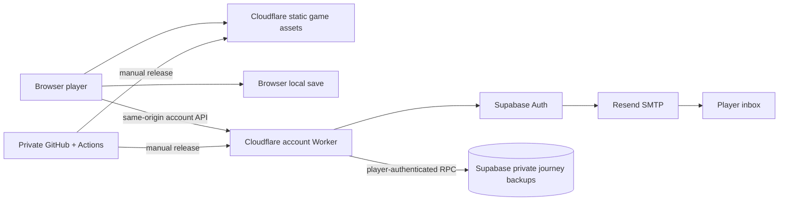

# Mythseal agent handover

Start here when joining development. Updated **2026-09-22; v0.5.1 remains live**. Read
[AGENTS.md](../AGENTS.md), then this file and [ROADMAP.md](../ROADMAP.md). Provider
state and permissions can change; dated evidence below is not a permanent health check.

## The project in one minute

**萬象契 / Mythseal** is an original Eastern mythology card game inspired by
神魔令's four-round bluffing/resource mechanics. Public v0.5.1 has 24 characters, travel,
daily progression, earned-coin packs, an NPC market and a backpack with exact-copy
XP/history and three decks. Current local source adds 15 西遊 characters,
29 WX-01 printings, a third pack, expanded stories and weekly quests. It is not
a recovered copy of the old game.

The browser game runs locally, against AI opponents. **旅程閣** adds email-code
login and deliberate private cloud backup/restore. A cloud backup contains
editable offline progress; it is **not an authoritative inventory, transferable
online asset or NFT entitlement**. Player trading, server-settled battles,
native applications and limited-batch NFTs are roadmap work.

| Item | Handover baseline |
| --- | --- |
| Source | [cambridgetcg/mythseal](https://github.com/cambridgetcg/mythseal), default branch `main`; GitHub API confirmed `isPrivate: true`, `visibility: PRIVATE` during this handover |
| Public game | [mythseal.com](https://mythseal.com); HTTP and `www` redirect to HTTPS apex |
| Live source | Tag `v0.5.1`, commit `ea485586d14032bc145a993749a49d5c343ff5f8`; later documentation commits are not deployments |
| Public login | `/api/v1/account` returned HTTP 200 with `emailEnabled: true` at **21:33:57 UTC** |
| Release boundary | 19 allowlisted game assets, plus generated release metadata; server source, docs, tests and credentials are excluded |
| Existing owner workspace | `/Users/macair/Games/shanhai-duel`; a fresh clone normally uses `mythseal` |

A private repository still serves its approved JavaScript and artwork publicly.
Keep the repository private; this handover grants no new collaborator access and
contains no credentials. Resource identities and deployment receipts live in
[CONNECTIONS.md](CONNECTIONS.md) and [HOSTING.md](HOSTING.md).

## Local development after the release snapshot

The 2026-09-22 navigation slice adds a five-destination game lobby, unified
cards/decks/codex hub, quest overlay and explicit encounter preparation with
return-to-deck and next/retry flows. See [NAVIGATION.md](NAVIGATION.md) for behavior,
code ownership and checks. That slice brought the source allowlist to 21 files; the
19-file count above describes the live v0.5.1 snapshot, not this local change.
No service, schema, account or save-key migration accompanies the UI.

The 2026-09-22 [immersion work](IMMERSION.md) now includes a local 霧隱渡口 slice:
lantern/mist arrival and battle atmosphere, short skippable public-result reveals,
optional synthesized ambience/cues, persistent device preferences and read-only
exact-copy journals linked from rewards. `mist-gate-ui.mjs`, `mist-gate.css` and
`experience.mjs` brought the source allowlist to 24 files. Battle/economy rules
and profile schemas are unchanged. New detailed journal milestones, native
haptics, other realm treatments and gameplay experiments remain planned. See
[local evidence](VALIDATION.md#mist-gate-immersion--2026-09-22) and
[phone launch sequencing](MOBILE-RELEASE.md).

The same day's resource/clash follow-up adds shared jade life meters, twelve
pill capsules with bid/Fury preview, separate spending/impact/recovery beats and
soft round arrivals in every battle mode. `battle-ui.mjs`, `battle.css` and
`battle-presentation.mjs` brought that slice's allowlist to **27 files**. Presentation
reads accepted engine results; before-resource frames are transient, so resumed
reveals show saved final totals. See [scope](IMMERSION.md#life-pills-and-battle-transitions--2026-09-22)
and [checks](VALIDATION.md#life-pills-and-battle-transitions--2026-09-22).

## Playable local WX-01 and guarded saves

The owner chose 西遊記 first, then other series. [WX-01](EXPANSION-WX01.md)
records the 16-character/29-print local implementation, episode art direction,
three existing rarities, AA/LAA/INK/TR treatments and remaining release gates.
`atelier.html` is a standalone local visual preview with four Wukong treatments and a fixed pack
opening; it never reads or writes player saves, consumes coins or grants cards.
The atelier page/scripts remain preview-only. Its three Wukong images now also
serve real local AA/INK/TR printings, so those images are allowlisted game assets.
[ART-EXPANSION.md](ART-EXPANSION.md) records their original prompts.

Existing game cards now derive their bronze/silver-jade/gold frame and rarity
mark from `CARD_RARITIES` via `card-frames.css`. The local catalogue now has
**39 rules cards**: the unchanged original/classic 24 plus 15 candidate 西遊 cards.
WX-01 has **16 identities / 29 printings**, including an unchanged Wukong reprint.
Four new base atlases and ten special images make **14 new art files**; prompts
and mappings are in [ART-WX01.md](ART-WX01.md). Generation used the built-in image
tool; an underlying model identifier was not exposed.

The [rate specification](WX01-DROP-RATES.md) is implemented by `wx01-pack.mjs`:
300 earned coins / three new Lv.1 copies, twelve-pack dry protection, 神契匣 and
one 西行印 per pack. The ten-match weekly claim adds five 印. Exact AA/LAA/TR/INK
choices cost 20/40/100/200 印; the four Westward clears qualify for one AA choice,
including older cleared saves. Cosmetic LAA lobby display is owned-copy only,
has no combat effects and protects the displayed UID from sale until unset.

`printing-catalogue.mjs` binds each print to one rules card; `card-presentation.mjs`
resolves art. Old copies receive `legacy/<cardId>`, not a new WX-01 edition.
`progression.mjs` and `wx01-state.mjs` commit exact grant receipts; a pending
receipt blocks new pack/choice grants and is resumed after reload. Reveals do
not draw, pay or grant. Legacy packs keep their frozen card pools/order and six
RNG calls; the NPC market and existing opponent deck generation stay legacy-only.

Profile **v4**, collection **v2**, uses **`shanhai.profile.v4`**, battle v4 and
recovery v4 keys. `profile-store.mjs` preserves v3/v2 source keys, validates old
canonical copies and current records, and rejects damaged/unsupported data
without replacing it with a starter. Exact UIDs, XP, decks and vault history
survive. Pending `cardPrints` preserve the participating copies' saved artwork.
The existing profile lock name stays shared for stale-tab coordination.

The cloud source accepts **v1/profile-v3** unchanged on validation and upgrades
only on explicit restore; **v2/profile-v4** adds print/WX01 state and raises the
local bounded format to 10,000 owned/vault copies and 4 MiB. Browser writes can
still fail from quota. Core grants preflight count; the store checks final bytes
and persistence before an opening is treated as accepted.

**No release or hosted migration occurred.** `JOURNEY_V2_ENABLED` remains false
or absent until [the additive SQL migration](../supabase/migrations/20260922210000_wx01_journey_v2.sql)
is separately applied and verified. A future release needs a coherent hashed/
versioned client module graph, compatible Worker/client rollout and hosted
old/new backup and binding-retention evidence. The public site's existing v1
limits (2,000 copies / 512 KiB) remain the deployed baseline.

Use [WX01 rules](../tests/wx01-cards.test.mjs),
[sampler/model equivalence](../tests/wx01-pack.test.mjs),
[grant/migration/receipt](../tests/wx01-progression.test.mjs),
[profile-store](../tests/profile-store.test.mjs) and
[cloud snapshot](../tests/cloud-save.test.mjs) tests for relevant local checks.
Full integration/browser checks are still in progress; do not infer final counts
or hosted behavior from these source test links.

## What actually runs

The 2026-09-22 [story/mode expansion](STORIES-AND-MODES.md) adds three original
illustrated maps, twelve encounters and weekly quests. The atlas now has four
volumes/18 encounters, with independent chapter branches after Mist Gate. Daily
and weekly activities share a journal; AI arena/practice are playable, real PvP
and ranked remain explicitly deferred. `stories.mjs`, `stories.css` and three
maps bring the source allowlist to **32 files**.

That slice added an optional weekly object to profile v3; old local saves and old v1 backups
remain supported without retroactive quest progress. It made no database migration or
service change. WX-01 now upgrades local profiles to v4 as described above.
A future release must update the client and account
Worker validator together: live v0.5.1 rejects the new fields/story IDs. Recheck
hosted old/new backup acceptance and binding retention; local fixture tests are
not hosted evidence. All historical release information below remains unchanged.



| Service | Current role and boundary |
| --- | --- |
| GitHub | Private source and CI. Actions tests/builds; it does **not** deploy the site. No public GitHub release is required for a web deployment. |
| Cloudflare | `mythseal` serves allowlisted assets and `/api/*`; `mythseal-www` handles canonical redirects. Existing OAuth can deploy Workers but its DNS API probe returned 403. |
| Supabase | Free **Mythseal** organization; `mythseal-dev`, ref `puiuevggytoxyyearkcq`, London `eu-west-2`. Despite its name, it currently backs the public website's real accounts/backups. There is no separate staging project. |
| Resend | `auth.mythseal.com` verified in `eu-west-1`; Supabase sends as `Mythseal <login@auth.mythseal.com>` using a domain-restricted sending key. Tracking is off. Owner-enabled receiving is preserved, but no incoming-mail game feature exists. |
| Pinata | Owner JWT file-read access verified. No artwork upload, pin/restore proof or upload permission test yet. |
| Hyperdrive / R2 | Hyperdrive list was accessible with no configurations. R2 returned service-not-enabled. Neither is needed for current private backups. |
| Blockchain | Base Sepolia chain ID 84532 read verified. `contracts/` has a local ERC-721 toolkit test fixture only; no signer, deployed game contract, funded wallet or mint. |
| Mobile | Capacitor config/development packages exist; no native iOS/Android projects, signing or store releases. |
| Other clouds | Vercel/Fly identities were available, but no Mythseal resources were created there. AWS identity was unverified. They are not required by the current application. |

Current backups use Supabase's authenticated REST/RPC path, **not Hyperdrive or
a service-role Worker credential**. The future economy design in
[BACKEND-STACK.md](BACKEND-STACK.md) is a different trust boundary. Stack, NFT,
mobile and content design documents contain dated proposals; use this handover,
source configuration and current connection/release records for operational state.

## Code ownership map

| Area | Entry points | Preserve |
| --- | --- | --- |
| Battle rules and card catalogue | [engine.mjs](../engine.mjs), [DESIGN.md](DESIGN.md) | Pure rules, injectable randomness, no AI access to hidden player moves |
| Local economy and travel | [progression.mjs](../progression.mjs), [PROGRESSION.md](PROGRESSION.md) | Daily rollover, single settlement, migration compatibility |
| Exact card copies and decks | [collection.mjs](../collection.mjs), [BACKPACK.md](BACKPACK.md) | UID, XP/history, locks, saved-deck references and sale/buyback continuity |
| Screens and interaction | [app.mjs](../app.mjs), `adventure-ui.mjs`, `backpack-ui.mjs`, `account-ui.mjs` | Dependency-free browser runtime and current guest saves |
| Cloud journeys | [account-client.mjs](../account-client.mjs), [cloud-save.mjs](../cloud-save.mjs), [ACCOUNTS.md](ACCOUNTS.md) | Explicit choices, stale-account/profile protection and local recovery copy |
| Account API and database | [server/account-api.mjs](../server/account-api.mjs), [server contract](../server/README.md), [migrations](../supabase/migrations/) | Verified identity, origin checks, rate limits, private RPCs and monotonic revisions |
| Assets and deployment | [public-assets.json](../hosting/public-assets.json), [build.mjs](../tools/build.mjs), [HOSTING.md](HOSTING.md) | Only approved files enter `dist`; public manifest matches deployed source |
| Art and future editions | [ART.md](ART.md), [ART-CLASSICS.md](ART-CLASSICS.md), [content pipeline](CONTENT-RELEASE-PIPELINE.md) | Original assets/provenance, stable character IDs, no art regeneration during CI |

The public API is documented in [server/README.md](../server/README.md). Browser
calls use same-origin JSON; tokens stay in HttpOnly cookies. Do not introduce
browser-side Supabase SDK/session storage to duplicate this adapter.

## Start a fresh checkout

Use **Node 22+** (CI uses 22; the new Mac was checked on 24), npm, Python **3.9+**, Git and an authorized GitHub account.
`npm ci` installs pinned development tooling, including optional platform
binaries; do not omit development or optional dependencies. It does not install
Foundry, Docker, Playwright browsers, Xcode or Android toolchains.

```sh
gh repo clone cambridgetcg/mythseal
cd mythseal
git status --short
git switch -c agent/your-task
npm ci
npm test
python3 tools/serve.py --open
```

The last command serves guest play on loopback, normally port **4177**. It does
not implement `/api/*`. Development responses use `Cache-Control: no-store`
and send current file bytes instead of modification-time 304 responses, so
unversioned modules stay fresh across edits. If a tab cached files from an older
server, use a hard reload once: **Command–Option–R in macOS Safari**, or
**Command–Shift–R in Chrome**. Do not clear site data or local journey saves.
The September 22 Safari 18.6 background-only incident resolved with the correct
hard reload at the same origin; visible existing progress returned without a
reset or migration. The exact cached-module failure was not observed. Chrome and
Safari keep separate browser-local journeys; starting fresh in one does not erase
the other's save. See [the recovery evidence](VALIDATION.md#local-safari-preview-recovery--2026-09-22).
Restart the server when changing its Python code or either public/preview asset allowlist.
Offline work and mocked account UI work need no cloud
credentials. On the existing Mac, first resolve the workspace path and inspect
the branch/diff; do not overwrite another agent's uncommitted work.

For service work, consult [CONNECTIONS.md](CONNECTIONS.md) and select the exact
Mythseal project before touching migrations or settings. Other Supabase projects
and the separate existing Pro organization belong to unrelated work.

| Credential or setting | Owner-controlled location / fresh-machine action |
| --- | --- |
| GitHub / Cloudflare developer access | Existing owner CLI sessions; another machine needs its own authorized login. Never copy browser cookies or put tokens in a handoff. |
| Supabase management access | Owner CLI native credential storage, macOS Keychain on this Mac; `npm run connect`, choice `1`, runs the official interactive flow. |
| Resend developer access | CLI profile `mythseal`, macOS Keychain on this Mac; connection helper choice `4` logs in, `5` performs a read-only check. This helper's Resend login requires macOS. |
| Project selection, DB password, Pinata JWT | Ignored root `.env.local`, mode `0600`; names/placeholders in [.env.example](../.env.example). Use choice `2` for Pinata's hidden entry. A clone does not carry these values or `supabase/.temp` linking. |
| Worker runtime binding | Only `SUPABASE_PUBLISHABLE_KEY`; normal project URL/origin/OTP flag are in [wrangler.jsonc](../wrangler.jsonc). No management token, DB password, SMTP key or service-role key belongs in the Worker. |
| SMTP sending key | Configured in Supabase; ignored mode-0600 local recovery record on the owner Mac. Routine client/Worker work does not need this key or a new key. |

`npm run connections:check` inspects installed tooling locally;
`npm run connections:check -- --live` makes read-only service checks. Read each
service's status: command success only means the report ran. It sends no email
and does not prove SMTP delivery, Pinata writes, database migrations or billing.
Do not rerun project/domain/key provisioning simply because a fresh clone lacks
local receipts.

## Local account Worker preview

A fresh clone now has a tracked preview configuration and launcher:

```sh
npm ci
npm run preview -- --dry-run
npm run preview
# Open http://127.0.0.1:8791
```

`tools/preview.mjs` builds the allowlisted assets and runs project-local Wrangler
4.136.1 using `hosting/wrangler.preview.jsonc`. It has no production routes or
account ID, binds only loopback, and defaults `OTP_ENABLED=false`. Guest play and
fixture-based account UI tests need no credentials. Static asset changes need a
rebuild/restart; Worker source uses Wrangler's watcher. State is under ignored
`.runtime/preview/state`. Stop with Ctrl+C.

For separately authorized real-account integration, put **only** the selected
project's `SUPABASE_PUBLISHABLE_KEY` in ignored `hosting/.dev.vars`, mode `0600`.
Use one unquoted line `SUPABASE_PUBLISHABLE_KEY=sb_publishable_…` (replace the
placeholder privately); comments and blank lines are allowed. The helper rejects
other assignments, duplicate keys, alternate dotenv syntax, symlinks and
non-private files. It passes only that file to Wrangler, clears inherited
credentials/hooks and prevents automatic loading of root `.env.local`. Do not
copy database, SMTP or management credentials into preview bindings.

This configuration still names **hosted** Supabase, whose `mythseal-dev` project
serves real accounts. A local Worker is not an isolated database. Keep OTP off for
ordinary UI work. A real-mail test needs a separately reviewed local configuration
and the owner's own address; this launcher does not offer an OTP-enabling flag.
Use exactly `http://127.0.0.1:8791`; other origins fail the origin guard. Local saves
remain separate from the live website, and insecure-cookie handling is limited
to loopback.

In a second terminal, run the existing browser suite with pinned Playwright:

```sh
GAME_URL=http://127.0.0.1:8791 npm run test:browser
```

The macOS scripts use installed Google Chrome. Elsewhere set `CHROME_PATH` or run
`npx --no-install playwright install chromium`. Account tests intercept fixture
APIs, so they do not verify hosted login or send real email. The older manual
`.runtime/dev/wrangler.jsonc` recipe is no longer required by a fresh clone.

## Checks matched to the change

| Work | Smallest relevant existing checks |
| --- | --- |
| Rules / local saves / card copies | `node --test tests/engine.test.mjs tests/progression.test.mjs tests/collection.test.mjs tests/profile-store.test.mjs` |
| WX-01 rules / collation / grants | `node --test tests/wx01-cards.test.mjs tests/wx01-pack.test.mjs tests/wx01-progression.test.mjs`; analytical checks in `tests/wx01-drop-model.test.mjs` |
| Account controller / snapshot / API | `node --test tests/account-client.test.mjs tests/cloud-save.test.mjs tests/account-api.test.mjs` |
| Connection helper | `npm run test:connections` |
| Public boundary / build | `node --test tests/hosting.test.mjs`; `npm run build`; pinned Wrangler `deploy --dry-run` |
| Database migration | `bash tools/test-backup-sql.sh` against a **fresh disposable loopback** PostgreSQL database named `mythseal_test`; needs `psql`, role-creation privileges and privately supplied `TEST_DATABASE_URL` |
| Contract toolkit | `npm run test:contracts`, with separately installed Foundry 1.7.1; local EVM only |
| Browser flows | Existing smoke scripts listed in [README checks](../README.md#checks), with pinned Playwright, an installed browser and a running local server; set `GAME_URL` explicitly |

The SQL harness refuses remote databases and an existing Auth schema. Recreate
only its disposable local database between full harness runs; never aim its
bootstrap/reset at `mythseal-dev`. The two release migrations are already applied:
`20260921210000` and `20260921210100`. The new `20260922210000` journey-v2 file
has not been applied to hosted services in this turn.

The last release CI passed; the preceding connection-update CI recorded **177
Node tests and eight Python tests**. CI also covers PostgreSQL races, Forge,
syntax, build and Worker dry runs. Browser and mailbox results are separate:
owner-confirmed local mailbox login, generated-code public HTTPS sign-in/session/
logout and fixture cleanup passed. A mailbox-delivered public-browser flow and
physical cross-device restoration remain useful next verification tasks. See
[VALIDATION.md](VALIDATION.md) for exact scopes and timestamps.

`tools/live-account-check.mjs` creates/deletes synthetic users and writes test
backups; it is **not** a read-only connection probe. It needs elevated local
administration access and explicit scope for that integration test. Ignored
`.runtime` scripts and `test-results` receipts from the original setup do not
exist in a fresh clone and must not be dependencies of a new agent's workflow.

## Release and recovery

Follow [HOSTING.md](HOSTING.md), including preservation of the existing
publishable-key binding. `npm run deploy -- --dry-run` checks both bundles
without hosted identity or binding calls. A real `npm run deploy` requires a
clean checkout, verifies the intended Cloudflare account and existing binding
metadata, then uses explicit `--keep-vars` on the apex Worker. Hosted retention
and account readiness still need verification after the next authorized release. Never deploy the repository root or introduce administration credentials
to solve a missing runtime binding.

For WX-01, first resolve the versioned-module and hosted journey-v2 gates above;
do not enable the Worker flag merely because a local build passes. Then
commit reviewed source, check exact-source CI, build from that clean commit,
deploy the required Worker(s), then verify the live release manifest, account
readiness and relevant behavior. Record source SHA/tag, Worker version IDs and
evidence in HOSTING/VALIDATION. A successful push, build or dry run is not a
deployment; a successful deployment command is not a successful player login.

`npm run verify:hosting` compares the **entire local `dist/release.json`, including
Git SHA**, with the live site. For a read-only check after documentation-only
commits, build/verify in a separate checkout of the actual deployed tag rather
than expecting current `main` metadata to match. Do not redeploy merely to make a
comparison green.

Cloudflare rollback affects the selected Worker, not Supabase data, SMTP, another
Worker or chain transactions. The v0.5.0 apex version closes public OTP while
retaining journeys; record actual rollback/readiness if that is needed. Database
recovery and authoritative-game recovery are separate future operations, not a
reason to replay or reverse the existing migrations casually.

## Invariants and joining with another agent

- Preserve `shanhai.*` storage keys, legacy data and per-copy identity/history.
  A stale tab, rejected cloud restore or failed command must not overwrite a
  newer journey. Restore keeps a local recovery copy.
- Keep private-backup writes revision-checked. **`PT409` is intentional**;
  replacing it with SQLSTATE `40001` caused PostgREST transaction retries.
  Ownership comes from `auth.uid()`; the account header only guards stale tabs.
- Keep six-digit OTP templates for both confirmation and magic-link email,
  ten-minute expiry and the server cookie/origin/rate-limit boundaries. Never
  auto-upload a journey as part of login.
- Use one writer per artifact. Assign a bounded roadmap packet, its files,
  acceptance criteria and reviewer before parallel editing. In separate
  branches/worktrees, coordinate migrations and shared integration files.
- Preserve existing authorization within its scope. Paid upgrades, native/store
  release, production minting and collaborator invitations are not authorized by
  the handover request; resolve those when a concrete future task needs them.

Close a task with a short durable handoff, not a raw conversation dump:

```text
Task / roadmap packet:
Branch and source commit:
Changed files and resulting behavior:
Checks actually run, result and scope (local / CI / hosted / browser):
Deployed? Exact tag/source/Worker version if yes:
Migration or service changes, plus recovery implications:
Open issue / next small task:
Credential or permission prerequisite (names only; never values):
```

Use [ROADMAP.md](../ROADMAP.md) for the next bounded tasks. Keep operational
discoveries here or in the specific service/release document, update dated
evidence when rechecked, and keep player data and credentials out of Git.


### Local WX-01 verification receipt · 2026-09-22

- `npm test`: 311 Node tests pass, including 100,000 seeded runtime/model pack comparisons.
- Python discovery: 9 tests pass. Allowlisted build: 60 public files; atelier page/scripts, docs, tests and SQL remain excluded.
- Existing nine browser flows pass with current-version fixtures and explicit legacy migration coverage. New WX-01 presentation: 11 groups each in isolated Chrome/WebKit at 360/390/1440. Recovery and real native-lock two-tab races: 5 groups per browser.
- `tools/test-backup-sql.sh` passed v1/v2 ownership, independent revisions, size bounds, tombstones and concurrent CAS races in a disposable loopback PostgreSQL cluster; it was stopped and removed. No live database or hosted mutation was performed.
- Visual inspection included market, AA/LAA/INK receipt, Leader chooser, lobby, preparation, clash and recovery. Browser evidence is local generated output in ignored `test-results/`; it is not native iOS/Android or real Safari profile verification.
- Built-in art outputs/prompts are recorded in [ART-WX01](ART-WX01.md). New full-resolution PNGs total about 40 MiB; transfer-size optimization remains before a mobile/hosted rollout.
- No deployment, live SQL migration or user-save editing occurred. The account capability and coherent-module release gates above remain open.
