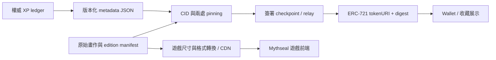

# Mythseal · NFT、錢包與檔案保存方案

研究日期：**2026-09-21**。本文所有外部連結均為當日查閱的官方文件。狀態：**建議先以 Base Sepolia 驗證；尚未選定正式鏈，沒有合約地址、NFT 發行、錢包設定或部署。**

推薦組合是 **Base Sepolia + Solidity／OpenZeppelin ERC-721 + viem + 後端權威 XP + 有版本的 IPFS metadata**。Polygon Amoy 是保留 ERC-721 與 TypeScript 整合的備選。IPFS 保存已封存內容，CDN 服務遊戲畫面，資料庫管理即時對局；三者各自有清楚職責。這是 [區塊鏈設計原則](BLOCKCHAIN-DESIGN.md) 的具體技術候選，不取代其中的限量、身份與審核條件。

## 為何先選 Base，而不是一次支援四條鏈

現有卡牌已經有逐張身份、自己的 XP，以及同名副本不可混用的要求。ERC-721 能沿用這個模型；Base 官方提供標準 EVM 介面，因此我們可集中驗證 cap、持有權與成長，而不用同時重寫 token 模型與客戶端工具。[Base 網路資料](https://docs.base.org/get-started/connect-to-base)

| 候選 | 與 Mythseal 的適配 | 需要接受或驗證的代價 | 本次判斷 |
| --- | --- | --- | --- |
| **Base** | 沿用 Solidity、ERC-721、OpenZeppelin、viem；可把外接錢包與 passkey smart account 做成不同 adapter | L2 inclusion、L1 batch 與 finality 是不同狀態；RPC、錢包與代付仍要實測 | 先用 Sepolia 完成單鏈驗證；沒有聲稱一定最便宜或最好用 |
| **Polygon PoS／Polygon Chain** | 同樣 EVM；可重用合約規格與大部分 viem 呼叫 | Heimdall／Bor 的共識、milestone 與 Ethereum checkpoint 有自身語意，不能照搬 Base 的確認規則 | 首選備案：在 Amoy 重跑相同驗收資料，達標才比較正式發行 |
| **Solana** | 原生 NFT 可表達逐張身份；Token Extensions 有動態 metadata，Metaplex Core 也有獨立 asset 模型 | 不直接使用 ERC-721／Solidity；要重做 program、錢包簽名、索引與審核範圍 | 只有目標玩家／合作需求證明值得承擔這項轉換時，才開獨立 spike |
| **Immutable Chain** | EVM；Passport、資產工具、索引與交易相關產品較集中 | 官方要求 ERC-721／1155 collections 實作 Operator Allowlist；需評估受支援 operator、smart wallet、平台設定與退出方案 | 有明確遊戲平台合作需要時再評估，初版避免把發行核心綁到整套服務 |

Polygon 官方把 EVM 執行與 PoS 共識分開，並區分快速 milestone finality 和提交 Ethereum 的 checkpoint；它不是把 Base RPC URL 換掉就有完全相同的安全模型。[Polygon 架構與 finality](https://docs.polygon.technology/pos/overview)

Solana 官方展示以 Token Extensions 保存 NFT 等級等資料；Metaplex Core 則用單一 asset account 表達 owner、URI 與 update authority。這兩條都是可行研究方向，但不是 ERC-721 原封不動搬過去。[Solana 動態 NFT metadata](https://solana.com/docs/tokens/extensions/dynamic-metadata-nft)、[Metaplex Core asset](https://developers.metaplex.com/core/what-is-an-asset)

Immutable 目前文件列出 EVM、Passport gas sponsorship 與網路設定；另一份官方文件明列 Operator Allowlist 的要求及對未支援合約 operator 的限制。這是選型時實際的互通性取捨，不能只看「game chain」名稱。[Immutable Chain](https://docs.immutable.com/docs/products/immutable-chain/overview)、[Operator Allowlist](https://docs.immutable.com/docs/products/asset-contracts/operator-allowlist)

首輪只維護一個 canonical 發行網路。改試另一條 testnet 不搬運、兌換或複製原本測試卡；正式發行後換鏈則是另一個需審核的遷移專案，不能藉「相容」繞過供應上限。

## 已核對的網路設定

| 網路 | 測試環境 | 正式環境 | 原生 gas 資產 | 官方資料 |
| --- | --- | --- | --- | --- |
| Base | Base Sepolia：`84532`；`https://sepolia.base.org` | Base：`8453`；`https://mainnet.base.org` | ETH／測試 ETH | [Base 設定](https://docs.base.org/get-started/connect-to-base) |
| Polygon | Amoy：`80002`；現行文件列 `https://polygon-amoy.drpc.org` | Polygon：`137`；`https://polygon.drpc.org` | POL／測試 POL | [Polygon RPC 參考](https://docs.polygon.technology/pos/reference/rpc-endpoints) |
| Immutable | Immutable zkEVM Testnet：`13473`；`https://rpc.testnet.immutable.com` | Immutable zkEVM：`13371`；`https://rpc.immutable.com` | tIMX／IMX | [Immutable 設定](https://docs.immutable.com/docs/products/immutable-chain/overview) |
| Solana | Devnet：`https://api.devnet.solana.com` | Mainnet Beta：`https://api.mainnet-beta.solana.com` | 測試 SOL／SOL | [Solana clusters](https://solana.com/docs/references/clusters) |

Solana 不套用表中 EVM 的數字 chain ID；候選 adapter 要以 cluster 與 genesis identity 辨認環境。public RPC 是起步參考，不是正式服務 SLA；上線前至少選兩個獨立供應來源，啟動時核對網路身份，錯網立即停寫。文件中的 endpoint 需於實作時再核對，不能沿用舊教學的 Mumbai 或舊 token 符號。

Mythseal 自有合約地址目前一律 **未部署／TBD**，不填示例地址冒充正式合約。每次未來 release manifest 才記錄真正的 `chainId`、地址、部署交易、起始區塊、bytecode hash、ABI hash、編譯器與依賴版本；client 只讀已核准 manifest，不讓 query string 或任意 wallet 回傳值改掉合約地址。

## 合約 release、畫作 edition、規則版本分開

| 名稱 | 例子只作命名示意 | 何時改變 |
| --- | --- | --- |
| `contractReleaseId` | `cards-v1` | 合約程式或封存發行範圍要改時另建版本；不代理升級舊 cap |
| `artEditionId` | `wukong-first-art` | 另一張畫作／明確的新批次；人物仍可相同，但版別、CID 與 cap 各自公開 |
| `templateId` | `wukong` | 表示人物身份；兩個 art edition 不因此成為兩個不同戰鬥角色 |
| `rulesVersion` | 版本化規則 hash | 遊戲平衡 patch；不改持有權、edition 身份或加印卡牌 |
| `checkpointSequence` | 單張卡的遞增整數 | 新的已驗證 XP／歷練 snapshot 發佈 |

首個 `MythsealCardsV1` 候選在 constructor 封存有限 edition 清單、每批 cap、template 綁定、edition manifest hash；未列入的後續批次需要明示的新 release 決策，不保留無上限「稍後加批次」入口。所有團隊、活動、補償與 treasury 卡都算在其 cap 內。正式數量仍是待決參數。

新增網站插圖、遊戲 CDN 壓縮尺寸或修正介面，不需要 NFT 合約發版。已鑄 NFT 的原版畫作 CID 不因網站換圖而改；真正換 NFT 畫作須成為明示的新 edition，不能在 XP 更新中偷換。若只限制單批而容許未來另發同人物版別，必須如此表述，不能宣稱該人物永久只有這些張。

### 最小合約候選，尚未實作

採 Solidity + 固定版本的 OpenZeppelin ERC-721、ERC-165、metadata 管理與權限元件；需要的 ERC-4906 事件一併實作。library 審核不等於自訂發行與 checkpoint 程式已審核。[OpenZeppelin Contracts](https://docs.openzeppelin.com/contracts/5.x)、[ERC721URIStorage](https://docs.openzeppelin.com/contracts/5.x/api/token/erc721#ERC721URIStorage)

`MythsealCardsV1` 保持一個最小、非代理核心，建議介面責任如下，名稱未定稿：

- `edition(editionId)`：讀固定 template、cap 與 manifest hash；`mintedEver(editionId)` 只增不減。
- `mintWithAuthorization(claim, signature)`：驗證一次性 claim、環境、收件人、期限及剩餘 cap；所有發行路徑集中到同一檢查。安全接收 callback 前完成狀態更新，失敗整筆回滾。
- `tokenEdition(tokenId)`：鑄造後固定；`ownerOf(tokenId)` 保持標準 ERC-721 持有權語意。
- `publishCheckpoint(tokenId, checkpoint, signature)`：只能接受有效 publisher 簽名、正確前一摘要及遞增 sequence；更新 URI／digest，發出 checkpoint 與 ERC-4906 事件。
- `tokenURI(tokenId)`：回傳最新已公布 snapshot 的 `ipfs://…/metadata.json`；固定 art edition manifest 可另行查讀。

發行權與 metadata 簽署權分離。初版不提供任意管理員 transfer、增 cap、重設 minted counter、舊 token ID 重用、橋接或自訂交易所。普通 ERC-721 持有人轉移保留標準行為；遊戲內鎖定只是 UI 保護。若需要應急停發，可只暫停 mint／checkpoint 寫入，任何對既有持有人轉移的限制必須另有公開理由與審核。

使用 `mintedEver` 而非仍存在的 `totalSupply` 執行 cap。即使日後支援 burn，也不回補額度；出售／回購只轉移同一枚，不能 burn-and-remint。NFT 數量與遊戲內非 tokenized 卡牌數量是兩個明確的 ledger。

## Wallet、SIWE 與 viem 接線

遊戲帳號先能獨立登入與遊玩，wallet 是可選的收藏入口。選型把 `AccountAuth`、`WalletConnector`、`ChainReader`、`TransactionSender` 分開；遊戲與 NFT identity 不使用供應商內部 user ID 作唯一外部鍵。

| 候選 | 首輪驗證內容 | 是否強制 |
| --- | --- | --- |
| 外接 EVM wallet | 連接、SIWE、收取安全轉移、wallet 斷線／換鏈、離開遊戲仍可操作資產 | 作基本互通測試；不要求每位玩家安裝 |
| passkey smart account | iOS Safari／Android Chrome、跨裝置、遺失裝置恢復、ERC-1271／未部署帳號驗證、資產轉出 | onboarding 候選，須通過恢復與退出測試才採用 |
| Coinbase 的 account SDK | 以目前官方支援版本作上述 smart-account spike | 可選 adapter；不用它來綁定所有遊戲登入 |
| Immutable Passport | 僅在 Immutable spike 中驗證其登入、錢包與平台流程 | 不放進 Base 初版的必須依賴 |

目前 Base 官方已把相關 wallet 文件移交 Coinbase Developer Platform；新頁面稱 Coinbase Wallet SDK，但說明當下仍推薦 `@base-org/account`。實作前核對套件版本與遷移狀態，不從舊 blog 複製 API。[Base 文件遷移說明](https://docs.base.org/sdks/migrated-products)、[Coinbase Wallet SDK 現行說明](https://docs.cdp.coinbase.com/coinbase-wallet/overview)

EVM adapter 建議採 viem：伺服器使用 `createPublicClient` 讀合約、模擬、驗簽與拉 logs；用戶端的 write 經使用者 wallet provider。後端 mint／checkpoint 簽署放在獨立受控 signer，不能把私鑰、pinning token 或 RPC 管理憑證打包進 browser。正式依賴固定 lockfile，按 release 測試 ABI 與 chain config；這次不安裝套件。

SIWE 驗證必須匹配伺服器生成並保存的 nonce、預期 origin/domain、URI、chain ID、有效時間及本次 linking intent，成功後原子消耗 nonce。production、preview、localhost 使用不同的准許 origin；不能直接信任任意 request Host。簽名證明 wallet 控制權，不直接證明還持有哪張卡，持有權仍查鏈。[ERC-4361](https://eips.ethereum.org/EIPS/eip-4361)、[viem verifySiweMessage](https://viem.sh/docs/siwe/actions/verifySiweMessage)

支援 smart account 時用 viem public-client 的驗簽 action；單純 utility 的 EOA 驗簽並不涵蓋合約帳號。測試已部署 ERC-1271 帳號及供應商實際使用的未部署帳號驗證路徑。[viem public verifyTypedData](https://viem.sh/docs/actions/public/verifyTypedData)

如日後採 ERC-4337 代付，paymaster 僅批准指定合約／方法與每帳號預算；wallet 恢復與 passkey 仍依賴所選實作。遊戲 session key 不獲任意 NFT transfer 或全 collection operator approval。沒有任何自動 gas 代付或無助記詞方案因此變成免費、無託管差異或無恢復風險。[ERC-4337](https://ercs.ethereum.org/ERCS/erc-4337)

## 索引與 reorg：即時提示和正式持有分開

後端 key 固定為 `(chainId, contractAddress, tokenId)`，再連到不變的 `assetId`；token ID 以大整數／十進位字串保存，不用 JavaScript 浮點數。此處 NFT 的 `assetId` 指 [後端方案](BACKEND-STACK.md) 中的 collectible identity，不強制與普通 `game_card_instances` 共用 ID 或權益。local `card-000001` 永不作 mint claim。每張收藏卡的 XP ledger 與 token 身份保持連結，轉手只換持有人，不複製／歸零歷練。

Base 官方列出 Flashblock、L2 block、L1 batch、L1 batch finality 四個階段，當日文件的參考時間約為 200 ms、2 秒、2 分鐘與 20 分鐘；它們是不同保障，不是同一種「完成」。7 天等待是往 Ethereum 的提領流程，並非每次 Base 內 NFT 轉移。[Base finality](https://docs.base.org/specifications/transactions/transaction-finality)

首輪採保守模型：新交易可立即顯示 `submitted / observed`，等 RPC 的 `finalized` 區塊涵蓋交易後，才成為可作權益依據的持有紀錄。先測清楚這段等待是否符合產品要求，再決定是否接受 `safe` 狀態的可撤回體驗；不能單靠固定等待兩秒或一個 receipt 就當作 finalized。RPC 不支援所需 tag 或回傳互相矛盾時，保留 pending，不降級假裝完成。

索引 worker 從 release 的 deployment block 逐段 `getLogs`，保存區塊 number／hash／parentHash、transactionHash、logIndex、ABI version 與處理狀態。事件唯一鍵含 chain、blockHash、transactionHash、logIndex；用資料庫交易更新 ownership projection 及 checkpoint。WebSocket 或 `watchContractEvent` 只用來喚醒同步，不能取代可重播的區塊掃描；viem watch 本身也可能使用 filter 或退回 getLogs。[viem watchContractEvent](https://viem.sh/docs/contract/watchContractEvent)

provisional projection 與 finalized projection 分開。重組時找共同祖先，撤回未 finalized 衍生紀錄，再重播；已 finalized 區塊若出現衝突，暫停權益結算並報告異常，不能靜默覆寫。RPC 切換、logs 重送、程序重啟及通知遺失，都要產生相同結果。每日從區塊紀錄與 `ownerOf` 抽查對帳，歷史可由 deployment block 重建。

對允許 NFT 戰卡的平台，開始與結算時核對精確 token／asset、owner 及所用區塊；所有權轉出令舊帳號無法再開新局，尚未結算的對局按既定規則處理。新持有人讀到同一份已完成的 XP 歷史。index lag 與 ownership dispute 不能靠複製卡牌解決。手機版則保持其獨立的非 NFT gameplay entitlement。

## XP checkpoint 與 dynamic metadata

即時 XP、勝局、對局證據存在權威後端，事件以 `matchId + assetId + rewardType` 保證單次結算。鏈上只公開已封存 checkpoint，避免每一局都產生交易。prototype 的 XP 門檻可繼續版本化使用，但客戶端匯出存檔不是可信 XP 證據。

建議先試「達到新等級或有更動的卡每日一次」的 checkpoint 排程，並測試手動刷新與合併批次的成本。這是待量測排程，不是已承諾的更新 SLA。介面顯示 `即時 XP`、`已公布 XP`、`asOf` 與同步狀態；市集可能仍有自己的 cache。

一次發佈候選流程：

1. 在短資料庫交易內鎖住該 token 的發佈列，取得 XP、level、rules hash、前一 checkpoint digest，分配唯一的下一 sequence 與 outbox 工作；按後端事件重算驗證。同一卡只保留一個待發候選，worker 用有期限的 lease 接手。交易提交後才進行 pinning／RPC 等網路操作，不長時間持有資料庫鎖。
2. 產生確定編碼的 metadata JSON，包含固定 `editionManifest`／`image` IPFS URI、XP／level、sequence、asOf；驗證固定欄位沒有漂移。
3. 先把這份 **不含自己的 CID 或簽名** 的 JSON 固定為 bytes，取得 CID，讓兩個 pinning 節點完成 pin／可讀驗證。
4. 簽署 EIP-712 attestation：domain 含 chain ID 與 NFT 合約；message 含 token ID、edition hash、sequence、previousDigest、metadataURIHash、XP、level、rules hash、issuedAt、expiry。`metadataURIHash = keccak256(bytes(newTokenURI))`，精確綁定完整 canonical IPFS URI。簽名放獨立 sidecar／交易 calldata，避免 JSON 包含自己的 CID 而形成循環。
5. relay `publishCheckpoint`；合約核對被批准的 signer、期限、前版、`sequence == currentSequence + 1`、edition hash 等於該 token 的固定 edition，以及實際新 URI 的 hash 等於被簽署值，防止 relay 偷換 URI。原子更新 URI／digest／sequence，發出 `CheckpointPublished` 與 `MetadataUpdate`。重送相同請求不重寫；較舊 sequence 不可回蓋。
6. 等交易達到約定確認狀態，才標記為已公布。relay 逾時或失去回覆時先查鏈上 sequence／digest 及原交易，不能直接分配另一候選重送。保留舊 CID、簽名、signer key epoch 與原因，支援匯出及重算。

EIP-712 定義結構化資料雜湊與簽署，但沒有替應用自動完成 replay protection，故上述 domain、sequence、previousDigest 與期限必須自己設計。[EIP-712](https://eips.ethereum.org/EIPS/eip-712)

ERC-4906 的事件讓外部索引者知道 metadata 要重讀；它不驗證 XP，也不保證立即更新。token URI 改成新 CID 後發出對應通知；若批次 token ID 不連續，就逐張事件或分成真正連續的範圍，不以任意最低／最高 ID 冒充精確變動集。[ERC-4906](https://eips.ethereum.org/EIPS/eip-4906)

publisher 權限不能 mint 或改 edition cap。合約能鎖住 edition 映射與 checkpoint 摘要，但不會理解任意 JSON 的圖片內容；因此 metadata pipeline 的固定欄位核對、簽署權限與公開 diff 仍是信任邊界。合法簽名只能證明指定 issuer 曾作此聲明，不證明一場被後端偽造的戰鬥是真的。作弊補正也要出新版本與理由，不刪歷史。

## IPFS 的位置：保存內容，CDN 負責遊戲載入

NFT 內採 `ipfs://<CID>/...` 作 canonical URI，優先 CIDv1／base32；不要把某一家 gateway 的 HTTPS 網址封進 edition 作唯一識別。UI 需要時再轉成可用 gateway URL。圖片與 metadata 分別有自己的 CID；改 bytes 就是新內容，而不是在舊 CID 下面覆蓋。[IPFS NFT 資料建議](https://docs.ipfs.tech/how-to/best-practices-for-nft-data/)

發行畫作先從遊戲 atlas 製作獨立、經確認的卡面成品與來源 manifest，再封存 CID；不要讓持有人只得到需依賴未來 CSS crop 規則的 atlas。已封存版本持續可取；遊戲可另用 AVIF／WebP、sprite、縮圖、lazy loading 和 CDN cache，這些展示衍生檔不偷偷取代 NFT 原版。

IPFS content addressing 可以驗證內容，**不會自行支付保存成本或保證永遠可讀**。pin 防止節點把檔案當 cache 清除；若所有保存者停止提供，CID 仍存在也取不到檔案。[IPFS persistence](https://docs.ipfs.tech/concepts/persistence/)

本專案候選保存策略：兩個獨立 pinning failure domains，加一份可離線還原的 CAR／原始檔備份；記錄 recursive pin 狀態、CID、大小、內容類型、來源與最後成功抓取時間。Pinata／Filebase 可列入採購比較，亦可用獨立 Kubo 節點；此刻不選購服務或建立帳號。IPFS 官方提供 vendor-neutral pinning API 方向，亦建議多節點備援。[IPFS pinning service](https://docs.ipfs.tech/how-to/work-with-pinning-services/)、[gateway 最佳實踐](https://docs.ipfs.tech/how-to/gateway-best-practices/)

先確認至少兩處完整 pin，再 mint／更新 URI；只「以 CID 要求 pin」但沒有人可提供全部 blocks，不能當作成功。每週以非主要 gateway 抓取抽樣、每月完整可還原演練；預算包含舊 checkpoint 的保存，不能更新後就 unpin 全部歷史。gateway／CDN 故障時切換供應點，URI 與內容身份保持不變。

IPFS 只放可公開的畫作、edition 資料與已決定公開的成長摘要；帳號 email、session、私鑰、完整玩家 save、未公開對局與客服紀錄不放上去。game bundle／登入 API 用一般 HTTPS hosting 與後端，IPFS 不代替資料庫、登入或 multiplayer server。

## 選型與發行的可量測門檻

以下是 **建議驗收目標，全部尚未量測**。在實作 spike 前可按預算修訂，但不能在結果不佳後偷偷改成已達標。

| 範圍 | 首輪驗收與記錄 | 失敗時的處理 |
| --- | --- | --- |
| Wallet | 至少 10 位測試者，iOS Safari／Android Chrome／桌面各覆蓋；至少 90% 在無人工代操作下完成登入與測試卡展示；各平台完成裝置遺失／恢復與轉出演練 | 先換 adapter 或簡化 wallet 入口，普通遊戲保持可玩 |
| Mint／cap | 1、10、25 張批次邊界、全部配額路徑、重入／重播／過期／失敗回滾；不變量 fuzz 至少 10,000 組，cap 超發及重用 ID 為 0 | 停止進入發行階段；修正並重新獨立審查 |
| 索引 | 至少 1,000 個測試轉移／checkpoint 事件；模擬重複、漏通知、亂序、10 區塊 reorg、兩次 worker 重啟；從部署區塊重建結果完全相同 | 修正 projection／重播流程；不以多等幾秒掩蓋問題 |
| 時間 | 分開量測 submission→receipt、safe、finalized 的 p50／p95；初定 receipt p95 ≤10 秒、finalized p95 ≤30 分鐘，正常網路下連測 7 天 | 若產品不能接受 Base finalized 等待，以相同流程測 Polygon Amoy；不把 receipt 假稱 finality |
| 成本 | 記錄每 mint、transfer、單卡／25 卡 checkpoint 的 gas、L1 額外費用、RPC、pinning、代付與每日更新量；用當時主網唯讀估算與 3 倍費率壓力情境對照已批准月預算 | 先降 checkpoint 頻率、合批或換 RPC；仍不符合預算才比較備案 |
| 內容 | 每個待發 edition／checkpoint 的 CID 均能由兩處取回並驗證；切斷主要 pinning／gateway 後仍可還原全部發行檔案 | 不 mint；修復備份與供應鏈 |
| 遊戲體驗 | 手機指定網路條件下，CDN 卡面可用 p95 ≤2 秒；IPFS 暫停不阻塞普通對局 | 調整圖像管線／cache，避免把遊戲渲染綁住 pinning |

testnet gas token 沒有正式報價意義，測試網的流量也不能證明正式鏈一定達到相同效能。Base 費用須計入 L2 執行與 L1 資料相關部分，不能只拿 `gasUsed × 某個低 gas price` 宣稱總費用。當日官方列出 GasPriceOracle 系統合約 `0x420000000000000000000000000000000000000F` 可估 L1 費用；它不是 Mythseal 的合約地址。[Base network fees](https://docs.base.org/specifications/transactions/network-fees)

Base 未達產品需求時，先在 Polygon Amoy 跑同一套功能、不變量、錢包與成本資料。若兩個 EVM 候選均不適合，再評估 Immutable 的整合流程是否值得接受其平台條件，或 Solana 的重新實作成本；不以未經測量的 TPS 宣傳決定。

正式發行仍要經過獨立安全審核、修正複核、供應 manifest／角色權限封存、部署演練、備份還原、預算及正式發行決策。原型前端放上網，不表示 NFT stack 已上線。

## 手機政策與本次工作範圍

沿用 [手機發佈研究](MOBILE-RELEASE.md)：iOS／Android 的玩法、XP、角色、造型與功能權益，不預設由 NFT 持有解鎖。NFT provenance／gallery 也是待審候選；web 的 token 轉手與可玩權益是否相連，要另定產品範圍，不能經共用帳號意外滲入手機版。

付費／有價值隨機 NFT 卡包、可兌換 NFT 的金幣、原型 save 兌換鑄造與現金回購，都不包含在這套技術建議的放行範圍。第一個 testnet 示例應是指定內容、無正式兌換承諾的測試卡。本文只新增設計文件，沒有安裝 runtime 依賴、連錢包、取得 token、上傳 IPFS、mint 或部署合約。
