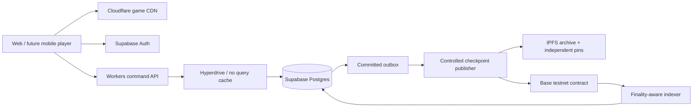

# Mythseal technical plan

Decision record: **2026-09-21 · 萬象契 / Mythseal · v0.4.1**. The owner acquired `mythseal.com`; the source repository is [private cambridgetcg/mythseal](https://github.com/cambridgetcg/mythseal). This is the entry point for the researched stack and implementation sequence.

## What is shipping now

The existing browser game is rebranded Mythseal, packaged into an explicit public-file allowlist and deployed on Cloudflare Workers Static Assets at `https://mythseal.com`. A separate small Worker redirects `www` and HTTP apex requests to the same HTTPS origin. See [HOSTING.md](HOSTING.md) for deployment evidence, the recorded DNS propagation caveat, commands and rollback.

The game still uses local saves and AI opponents. Daily activities, the backpack, per-copy XP and the NPC market are playable; online accounts, player trading, on-chain ownership and native apps are not implemented. Existing `shanhai.*` storage namespaces are deliberately retained. A new website origin has its own browser storage; localhost progress does not automatically move with the repo rename.

## Selected direction

| Layer | Choice | Why it fits this game |
| --- | --- | --- |
| Client | Existing ES modules + HTML/CSS; later Capacitor experiment | Preserve the working UI, pure battle engine and deterministic tests. |
| Hosting and command API | Cloudflare Workers Static Assets now; Workers API next | Domain already belongs to this account; static deployment requires no framework migration. |
| Identity and database | Supabase Auth + Postgres, proposed | One transactional authority for card copies, XP, currency, decks and trades. |
| DB connection | Hyperdrive with caching disabled + `pg`, proposed | Short atomic commands; keep game state fresh and use a restricted database role. |
| Source and checks | Private GitHub repo + Actions | Every push runs tests and validates the public build; current production deploy is explicit and manual. |
| Blockchain experiment | Base Sepolia + Solidity/OpenZeppelin ERC-721 + viem | One token per exact collectible copy; familiar EVM tooling. Polygon Amoy is the fallback experiment. |
| Art delivery | Existing static assets now; versioned R2/CDN derivatives later | Fast game loading and conventional recovery; no IPFS gateway dependency for every screen. |
| Collectible archive | Versioned IPFS bundles, two independent pins + CAR backup | Content-addressed original art and metadata; availability needs maintained copies. |
| Animation | CSS/WAAPI first; measured Pixi FX or layered Spine art later | Improve the current card presentation without replacing its renderer. |

Vercel is a workable alternative host; it adds no necessary capability to today's deployment. Fly is a later candidate for a continuously running indexer. AWS is an alternative when concrete infrastructure requirements justify the additional services. These are project choices, not claims that the other ecosystems cannot run the game.

## How the pieces connect

Only the static hosting part is implemented in this release. The next server slice should reuse the pure engine to validate a submitted move, then atomically commit the match, exact participating card XP, reward ledger and idempotency receipt. The browser never submits a trusted winner, balance or replacement profile. Ownership transfers preserve the same card identity and completed history.

The blockchain experiment separates template, edition and token identity. Fixed edition caps count every issued token, including team allocations; burning must not restore issuance allowance. Chain ownership is indexed with a finality/reorg policy. Frequent XP changes live in the authoritative database; signed, sequenced snapshots can update token metadata periodically while original art CIDs remain fixed. This design still trusts the game operator for battle results and XP.

Native gameplay entitlement needs its own product decision. The current mobile plan keeps ordinary playable cards separate from optional collectibles; a token-gated battle card cannot simply be promised across all storefronts. See the specific platform evidence and alternatives in [MOBILE-RELEASE.md](MOBILE-RELEASE.md).

## Implementation order

1. **Public prototype:** rebrand, package, deploy HTTPS, verify desktop/mobile browser flow and private-file exclusion. Record the exact deployed commit and manifest.
2. **Authoritative account slice:** Supabase migrations/auth and one Workers command path; a complete server-settled practice match with per-copy history, duplicate-command tests and recovery. Then daily claims, packs and the NPC market.
3. **Player trading:** exact-copy custody and atomic settlement, stale listing checks, concurrent-buyer tests and an audit ledger. Keep earned-only game currency initially.
4. **Art and mobile:** approved per-card derivatives, one polished animation sample, then Capacitor builds through TestFlight/Play testing with physical-device checks. Do not regenerate artwork during CI.
5. **Testnet collectibles:** fixed-content edition, ERC-721 cap invariants, wallet linking/recovery, IPFS restore, transfers and XP checkpoints. No paid random NFT pack in the first experiment.
6. **Production launch decisions:** select final chain, issue quantities, recovery budget, supported platforms and signing arrangements from measured evidence; handle contract issuance independently of web releases.

Web, API/rules, contract and art releases each have their own version. A release manifest fixes the compatible set. Website rollback cannot undo a database trade or a confirmed mint. The current `release.json` records the public file hashes, client version and source commit with `contractRefs: []`; it does not claim a backend or contract release exists.

## Cost and detailed research

Today's assets-only site can use Workers Free; the small `www` redirect invokes Worker code and is subject to the account's Worker quota. No paid plan is required by this deployment. The proposed next-stage baseline is approximately **US$30/month** for Workers Paid plus one Supabase Pro Micro project, before extras. A **US$40–60/month** planning allowance is reasonable for a small beta; PITR, email, staging, RPC, pinning, storage and signing operations change that budget. These are researched planning figures, not charges incurred or a fixed quote. [Cloudflare pricing](https://developers.cloudflare.com/workers/platform/pricing/), [Supabase pricing](https://supabase.com/pricing).

- [Backend stack](BACKEND-STACK.md): ecosystem comparison, schemas, API/transaction boundaries, hosting region, security and cost assumptions.
- [NFT stack](NFT-STACK.md): Base/Polygon/Solana/Immutable comparison, wallets, contract interfaces, indexing, checkpoints and IPFS gates.
- [Content and release pipeline](CONTENT-RELEASE-PIPELINE.md): image generation/provenance, derivatives, animation, previews, release manifests and mobile signing.
- [Original blockchain design](BLOCKCHAIN-DESIGN.md) and [mobile release plan](MOBILE-RELEASE.md): product constraints and store-specific evidence.

No Supabase project, paid plan, R2 bucket, pinning subscription, wallet, contract or mint is created by this design.
